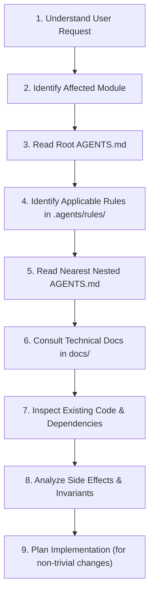

# Learnova — AI Agent System Instructions & Repository Guide

Welcome to **Learnova**. This file (`AGENTS.md`) is the primary entry point and authoritative instruction contract for any AI coding agent, subagent, or assistant operating within this repository.

All AI agents must strictly observe the instructions, constraints, workflows, and conventions detailed below before reading or modifying any code.

---

## 1. Project Overview & Architecture

### Platform Purpose
**Learnova** is an enterprise-grade, adaptive, and gamified educational platform built for higher education and high-stakes technical training. It combines cognitive science, **Bayesian Knowledge Tracing (BKT)**, **directed acyclic prerequisite graphs (DAG)**, **server-authoritative grading**, and **teacher-governed AI question generation** with **gamification mechanics** (XP ledger, streaks, tiered badges, privacy-preserving leaderboards).

### Architecture Topology: Option B Modular Monolith
The platform operates as a cohesive, single-service modular monolith:
- **Backend Service (FastAPI on Port 8000):** Hosts authoritative REST API endpoints (`/api/v1/*`), domain business services, SQLAlchemy ORM entities, and an **in-process Durable Outbox Processor** running inside the FastAPI `lifespan` (`backend/app/main.py`). The outbox asynchronously consumes gamification (XP, badges, streaks) and mastery recalculation events without requiring a separate broker or background container.
- **Frontend Service (React 19 / TypeScript / Vite / Express on Port 3000):** Single-page application serving three authenticated user portals:
  - **Student Portal:** Adaptive practice, timed assessments, cognitive mastery trees, gamification rewards, AI tutoring.
  - **Teacher Portal:** Course authoring, question bank categorization (Course -> Lesson), AI candidate question review queue (quarantine governance), student analytics.
  - **Administrator Portal:** User directory, RBAC assignment, security audit logs, service diagnostics.
  - **Express Server (`frontend/server.ts`):** Serves the Vite client, hosts static production bundles, and provides a transparent full-duplex proxy to FastAPI (`/api/v1/*`) and backward-compatibility AI endpoints (`/api/ai/*`).
- **Public Showcase Bundle (`learnova-public-pages/`):** Standalone marketing application featuring the **3D Holographic Particle Cortex (Dala Brain Engine)** built with Three.js and GSAP.
- **Persistence Layer (PostgreSQL 17 / SQLite):** 16 normalized relational models, Alembic migrations (13 versions), transactional outbox queue (`domain_outbox_events`), row-level exclusive locking (`with_for_update`), and PostgreSQL advisory locking for multi-worker concurrency safety.

### Technology Stack Summary
| Domain | Technologies |
| :--- | :--- |
| **Backend** | Python 3.13, FastAPI 0.115+, Uvicorn 0.34+, Pydantic v2, SQLAlchemy 2.0, Alembic 1.13+, PyJWT, bcrypt, anyio |
| **Frontend** | React 19.0.1, TypeScript 7.0+, Vite 8.3+, Tailwind CSS v4, Express 4.21+, Lucide React, Motion, Three.js, GSAP |
| **Database** | PostgreSQL 17 (Docker/Production) & SQLite with foreign key pragmas (local development and pytest) |
| **Testing** | Backend: pytest 9.1+, httpx TestClient; Frontend: Node test runner (`node --experimental-strip-types --test`), TSX test runner |
| **AI Integration** | Google Gemini 2.5 Flash (`GeminiServiceAdapter`), Antigravity CLI subprocess (`AgyCliAdapter` / `agy -m`) |

---

## 2. Repository Directory Map

```text
Learnova/
├── AGENTS.md                               # THIS FILE: Root agent instruction contract
├── .agents/                               # AI agent rules, workflows, and progressive skills
│   ├── rules/                              # Specialized rules (architecture, coding, backend, frontend, etc.)
│   └── skills/                             # Actionable runbooks (implement-feature, debug-issue, test-app, etc.)
├── backend/                                # FastAPI application root
│   ├── AGENTS.md                           # Backend module instructions and service catalog
│   ├── app/                                # Application package (api, core, db, models, schemas, services, workers, ai)
│   ├── alembic/                            # Database migrations (13 versions)
│   │   └── AGENTS.md                       # Database schema & migration governance instructions
│   └── tests/                              # Pytest test suite (230+ comprehensive unit & integration tests)
├── frontend/                               # React 19 + TypeScript + Vite frontend
│   ├── AGENTS.md                           # Frontend module instructions, component hierarchy, portal rules
│   ├── server.ts                           # Express server and FastAPI reverse proxy
│   └── src/                                # Components, pages, services, utils, types
├── learnova-public-pages/                  # Standalone 3D particle marketing bundle
│   └── AGENTS.md                           # Public pages instructions and 3D WebGL guidelines
├── docs/                                   # Authoritative technical documentation
│   ├── README.md                           # Documentation index and sitemap
│   ├── architecture.md                     # Deep system architecture & component diagrams
│   ├── project-overview.md                 # Detailed mission, portals, and capabilities
│   ├── database-schema.md                  # Comprehensive schema, models, constraints, ER diagram
│   ├── api-documentation.md                # Full REST API endpoint reference and payload contracts
│   ├── development-workflow.md             # Local environment startup, seeds, and execution runbooks
│   ├── testing-strategy.md                 # Testing frameworks, commands, and verification standards
│   └── decisions/                          # Architectural Decision Records (ADR) catalog
├── API_CONTRACT.md                         # Authoritative endpoint specifications & contracts
├── DECISIONS.md                            # Architectural Decision Records (DEC-001 through DEC-P12-001)
├── IMPLEMENTATION_STATUS.md                # Historical implementation matrix & phase status
└── docker-compose.yml                      # Container topology (database, backend, frontend)
```

---

## 3. Mandatory Initial Workflow for AI Agents

Before writing or editing code in this repository, **every agent must follow this 9-step workflow**:



1. **Understand Requested Task:** Clarify user requirements and verify whether the task touches frontend, backend, database, AI, or testing.
2. **Identify Affected Module:** Determine target files (`backend/`, `frontend/`, `learnova-public-pages/`, or `docs/`).
3. **Read Root AGENTS.md:** Ensure high-level constraints and invariants are respected.
4. **Identify Applicable Rules:** Antigravity automatically activates glob-matched rules, but the agent must understand rule boundaries in `.agents/rules/`:
   - `architecture.md` (Always active)
   - `coding-standards.md` (Always active)
   - `backend.md` (Active on backend files)
   - `frontend.md` (Active on frontend files)
   - `database.md` (Active on model/migration files)
   - `security.md` (Model decision for auth/security)
   - `testing.md` (Model decision for testing)
5. **Read Nearest Nested AGENTS.md:** Inspect the local directory contract:
   - For backend code: Read [`backend/AGENTS.md`](file:///c:/Learnova/backend/AGENTS.md).
   - For frontend code: Read [`frontend/AGENTS.md`](file:///c:/Learnova/frontend/AGENTS.md).
   - For database/migrations: Read [`backend/alembic/AGENTS.md`](file:///c:/Learnova/backend/alembic/AGENTS.md).
   - For public landing pages: Read [`learnova-public-pages/AGENTS.md`](file:///c:/Learnova/learnova-public-pages/AGENTS.md).
6. **Consult Relevant Technical Documentation:**
   - Architecture or event flow: Read [`docs/architecture.md`](file:///c:/Learnova/docs/architecture.md).
   - API endpoints: Read [`docs/api-documentation.md`](file:///c:/Learnova/docs/api-documentation.md) or [`API_CONTRACT.md`](file:///c:/Learnova/API_CONTRACT.md).
   - Database schema: Read [`docs/database-schema.md`](file:///c:/Learnova/docs/database-schema.md).
   - Testing patterns: Read [`docs/testing-strategy.md`](file:///c:/Learnova/docs/testing-strategy.md).
7. **Inspect Existing Code & Dependencies:** Read the target files and their callers/callees. Do NOT guess class names, function signatures, or parameters.
8. **Analyze Side Effects:** Check relational cascades, outbox events, Pydantic schemas, and frontend API contracts.
9. **Formulate Implementation Plan:** For any multi-file or structural modification, present a concise plan to the user or artifact directory before altering files.

---

## 4. Non-Negotiable Architectural Invariants

Every agent must respect these core architectural principles established across ADRs and blueprints:

1. **Teacher Governance for AI Content (SSD-08, DEC-P9-001):**
   - AI-generated assessment questions are strictly quarantined in `ai_question_candidates` with `status = "pending_review"`.
   - Never inject AI questions directly into the live `questions` table or active assessments.
   - Approval is atomic: acquires a row lock (`with_for_update()`), copies candidate data to `questions` with `source = "ai_generated"`, links `approved_question_id`, and writes an immutable audit log in one transaction.
   - Teachers are strictly authorized only for courses assigned in `course_teachers`.
2. **Curriculum Hierarchy:**
   - The hierarchy is strictly: **Course -> Topic -> Lesson -> LearningResource**.
   - Questions are categorized hierarchically: **Course -> Lesson**.
   - Question generation is scoped to Course -> Lesson, filtering resources to that specific lesson.
3. **Option B In-Process Outbox Processor (DEC-P12-001):**
   - Asynchronous gamification (XP, streaks, badges) and BKT mastery recalculations are handled by the in-process `OutboxProcessor` started during FastAPI `lifespan` (`backend/app/main.py`).
   - Do NOT introduce external message brokers (Kafka, RabbitMQ, Celery, Redis) or separate worker containers unless explicitly instructed by the user.
4. **Answer Key Segregation & Server-Authoritative Grading (DEC-P5-001):**
   - Student payloads must NEVER contain `is_correct`, `solution_pairs`, or `answer_key`.
   - All evaluation and grading occurs server-side in `GradingService`.
5. **Topic Prerequisite DAG Cycle Prevention (DEC-P4-002):**
   - Topic prerequisites form a Directed Acyclic Graph. Cycle checks are strictly enforced via depth-first search / Kahn's algorithm in `DAGService` and `frontend/src/utils/dag.ts`.
6. **Normalized BKT Mastery Unit (DEC-001):**
   - Stored in the database as a normalized decimal `0.0000` to `1.0000` (`DECIMAL(5,4)`), serialized as an integer percentage `0-100` for frontend display.

---

## 5. Development Principles

- **Simple & Maintainable Solutions:** Prefer readable, explicit code over complex abstractions or premature meta-programming.
- **Avoid Duplicate Implementations:** Reuse existing service layer methods (`QuestionService`, `CourseService`, `GamificationService`, `GradingService`).
- **Avoid Unnecessary Dependencies:** Do not add npm packages or Python libraries without clear justification and verification.
- **Preserve Backward Compatibility:** The root health endpoint (`GET /health`), existing proxy routes (`/api/ai/*`), and existing Express behavior must remain functional.
- **Strict Status Codes:** Use `HTTP_422_UNPROCESSABLE_ENTITY` for semantic/domain validation errors in FastAPI.
- **Never Assume Undocumented Behavior:** If a detail cannot be established from the codebase, explicitly mark it as UNKNOWN or ask the user for confirmation.

---

## 6. Testing Requirements

- **Execute Relevant Tests After Changes:**
  - Backend tests:
    ```powershell
    python -m pytest backend/tests
    # Or focused:
    python -m pytest backend/tests/test_question_bank.py
    ```
  - Frontend tests:
    ```powershell
    npm test
    npm --prefix frontend run lint
    npm --prefix frontend run build
    ```
- **Add Tests for New Functionality:** Every new service method, endpoint, or utility must be accompanied by corresponding tests.
- **Zero-Tolerance for False Reporting:** NEVER claim a test passed without running it and inspecting the output.
- **Report Unexecuted Tests:** If any tests cannot be executed (e.g. database container offline), explicitly report this limitation to the user.

---

## 7. Documentation Maintenance Protocol

Whenever a change touches:
1. **API Endpoints or Payloads:** Update [`docs/api-documentation.md`](file:///c:/Learnova/docs/api-documentation.md) and [`API_CONTRACT.md`](file:///c:/Learnova/API_CONTRACT.md).
2. **Database Schemas or Models:** Update [`docs/database-schema.md`](file:///c:/Learnova/docs/database-schema.md) and [`backend/alembic/AGENTS.md`](file:///c:/Learnova/backend/alembic/AGENTS.md).
3. **Architecture or Event Processing:** Update [`docs/architecture.md`](file:///c:/Learnova/docs/architecture.md).
4. **Execution or Setup Procedures:** Update [`docs/development-workflow.md`](file:///c:/Learnova/docs/development-workflow.md).
5. **Architectural Decisions:** Record the context and rationale in [`DECISIONS.md`](file:///c:/Learnova/DECISIONS.md) and [`docs/decisions/README.md`](file:///c:/Learnova/docs/decisions/README.md).

---

## 8. Subagent Delegation Guidelines

When invoking subagents (`invoke_subagent`):
1. **Provide Clear Context:** Describe the exact task, affected files, and boundary constraints.
2. **Specify Applicable Instruction Files:** Explicitly instruct the subagent to read the root [`AGENTS.md`](file:///c:/Learnova/AGENTS.md) and the nearest nested `AGENTS.md`.
3. **Enforce Repository Standards:** Mandate adherence to `.agents/rules/` and existing architectural patterns.
4. **Require Verification Evidence:** Instruct subagents to run tests and return exact test output logs.
5. **Review Before Integration:** The parent agent is responsible for verifying all subagent modifications.

---

## 9. Final Task Reporting Format

At the completion of every significant task, present a structured summary:
- **Summary of Implementation:** What was designed, changed, or fixed.
- **Files Modified / Created:** Clickable links (e.g. `[filename](file:///absolute/path/to/file)`) to each affected file.
- **Architectural Invariants Respected:** How constraints (quarantine, outbox, answer key segregation) were maintained.
- **Tests Executed & Results:** Exact commands run, test counts, execution durations, pass/fail status.
- **Unexecuted Tests & Remaining Items:** Any tests skipped, known limitations, or items awaiting user confirmation.
