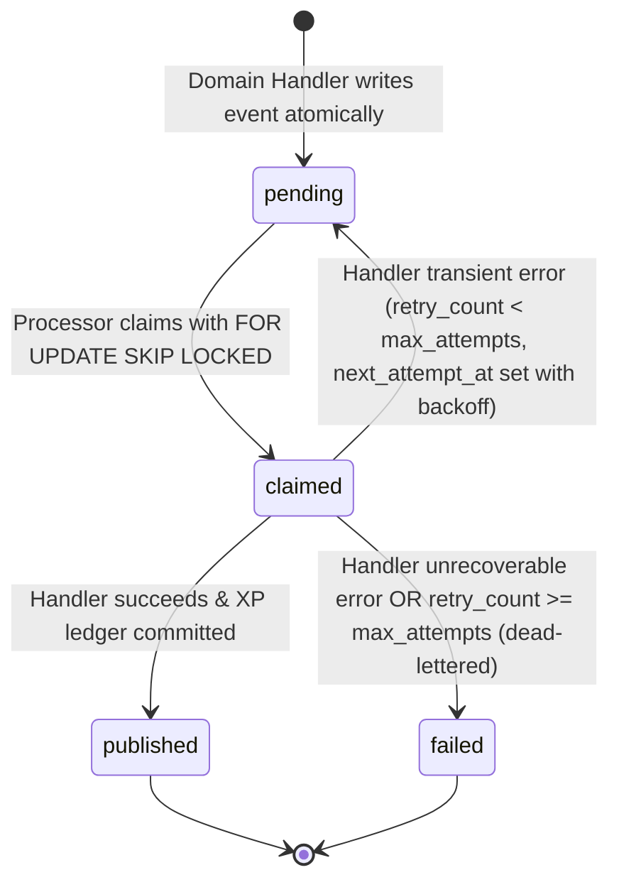

# Learnova — Durable Outbox Background Processor Architecture (Option B)

## 1. Executive Overview & Selection Rationale
Learnova implements the **Transactional Outbox Pattern** to asynchronously decouple domain events (such as `assessment.completed`, `lesson.completed`, `resource.reviewed`) from gamification reward processing (XP awards, level progression, streaks, badge evaluations, and challenge completions).

### Why Option B Was Selected
Option B integrates the outbox background processor directly into the **FastAPI application lifespan** within the existing backend process.
- **Topological Integrity**: Learnova's deployment topology is strictly bounded to three Docker Compose services: `frontend`, `backend`, and `database`.
- **Infrastructure Simplicity**: Introducing a separate worker container (Option A) or external messaging brokers like Redis, Celery, RabbitMQ, or Kafka introduces operational overhead, deployment divergence, resource waste in single-host deployments, and complex multi-container monitoring requirements.
- **Zero Additional Dependencies**: The processor leverages Python's native `asyncio` runtime combined with threadpool offloading (`asyncio.to_thread`) for synchronous SQLAlchemy operations, maintaining full transactional isolation and non-blocking I/O.

### Why There Is No Separate Worker Container
A fourth worker container is explicitly rejected because:
1. It duplicates the container image footprint, build overhead, and environment orchestration without architectural necessity.
2. It fragments logging, metrics, and health observability across multiple standalone services.
3. The workload profile of Learnova's gamification event processing is lightweight and batch-oriented; running an in-process background task within the FastAPI lifespan easily services throughput while preserving total infrastructure cohesion.

---

## 2. Lifecycle Integration & Mechanics

### How the Processor Starts
The processor is managed by the FastAPI lifespan context manager in `backend/app/main.py`:
1. On application startup, `lifespan(app: FastAPI)` evaluates `settings.OUTBOX_ENABLED` (default: `True`).
2. If enabled, `create_outbox_processor()` instantiates `OutboxProcessor`.
3. `await processor.start()` is invoked, spawning a background `asyncio.Task` (`run_forever()`).
4. The instance is registered on `app.state.outbox_processor` for HTTP telemetry and health inspection.
5. Startup logging announces the active polling interval, batch size, and maximum retry limits.

### How the Processor Stops
FastAPI triggers the lifespan shutdown sequence when receiving `SIGTERM` or `SIGINT`:
1. The shutdown block in `main.py` checks `hasattr(app.state, "outbox_processor")`.
2. `await app.state.outbox_processor.stop()` sets an internal `asyncio.Event` (`_stop_event`), immediately interrupting any active sleep cycle.
3. The background task is awaited up to `OUTBOX_SHUTDOWN_TIMEOUT_SECONDS` (default: `10.0s`) to allow any in-flight database batch to commit cleanly.
4. If an advisory lock was acquired, `_release_advisory_lock()` executes `pg_advisory_unlock(742918)` and closes the dedicated database connection.
5. The task terminates cleanly with zero orphaned threads or leaked connections.

---

## 3. Configuration Settings & Defaults

All parameters are configured in `backend/app/core/config.py` and configurable via `.env`:

| Setting | Type | Default | Description |
|---|---|---|---|
| `OUTBOX_ENABLED` | `bool` | `True` | Master toggle to enable or disable background processing. |
| `OUTBOX_POLL_INTERVAL_SECONDS` | `float` | `5.0` | Polling frequency when no backlog exists (seconds). |
| `OUTBOX_BATCH_SIZE` | `int` | `20` | Maximum number of pending events claimed per batch cycle. |
| `OUTBOX_MAX_ATTEMPTS` | `int` | `5` | Maximum retry attempts before marking an event as `failed` (dead-lettered). |
| `OUTBOX_RETRY_BASE_SECONDS` | `float` | `5.0` | Initial exponential backoff delay base (seconds). |
| `OUTBOX_RETRY_MAX_SECONDS` | `float` | `300.0` | Maximum retry backoff ceiling (seconds). |
| `OUTBOX_SHUTDOWN_TIMEOUT_SECONDS` | `float` | `10.0` | Grace period allowed during server shutdown for active batches. |
| `OUTBOX_ENABLE_ADVISORY_LOCK` | `bool` | `True` | Whether to acquire PostgreSQL session advisory lock (`742918`) for leader election. |

---

## 4. Event Lifecycle & State Machine



### Event States
- `pending`: Written atomically within domain transaction (e.g. grading). Eligible for processing when `next_attempt_at IS NULL OR next_attempt_at <= now()`.
- `published`: Successfully processed by the gamification engine. `published_at` timestamp recorded.
- `failed`: Permanently failed / dead-lettered after exhausting all retry attempts or encountering an unrecoverable payload error. `last_error` populated.

---

## 5. Idempotency & Concurrency Guarantees

### Dual-Layer Idempotency
1. **Outbox Event Level**:
   - Every `DomainOutboxEvent` has a unique `idempotency_key` constraint. Re-emitting the same event is rejected at the database level.
2. **XP Ledger Level**:
   - `XPLedger` enforces `UniqueConstraint("idempotency_key", name="uq_xp_ledger_idempotency")`.
   - `GamificationService.award_xp_idempotent` uses nested database savepoints (`begin_nested()`). If a duplicate key race occurs, the `IntegrityError` is safely trapped and swallowed, returning the existing ledger entry without inflating student XP or streak metrics.

### Multi-Instance & Multi-Process Safety
Learnova protects against concurrent worker conflicts through two defense-in-depth mechanisms:
1. **PostgreSQL Session Advisory Lock (`OUTBOX_ADVISORY_LOCK_ID = 742918`)**:
   - When enabled, the processor attempts `pg_try_advisory_lock(742918)` over a dedicated PostgreSQL connection.
   - If acquired, this instance acts as the active **leader**. Other running instances (e.g. in multi-worker Uvicorn setups) remain in **standby** mode, sleeping between poll cycles without executing duplicate queries.
2. **Row-Level Claiming (`FOR UPDATE SKIP LOCKED`)**:
   - The query selecting pending events explicitly applies `with_for_update(skip_locked=True)` on PostgreSQL engines.
   - If multiple workers poll simultaneously, each worker claims a mutually exclusive subset of pending rows. Neither worker blocks the other, and no row is processed twice.

---

## 6. Observability, Health Checks & Telemetry

### HTTP Telemetry Endpoint
- **URL**: `GET /api/v1/health/outbox`
- **Response Format**:
```json
{
  "status": "running",
  "diagnostics": {
    "is_running": true,
    "is_leader": true,
    "poll_interval_seconds": 5.0,
    "batch_size": 20,
    "max_attempts": 5,
    "last_poll_time": "2026-11-12T22:46:54.565343+00:00",
    "last_error": null,
    "processed_total": 1,
    "failed_total": 0
  }
}
```

### Logging Standards
- Processor lifecycle events (`start`, `stop`, `batch completed`) log at `INFO` level.
- Recoverable polling errors log at `WARNING` level with sanitized error messages.
- No user credentials, passwords, or PII payloads are ever recorded in application logs.

---

## 7. Operational Runbook & Verification

### Running Automated Tests
```powershell
# Run all outbox processor tests
.\.venv\Scripts\python.exe -m pytest backend/tests/test_outbox_processor_unit.py backend/tests/test_fastapi_lifespan_integration.py backend/tests/test_outbox_multi_instance.py backend/tests/test_gamification_outbox_worker.py backend/tests/test_outbox_concurrency.py -v

# Run full backend regression suite
.\.venv\Scripts\python.exe -m pytest backend/tests/ -v
```

### Verifying Docker Runtime
```powershell
# Inspect topology
docker compose ps

# Inspect processor startup and batch processing logs
docker compose logs --tail=100 backend

# Query live outbox telemetry
Invoke-RestMethod -Uri http://localhost:8000/api/v1/health/outbox | ConvertTo-Json
```

### Troubleshooting
1. **Processor reports `is_leader: false`**:
   - Another worker or instance holds advisory lock `742918`. This is expected in multi-worker configurations.
2. **Events stuck in `pending`**:
   - Check `next_attempt_at`. If `retry_count > 0`, the event is under active exponential backoff.
   - Verify `OUTBOX_ENABLED` is `true`.
3. **Events in `failed` status**:
   - Inspect `last_error` on the event row: `SELECT id, event_type, last_error FROM domain_outbox_events WHERE status = 'failed';`. Correct the malformed payload and reset status to `pending` if reprocessing is desired.

---

## 8. Limitations & Scaling Considerations
- **Single Monolith Scope**: Designed specifically for the modular monolith architecture. When event throughput exceeds several thousand events per second, an external stream broker (e.g., Kafka / AWS SQS) may be adopted without altering domain services, since domain handlers write strictly to the database abstraction.
- **SQLite Fallback**: In SQLite test environments, session advisory locks and `FOR UPDATE SKIP LOCKED` are gracefully no-ops; idempotency is strictly guaranteed by database unique constraints.
