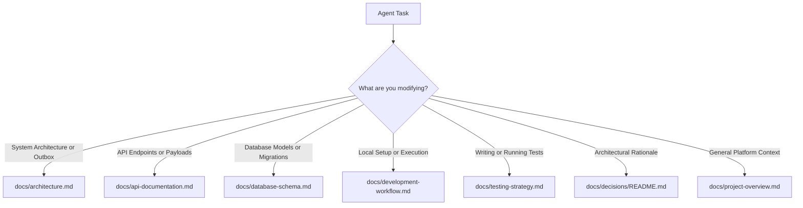

# Learnova Technical Documentation Index

Welcome to the **Learnova Platform Documentation**. This directory provides technical references, architectural specifications, schema definitions, API contracts, and development runbooks for the Learnova ecosystem.

---

## 1. Documentation Structure & Map

| Document | Purpose & Key Topics | Target Audience |
| :--- | :--- | :--- |
| [`project-overview.md`](./project-overview.md) | Platform purpose, mission, portals (Student, Teacher, Admin), core pedagogical methodologies (BKT, DAG, gamification). | All Agents & Engineers |
| [`architecture.md`](./architecture.md) | Deep system architecture, Option B Modular Monolith, component interactions, Mermaid diagrams, data flow. | Architecture & Core Dev |
| [`database-schema.md`](./database-schema.md) | Complete 16-table relational schema, Alembic migration history, constraints, indexes, ER diagram. | Backend & DB Engineers |
| [`api-documentation.md`](./api-documentation.md) | Authoritative REST API v1 reference, endpoints, request/response DTOs, error contracts. | Frontend & Backend Dev |
| [`development-workflow.md`](./development-workflow.md) | Startup runbook, local commands, environment variables, seeding, Docker Compose. | Local Setup & Dev |
| [`testing-strategy.md`](./testing-strategy.md) | Pytest suites, Node/TSX test runners, mock strategies, test execution guide. | QA & Test Automation |
| [`decisions/README.md`](./decisions/README.md) | Architectural Decision Records (ADR) index, summarizing DEC-001 through DEC-P12-001. | Architecture & Governance |

---

## 2. Fast Navigation for AI Coding Agents

When working on specific tasks, agents should jump directly to the relevant document:

---

## 3. Related Root Resources
- [`AGENTS.md`](file:///c:/Learnova/AGENTS.md): Root AI agent instructions and mandatory 9-step workflow.
- [`API_CONTRACT.md`](file:///c:/Learnova/API_CONTRACT.md): Verified endpoint payload contracts.
- [`DECISIONS.md`](file:///c:/Learnova/DECISIONS.md): Full-text Architectural Decision Records.
- [`backend/AGENTS.md`](file:///c:/Learnova/backend/AGENTS.md): FastAPI service catalog and backend instructions.
- [`frontend/AGENTS.md`](file:///c:/Learnova/frontend/AGENTS.md): React 19 portal and frontend guide.
- [`backend/alembic/AGENTS.md`](file:///c:/Learnova/backend/alembic/AGENTS.md): Database migration runbook.
