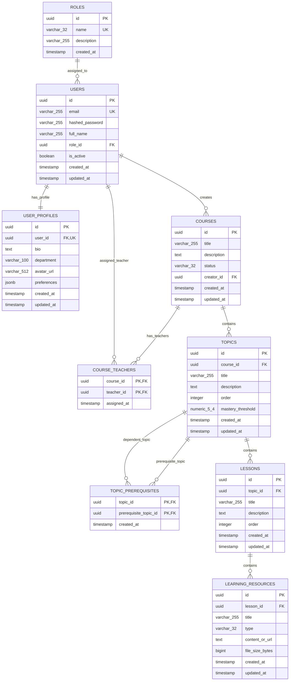

# Phase 2 Plan — Initial Domain Schema and Migrations

- **Phase:** Phase 2 — Initial Domain Schema and Migrations
- **Status:** **PLAN_SUBMITTED_FOR_REVIEW** (Stage A: Awaiting explicit project-owner approval before application code edits)
- **Governing Standard:** `agent-prompt.md` Section 4 & `UNIVERSAL_ANTIGRAVITY_PROMPT_PHASES_02_03.md` Section 3
- **Primary Source:** `docs/sources/Learnova_Master_Backend_Implementation_Blueprint.md`, Sections 5.4, 7 (Database Design), 10 (Phase 2), 15 (Decisions).
- **Related Sources:** `docs/sources/Learnova_SRS_Final_Aligned_V2 (1).docx`, `docs/sources/Learnova_Final_SSDs_V2.xml` (SSD-01, SSD-02, SSD-07), `docs/sources/Readme.md` (D1, D2), `docs/phases/PHASE-02_INITIAL_DOMAIN_SCHEMA.md`, `docs/antigravity-bible/AGENT_OPERATING_RULES.md`, `API_CONTRACT.md`, `IMPLEMENTATION_STATUS.md`, `DECISIONS.md`.
- **Branch / Commit Baseline:** `main` / `2905f92 phase 1 implemented` (Working tree verified; foundation healthy, 13 backend tests pass, 29 frontend tests pass, `tsc` zero errors).

---

## 1. Task Objective

Implement only the foundational PostgreSQL relational schema and staged Alembic migrations for:
- **D1 — User Accounts & Roles:** User identity, password hash storage, profile data, and strict role lookup (`student`, `teacher`, `administrator`).
- **D2 — Courses, Curriculum & Resources:** Courses, course-teacher assignments, topics, prerequisite DAG edges with self-edge rejection, lessons, and provider-neutral learning resource metadata.

Scope explicitly excludes:
- Registration, login, session lifecycle, JWT, refresh tokens, and RBAC authorization routes (strictly deferred to Phase 3).
- Course/curriculum/resource REST endpoints and CRUD operations (strictly deferred to Phase 4).
- D3 Question bank, D4 Enrollments/attempts, D5 Mastery/paths, D6 AI cache, D7 Gamification, D8 Analytics.
- Any modification to persistent Docker volume `postgres_data`.

---

## 2. SRS and SSD Requirements Traceability

- **`Learnova_SRS_Final_Aligned_V2 (1).docx` & `Learnova_Final_SSDs_V2.xml`:**
  - `SSD-01` (Course Enrollment & Curriculum Loading): Requires relational persistence of courses, topics, lessons, and resources.
  - `SSD-02` (Topic Selection & Prerequisite Diagnostic): Requires relational persistence of topic prerequisite DAG edges (`topic_prerequisites`).
  - `SSD-07` (Teacher Course & Content Management): Requires explicit course ownership (`creator_id`), course-teacher assignments (`course_teachers`), curriculum hierarchy (`topics`, `lessons`, `learning_resources`), and course lifecycle statuses (`draft`, `published`, `archived`).
  - `Readme.md` Data Stores:
    - `D1 User Accounts & Roles`: Credentials, password hashes, profiles, assigned roles (`student`, `teacher`, `administrator`).
    - `D2 Courses, Curriculum & Resources`: Course definitions, topic hierarchies, prerequisite DAG edge-lists, lesson texts, multimedia URLs, documents.
  - `NFR-DATA-01`: Version-controlled relational migrations via Alembic.
  - `NFR-SEC-01`: Passwords stored exclusively as secure hashes (bcrypt format, never plaintext).

---

## 3. Relevant Architecture and Business Rules

- **Modular Monolith & Layer Separation:** Relational persistence entities live in `backend/app/models/` under `LAY-DOMAIN` / `LAY-TECH`, inheriting from the single shared `Base = DeclarativeBase` in `backend/app/db/base.py`.
- **Database Driver Strategy:** Reuse existing synchronous SQLAlchemy 2.0+ engine and session factory (`backend/app/db/session.py`) with `psycopg2-binary`.
- **Surrogate UUID Keys:** All entities utilize `UUID` primary keys (`uuid4`) for distributed uniqueness, database portability, and compatibility with frontend string IDs.
- **Role Constancy:** Role cardinality is single active role per user (DEC-P2-001 / DEC-04). Roles are pre-populated lookup records (`student`, `teacher`, `administrator`) with foreign key constraints.
- **Teacher Assignment:** Explicit many-to-many junction entity `course_teachers` (DEC-P2-002 / DEC-05) ensures clean teacher course scoping.
- **Prerequisite DAG Integrity:** `topic_prerequisites` table explicitly rejects self-edges at the database constraint level (`CHECK (topic_id <> prerequisite_topic_id)`). Transitive cycle detection is enforced at domain service level (Phase 4).
- **Mastery Threshold Unit:** Normalized `DECIMAL(5,4)` with interval `[0.0000, 1.0000]` (default `0.7500`, representing 75% passing threshold) avoiding hardcoded values in application logic (DEC-P2-003 / DEC-02).
- **Resource Neutrality:** Resource metadata supports types `document`, `video`, `markdown`, `code`, `link` with `content_or_url` string without vendor-locked storage binaries (DEC-P2-004 / DEC-11).
- **Guarded Development Seed:** Explicit CLI seed command (`python -m app.cli.seed`) executing only when `ENVIRONMENT=development`, reading credentials from environment variables, idempotent on rerun, and never run automatically on container startup or migration.
- **Persistent Data Invariant:** Zero destructive operations on `postgres_data`. Migration testing conducted on isolated disposable test databases.

---

## 4. Code and Runtime Inspection Baseline

The current baseline was inspected directly:
- Git branch: `main`, clean working tree at commit `2905f92`.
- Backend runtime: Python 3.12, FastAPI on port 8000. Liveness (`/health`) and readiness (`/ready`) endpoints functional.
- PostgreSQL runtime: PostgreSQL 17-alpine on port 5432, connection verified via `check_db_connection()`.
- Alembic scaffold: Configured dynamically in `backend/alembic/env.py`, `alembic_version` table present with 0 applied revisions.
- Test suites: 13 backend unit/integration tests passing; 29 frontend Vitest tests passing; frontend TypeScript check (`tsc --noEmit`) clean with zero errors.

---

## 5. Entity-Relationship (ER) Design

---

## 6. Exact File-by-File Change Plan

### A. Application Source Code (Models & CLI Seed)

| Path | Action | Purpose & Description | Source Traceability |
|---|:---:|---|---|
| `backend/app/models/__init__.py` | CREATE | Package marker exposing all declarative models (`Role`, `User`, `UserProfile`, `Course`, `CourseTeacher`, `Topic`, `TopicPrerequisite`, `Lesson`, `LearningResource`) for Alembic auto-discovery. | Blueprint Sec 7.1, 16 |
| `backend/app/models/role.py` | CREATE | `Role` model with `id`, unique `name` ('student', 'teacher', 'administrator'), `description`, and `ck_roles_name` check constraint. | D1, DEC-P2-001 |
| `backend/app/models/user.py` | CREATE | `User` model with `id`, normalized lowercase unique `email`, `hashed_password`, `full_name`, `role_id` FK (RESTRICT), `is_active`, timestamps. | D1, NFR-SEC-01 |
| `backend/app/models/profile.py` | CREATE | `UserProfile` model with 1:1 `user_id` FK (CASCADE), `bio`, `department`, `avatar_url`, JSONB `preferences`. | D1, frontend types |
| `backend/app/models/course.py` | CREATE | `Course` model with `id`, `title`, `description`, `status` (`draft`, `published`, `archived`), `creator_id` FK (SET NULL), timestamps. | D2, SSD-07 |
| `backend/app/models/course_teacher.py` | CREATE | `CourseTeacher` junction model with composite PK `(course_id, teacher_id)` and CASCADE FKs. | D2, DEC-P2-002 |
| `backend/app/models/topic.py` | CREATE | `Topic` model with `id`, `course_id` FK (CASCADE), `title`, `description`, `order` (>= 0), `mastery_threshold` (0.0 to 1.0). | D2, DEC-P2-003 |
| `backend/app/models/topic_prerequisite.py` | CREATE | `TopicPrerequisite` model with composite PK `(topic_id, prerequisite_topic_id)` and check constraint `topic_id <> prerequisite_topic_id`. | D2, SSD-02 |
| `backend/app/models/lesson.py` | CREATE | `Lesson` model with `id`, `topic_id` FK (CASCADE), `title`, `description`, `order` (>= 0). Relies on topic relationship without redundant `course_id`. | D2, Blueprint Sec 7.2 |
| `backend/app/models/resource.py` | CREATE | `LearningResource` model with `id`, `lesson_id` FK (CASCADE), `title`, `type` (`document`, `video`, `markdown`, `code`, `link`), `content_or_url`, `file_size_bytes`. | D2, DEC-P2-004 |
| `backend/app/cli/__init__.py` | CREATE | Package marker for backend CLI commands. | Python standard |
| `backend/app/cli/seed.py` | CREATE | CLI seed command (`python -m app.cli.seed`) enforcing `ENVIRONMENT=development`, seeding 3 canonical roles, idempotent on rerun, reading admin credentials from environment. | Blueprint Sec 10, DEC-004 |

### B. Alembic Migrations

| Path | Action | Purpose & Description | Source Traceability |
|---|:---:|---|---|
| `backend/alembic/env.py` | MODIFY | Import `app.models` so `Base.metadata` receives all D1 and D2 table schemas. | Blueprint Sec 10, 16 |
| `backend/alembic/versions/20261108_0001_d1_users_and_roles.py` | CREATE | Staged migration 1: creates `roles`, `users`, `user_profiles` tables with constraints, indexes, and initial canonical roles insert. Downgrade drops in reverse order. | D1, AC-01, AC-02 |
| `backend/alembic/versions/20261108_0002_d2_courses_and_teachers.py` | CREATE | Staged migration 2: creates `courses`, `course_teachers` tables with constraints and indexes. Downgrade drops in reverse order. | D2, AC-01, AC-02 |
| `backend/alembic/versions/20261108_0003_d2_topics_and_prerequisites.py` | CREATE | Staged migration 3: creates `topics`, `topic_prerequisites` tables with self-edge check constraint and indexes. Downgrade drops in reverse order. | D2, AC-05, AC-06 |
| `backend/alembic/versions/20261108_0004_d2_lessons_and_resources.py` | CREATE | Staged migration 4: creates `lessons`, `learning_resources` tables with type check constraint and indexes. Downgrade drops in reverse order. | D2, AC-05 |

### C. Test Suites

| Path | Action | Purpose & Description | Source Traceability |
|---|:---:|---|---|
| `backend/tests/test_models_d1.py` | CREATE | Unit tests for D1: Role constraints, User email normalization/uniqueness, password hash storage, profile 1:1 cascade. | P2-AC-02, P2-AC-05 |
| `backend/tests/test_models_d2.py` | CREATE | Unit tests for D2: Course status checks, CourseTeacher composite key, Topic ordering/mastery threshold, TopicPrerequisite self-edge rejection (`topic_id <> prerequisite_topic_id`), duplicate edge rejection, Lesson/Resource constraints. | P2-AC-05, P2-AC-06 |
| `backend/tests/test_migrations_postgres.py` | CREATE | Migration integration test verifying full upgrade (`head`) -> downgrade -> upgrade cycle on isolated disposable database. Confirms zero changes to persistent database. | P2-AC-07, P2-AC-08, P2-AC-09 |
| `backend/tests/test_seed_dev.py` | CREATE | Unit tests for development seed CLI: blocks non-development environment, seeds roles idempotently, handles existing records safely. | P2-AC-11 |

### D. Documentation & Control Documents

| Path | Action | Purpose & Description | Source Traceability |
|---|:---:|---|---|
| `DECISIONS.md` | MODIFY | Record Phase 2 ADRs: `DEC-P2-001` (Single active role per user), `DEC-P2-002` (Course-teacher assignment junction), `DEC-P2-003` (Mastery threshold storage unit), `DEC-P2-004` (Provider-neutral resource storage), `DEC-P2-005` (Surrogate UUID primary keys). | Universal Prompt Sec 5, DECISIONS |
| `IMPLEMENTATION_STATUS.md` | MODIFY | Update Phase 2 status from PLANNED to IN_PROGRESS. | Bible rules |
| `API_CONTRACT.md` | MODIFY | Document PROPOSED/PLANNED D1/D2 entity contracts without claiming live endpoints. | Universal Prompt Sec 4, 8 |
| `docs/antigravity-bible/phases/PHASE-02_INITIAL_DOMAIN_SCHEMA.md` | CREATE | Copy phase instruction file into Bible phases directory per instruction package instructions. | README_FIRST.md |
| `docs/antigravity-bible/phases/PHASE-03_AUTHENTICATION_RBAC.md` | CREATE | Copy phase instruction file into Bible phases directory per instruction package instructions. | README_FIRST.md |
| `docs/antigravity-bible/UNIVERSAL_ANTIGRAVITY_PROMPT_PHASES_02_03.md` | CREATE | Copy universal prompt into Bible directory per instruction package instructions. | README_FIRST.md |
| `docs/antigravity-bible/phase-records/PHASE-02/PLAN.md` | CREATE | Phase 2 Master Plan. | agent-prompt.md Sec 4 |
| `docs/antigravity-bible/phase-records/PHASE-02/EXECUTION_LOG.md` | CREATE | Execution log tracking all commands, exit codes, and side effects. | agent-prompt.md Sec 7 |
| `docs/antigravity-bible/phase-records/PHASE-02/FILE_CHANGE_LEDGER.md` | CREATE | File change ledger tracking all created/modified files. | agent-prompt.md Sec 6 |
| `docs/antigravity-bible/phase-records/PHASE-02/TEST_AND_EVALUATION.md` | CREATE | Test record evaluating every acceptance criterion. | agent-prompt.md Sec 8 |
| `docs/antigravity-bible/phase-records/PHASE-02/ISSUES_AND_DECISIONS.md` | CREATE | Architectural issues and decisions record. | agent-prompt.md Sec 6 |
| `docs/antigravity-bible/phase-records/PHASE-02/PHASE_SUMMARY.md` | CREATE | Phase summary and acceptance sign-off sheet. | agent-prompt.md Sec 10 |

---

## 7. Migration & Rollback Strategy

1. **Isolation Guarantee:** Migrations are authored in `backend/alembic/versions/` and tested on a disposable SQLite or separate disposable PostgreSQL database created specifically during test execution.
2. **Persistent DB Protection:** The production/persistent database `learnova_whz` on Docker volume `postgres_data` is NOT modified during testing.
3. **Application Head Migration:** Upon explicit user approval of implementation, migrations are applied to the live development database via `alembic upgrade head`.
4. **Rollback Procedure:** Every migration script implements an exact symmetric `downgrade()` function:
   - Migration 4 downgrade drops `learning_resources`, then `lessons`.
   - Migration 3 downgrade drops `topic_prerequisites`, then `topics`.
   - Migration 2 downgrade drops `course_teachers`, then `courses`.
   - Migration 1 downgrade drops `user_profiles`, `users`, then `roles`.
5. **Alembic Verification:** Rollback is verified by downgrading each migration sequentially and verifying clean restoration of previous state.

---

## 8. Dependencies and Compatibility Risks

| Risk | Impact | Mitigation Strategy |
|---|---|---|
| PostgreSQL check constraint compatibility with SQLite in tests | Low | Unit tests using SQLite mock databases must handle PostgreSQL-specific syntax appropriately, or use disposable PostgreSQL test containers/databases for dialect-specific tests. |
| Redundant `course_id` on Lesson/Resource | Medium | In the frontend mock model, `Lesson` has both `courseId` and `topicId`. In relational normalization, `lesson` belongs to `topic` which belongs to `course`. Redundant `course_id` introduces data anomaly risk if a lesson is moved between topics. Resolution: Normalized schema omits redundant `course_id` from `lessons` and `learning_resources`; API serializers in Phase 4 can synthesize `course_id` from the topic parent relationship for 100% frontend compatibility. |
| Mastery threshold scale mismatch | Medium | Frontend uses integer percentage `75`. Database stores normalized float `0.7500`. Resolution: Documented in DEC-P2-003; serializer converts between decimal and percentage. |
| Self-edge or cycle in topic prerequisites | High | Database CHECK constraint `CHECK (topic_id <> prerequisite_topic_id)` rejects self-edges at the storage layer. DAG acyclicity validation is performed in the domain service layer (Phase 4). |

---

## 9. Acceptance Criteria (Traceable to Phase 2 Specification)

| ID | Criterion | Verification Method |
|---|---|---|
| P2-AC-01 | Approved ER model covers D1/D2 without prematurely creating D3–D8. | Inspection of models and migrations. |
| P2-AC-02 | User identity, profile, role, and teacher/course assignment are explicit. | Model unit tests. |
| P2-AC-03 | Schema matches recorded decisions and frontend domain semantics where appropriate. | Inspection and decision log reconciliation. |
| P2-AC-04 | Models use the existing SQLAlchemy Base and Alembic setup. | `Base.metadata.tables` inspection. |
| P2-AC-05 | PK/FK/unique/check constraints and indexes are implemented and tested. | Model unit tests and migration tests. |
| P2-AC-06 | Prerequisite edges reject self-reference and duplicate edges. | Database constraint unit tests. |
| P2-AC-07 | Migrations upgrade from empty disposable PostgreSQL. | Alembic migration test runner. |
| P2-AC-08 | Safe downgrade/upgrade checks pass. | Alembic rollback and re-apply test. |
| P2-AC-09 | Existing persistent database and Docker volume remain untouched. | Read-only inspection of persistent volume. |
| P2-AC-10 | Authentication and full course APIs are not implemented prematurely. | Routing table inspection (only `/health` and `/ready` active). |
| P2-AC-11 | Development seeding is explicit and never automatic. | CLI seed unit test and non-dev environment guard verification. |
| P2-AC-12 | Backend and frontend regression checks pass. | Pytest and npm test execution. |
| P2-AC-13 | API contract, status, and decisions accurately describe actual behavior. | Documentation audit. |
| P2-AC-14 | File ledger reconciles with complete Git diff. | `git status` vs `FILE_CHANGE_LEDGER.md`. |
| P2-AC-15 | Six Phase 2 evidence records are complete and truthful. | Phase record audit. |

---

## 10. Approval Protocol

This plan is submitted in **Stage A (Plan Only)**. In accordance with `agent-prompt.md` Section 4 and `UNIVERSAL_ANTIGRAVITY_PROMPT_PHASES_02_03.md` Section 3:
- **No application code, migrations, or database changes will be implemented until the project owner provides explicit written approval.**
- Status: **PLAN_SUBMITTED_FOR_REVIEW**.
