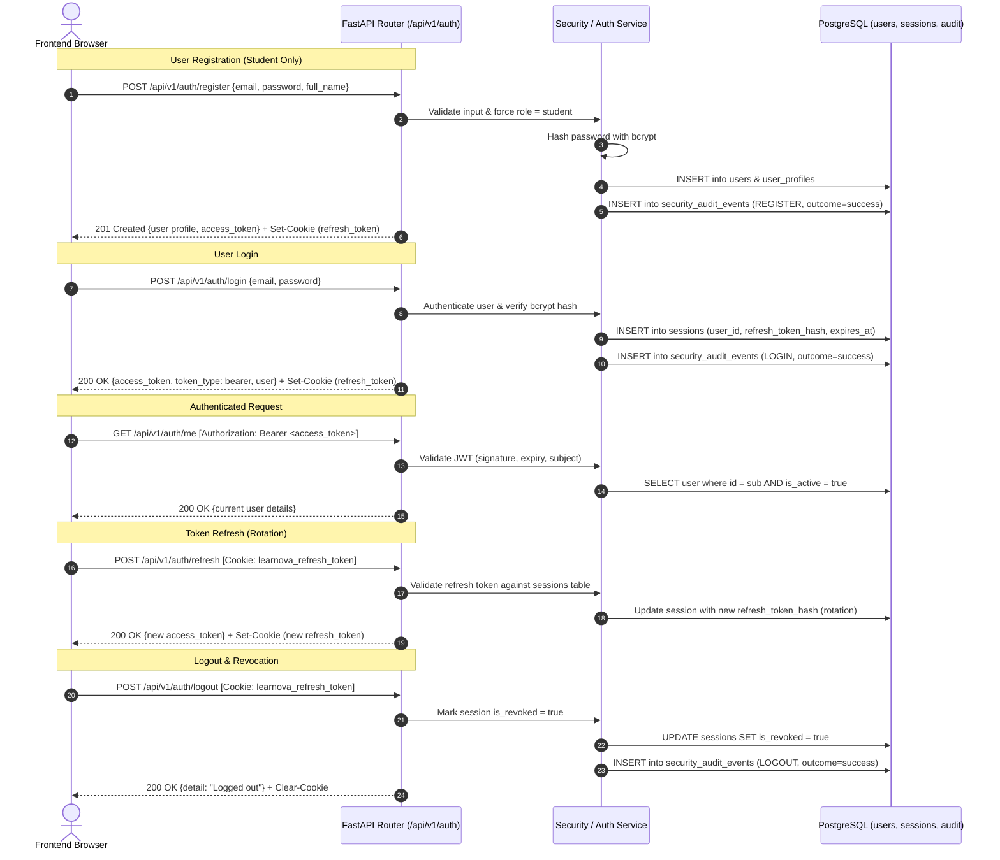

# Phase 3 Plan — Authentication and Role-Based Access Control (RBAC)

- **Phase:** Phase 3 — Authentication and Role-Based Access Control (RBAC)
- **Status:** **PLAN_SUBMITTED_FOR_REVIEW** (Stage A: Awaiting explicit project-owner approval before application code edits)
- **Governing Standard:** `agent-prompt.md` Section 4 & `UNIVERSAL_ANTIGRAVITY_PROMPT_PHASES_02_03.md` Sections 2, 3, 6
- **Primary Source:** `docs/sources/Learnova_Master_Backend_Implementation_Blueprint.md`, Sections 8.1, 10 (Phase 3), 15 (Decisions).
- **Related Sources:** `docs/sources/Learnova_SRS_Final_Aligned_V2 (1).docx` (use case `uc_auth`, NFR-SEC-01), `docs/sources/Learnova_Final_SSDs_V2.xml` (SSD-01, SSD-07, SSD-08), `docs/sources/Readme.md` (D1, RBAC rules), `docs/phases/PHASE-03_AUTHENTICATION_RBAC.md`, `docs/antigravity-bible/AGENT_OPERATING_RULES.md`, `API_CONTRACT.md`, `IMPLEMENTATION_STATUS.md`, `DECISIONS.md`.
- **Branch / Commit Baseline:** `main` (Phase 1 and Phase 2 accepted; 31 backend tests passing, 29 frontend tests passing, `tsc` zero errors, development database at migration head `20261108_0004`).

---

## 1. Task Objective

Implement secure, production-grade authentication, revocable session lifecycle, security auditing, and backend-enforced Role-Based Access Control (RBAC) extending the accepted Phase 2 D1/D2 schema:
1. Provide password hashing and verification using industry-standard `bcrypt` (never plaintext or logged).
2. Issue short-lived signed JWT access tokens (15-minute expiry) and rotating revocable refresh tokens (7-day expiry) tracked via server-side session persistence.
3. Transport refresh tokens via protected `HttpOnly`, `SameSite=Lax`, `Secure` cookies (`learnova_refresh_token`) and access tokens in memory to mitigate XSS and token-theft threats.
4. Implement the canonical auth route set:
   - `POST /api/v1/auth/register` (public self-registration restricted exclusively to `student` accounts)
   - `POST /api/v1/auth/login` (verifies credentials, issues access token & sets session cookie)
   - `POST /api/v1/auth/refresh` (rotates refresh token, issues fresh access token)
   - `POST /api/v1/auth/logout` (revokes server session & clears cookie)
   - `GET /api/v1/auth/me` (returns current authenticated principal and profile)
   - `PUT /api/v1/users/me` (updates permitted user profile fields)
   - `PUT /api/v1/users/me/preferences` (updates user preferences JSON)
   - `PUT /api/v1/users/me/password` (verifies current password, sets new hash, revokes other sessions)
5. Implement administrative role and account status operations with transactional lockout safeguards:
   - `PUT /api/v1/admin/users/{id}/role` (prevents self-demotion and last-active-admin demotion)
   - `PUT /api/v1/admin/users/{id}/status` (prevents self-deactivation and last-active-admin deactivation)
6. Implement reusable FastAPI security dependencies:
   - `get_current_user` (authenticates bearer token, checks revocation and `is_active`)
   - `require_role(role_name)` (enforces student / teacher / administrator)
   - `require_teacher_assigned_to_course(course_id)` (enforces teacher course data isolation via `course_teachers`)
7. Add minimal session and security audit log persistence via Alembic migration `20261108_0005_d1_sessions_and_audit.py`.
8. Integrate frontend authentication replacing mock timeouts in `SignInPage.tsx` and `CreateAccountPage.tsx` with live API client calls, preserving all other UI workflows and mock localStorage data.

---

## 2. SRS and SSD Requirements Traceability

- **`Learnova_SRS_Final_Aligned_V2 (1).docx`:**
  - `uc_auth` (Manage Account & Profile): Secure login, registration, logout, profile update, and password rotation.
  - `NFR-SEC-01` (Credential Security): Bcrypt password hashing, signed JWT tokens transmitted over TLS/HTTPS, generic authentication error messages preventing user enumeration.
  - `NFR-SEC-02` (RBAC & Authorization): Strict role separation between `student`, `teacher`, `administrator`. Teachers restricted to assigned courses.
  - `NFR-AUDIT-01` (Security Auditing): Security-critical events (login, logout, failed auth, role change, status change, password rotation) logged with correlation ID and actor metadata without recording sensitive credentials.
- **`Learnova_Final_SSDs_V2.xml`:**
  - `SSD-01` (Course Enrollment): Student identity authenticated via JWT session token before accessing courses.
  - `SSD-07` (Teacher Content Management): Teacher operations gated to authorized teachers assigned to the course.
  - `SSD-08` (Teacher Assessment Management): Access control checks verify teacher authorization.
- **`Readme.md` Data Stores:**
  - `D1 User Accounts & Roles`: Extends accepted Phase 2 `users`, `roles`, `user_profiles` with `sessions` and `security_audit_events`.

---

## 3. Relevant Architecture and Business Rules

- **No Schema Duplication:** Extends the existing `User`, `Role`, `UserProfile`, `Base`, and synchronous session factory accepted in Phase 2. Zero duplicate tables or engines.
- **Role Cardinality (DEC-P2-001):** Single active role per user (`student`, `teacher`, `administrator`).
- **Registration Privilege Guard (DEC-P3-003):** Public registration payload role is strictly ignored or enforced as `student`. Administrator accounts can never be created via public registration.
- **Revocable Session Lifecycle (DEC-P3-001):** Stateless access tokens alone are insufficient for instant logout. Refresh tokens are hashed (`SHA-256`) and tracked in `sessions` table. Logout marks `is_revoked = True`.
- **Credential Storage & Transport (DEC-P3-002):** Refresh token in `HttpOnly, Secure, SameSite=Lax` cookie. Access token kept in browser memory. Plaintext passwords, raw tokens, or signing keys are never logged.
- **Teacher Course Authorization:** Teacher course access enforced at backend query/dependency layer (`course_teachers` junction).
- **Admin Lockout Safeguards (DEC-P3-004):** Transactional validation with row/table locks preventing self-demotion, self-deactivation, and demotion/deactivation of the last active administrator under concurrent requests.
- **Frontend Boundary Invariant:** Replaces only mock authentication in `SignInPage.tsx`, `CreateAccountPage.tsx`, and session restore. Non-auth curriculum, assessment, and gamification mock workflows in `storageService.ts` remain intact.

---

## 4. Conceptual Security Architecture & Threat Model

---

## 5. Exact File-by-File Change Plan

### A. Backend Source Code

| Path | Action | Purpose & Description | Source Traceability |
|---|:---:|---|---|
| `backend/requirements.txt` | MODIFY | Add pinned dependencies `pyjwt>=2.9.0` and `bcrypt>=4.2.0`. | SRS NFR-SEC-01, Blueprint Sec 16 |
| `backend/app/core/config.py` | MODIFY | Add `SECRET_KEY`, `ACCESS_TOKEN_EXPIRE_MINUTES` (15), `REFRESH_TOKEN_EXPIRE_DAYS` (7), `ALGORITHM` (HS256), `CORS_ORIGINS`. | Blueprint Sec 10, DEC-P3-001 |
| `backend/app/core/security.py` | CREATE | Password hashing (`hash_password`, `verify_password` via `bcrypt`), JWT token generation (`create_access_token`, `create_refresh_token`, `decode_token`), and refresh token hashing (`hash_refresh_token`). | SRS NFR-SEC-01, Blueprint Sec 16 |
| `backend/app/core/dependencies.py` | CREATE | Reusable FastAPI auth dependencies: `get_current_user`, `get_current_active_user`, `require_role(role)`, `require_teacher_assigned_to_course(course_id)`. | Blueprint Sec 8.1, 10 |
| `backend/app/models/session.py` | CREATE | `UserSession` model (`sessions` table) storing `id`, `user_id` FK (CASCADE), `refresh_token_hash`, `is_revoked`, `expires_at`, `created_at`, `last_used_at`, `user_agent`, `ip_address`. | Blueprint Sec 10, DEC-P3-001 |
| `backend/app/models/security_audit_event.py` | CREATE | `SecurityAuditEvent` model (`security_audit_events` table) storing `actor_id`, `actor_role`, `action`, `target_type`, `target_id`, `outcome`, `correlation_id`, `details`, `created_at`. | SRS NFR-AUDIT-01, Blueprint Sec 10 |
| `backend/app/models/__init__.py` | MODIFY | Export `UserSession` and `SecurityAuditEvent`. | Blueprint Sec 16 |
| `backend/app/schemas/auth.py` | CREATE | Pydantic schemas: `UserRegisterRequest`, `UserLoginRequest`, `TokenResponse`, `RefreshTokenRequest`, `PasswordChangeRequest`. | Blueprint Sec 8.1 |
| `backend/app/schemas/user.py` | CREATE | Pydantic schemas: `UserResponse`, `UserProfileResponse`, `UserProfileUpdateRequest`, `UserPreferencesUpdateRequest`, `UserRoleUpdateRequest`, `UserStatusUpdateRequest`. | Blueprint Sec 8.1 |
| `backend/app/services/auth_service.py` | CREATE | Authentication business logic: registration, credential validation, session creation, token rotation, session revocation, and security audit logging. | Blueprint Sec 8.1, 10 |
| `backend/app/services/admin_service.py` | CREATE | Administrative user governance with transactional lockout safeguards (no self-demotion, no self-deactivation, last active admin protection with database row lock). | Blueprint Sec 10, DEC-P3-004 |
| `backend/app/api/v1/endpoints/auth.py` | CREATE | Auth router endpoints: `/register`, `/login`, `/refresh`, `/logout`, `/me`. | Blueprint Sec 8.1 |
| `backend/app/api/v1/endpoints/users.py` | CREATE | User router endpoints: `PUT /me`, `PUT /me/preferences`, `PUT /me/password`. | Blueprint Sec 8.1 |
| `backend/app/api/v1/endpoints/admin.py` | CREATE | Admin router endpoints: `PUT /users/{id}/role`, `PUT /users/{id}/status`. | Blueprint Sec 8.1 |
| `backend/app/api/v1/router.py` | MODIFY | Mount `auth`, `users`, and `admin` sub-routers under `/api/v1`. | Blueprint Sec 8.1 |
| `backend/app/main.py` | MODIFY | Add `CORSMiddleware` configured with `settings.CORS_ORIGINS` and `allow_credentials=True`. | Blueprint Sec 10, DEC-P3-002 |

### B. Alembic Migrations

| Path | Action | Purpose & Description | Source Traceability |
|---|:---:|---|---|
| `backend/alembic/versions/20261108_0005_d1_sessions_and_audit.py` | CREATE | Staged migration creating `sessions` and `security_audit_events` tables with constraints and indexes. | Blueprint Sec 10, P3-AC-06, P3-AC-11 |

### C. Backend Test Suites

| Path | Action | Purpose & Description | Source Traceability |
|---|:---:|---|---|
| `backend/tests/test_auth_endpoints.py` | CREATE | Tests registration (student role enforcement), login (valid/invalid), refresh rotation, logout revocation, current user retrieval. | P3-SEC-01 to 09 |
| `backend/tests/test_rbac_authorization.py` | CREATE | Tests student/teacher/admin role gating (403 on role mismatch), teacher course assignment access control, unauthorized bypassing prevention. | P3-SEC-10 to 14 |
| `backend/tests/test_admin_guardrails.py` | CREATE | Tests self-demotion prevention, self-deactivation prevention, last active admin demotion/deactivation prevention, concurrent admin changes protection. | P3-SEC-15 to 17 |
| `backend/tests/test_user_profile_security.py` | CREATE | Tests profile update, preferences update, password rotation (invalidates sessions, rejects old password). | P3-SEC-18 to 20 |

### D. Frontend Integration

| Path | Action | Purpose & Description | Source Traceability |
|---|:---:|---|---|
| `frontend/src/services/api/authApi.ts` | CREATE | Typed auth API client calling `/api/v1/auth/*` and `/api/v1/users/*` with credentials. | Blueprint Sec 8.1, P3-AC-12 |
| `frontend/src/pages/student/SignInPage.tsx` | MODIFY | Wire real `authApi.login()` call, display backend validation errors, clear mock timeout, remove hardcoded prefilled password. | P3-AC-12 |
| `frontend/src/pages/student/CreateAccountPage.tsx` | MODIFY | Wire real `authApi.register()` call, display backend validation errors, clear mock timeout. | P3-AC-12 |
| `frontend/src/App.tsx` | MODIFY | Restore authenticated user via `authApi.getMe()` on initial load, wire live logout calling `authApi.logout()`. | P3-AC-13 |

### E. Documentation & Control Documents

| Path | Action | Purpose & Description | Source Traceability |
|---|:---:|---|---|
| `DECISIONS.md` | MODIFY | Record Phase 3 decisions: `DEC-P3-001` (Token lifecycle & revocation), `DEC-P3-002` (Cookie transport & CORS), `DEC-P3-003` (Public registration student constraint), `DEC-P3-004` (Admin lockout safeguards), `DEC-P3-005` (Teacher course query boundary). | Universal Prompt Sec 6 |
| `IMPLEMENTATION_STATUS.md` | MODIFY | Update Phase 3 status to IN_PROGRESS (Stage A completed). | Bible rules |
| `API_CONTRACT.md` | MODIFY | Update `/api/v1/auth/*`, `/api/v1/users/*`, and `/api/v1/admin/*` contracts. | API contract rules |
| `docs/antigravity-bible/phase-records/PHASE-03/PLAN.md` | CREATE | Phase 3 Master Plan. | agent-prompt.md Sec 4 |
| `docs/antigravity-bible/phase-records/PHASE-03/EXECUTION_LOG.md` | CREATE | Phase 3 Execution Log. | agent-prompt.md Sec 7 |
| `docs/antigravity-bible/phase-records/PHASE-03/FILE_CHANGE_LEDGER.md` | CREATE | Phase 3 File Change Ledger. | agent-prompt.md Sec 6 |
| `docs/antigravity-bible/phase-records/PHASE-03/TEST_AND_EVALUATION.md` | CREATE | Phase 3 Test and Evaluation Record. | agent-prompt.md Sec 8 |
| `docs/antigravity-bible/phase-records/PHASE-03/ISSUES_AND_DECISIONS.md` | CREATE | Phase 3 Issues and Decisions Record. | agent-prompt.md Sec 6 |
| `docs/antigravity-bible/phase-records/PHASE-03/PHASE_SUMMARY.md` | CREATE | Phase 3 Summary and Sign-Off Record. | agent-prompt.md Sec 10 |

---

## 6. Migration & Rollback Strategy

1. **Migration Isolation:** Migration `20261108_0005_d1_sessions_and_audit.py` will be tested on an isolated disposable PostgreSQL database before applying to development DB.
2. **Persistent DB Protection:** Docker volume `postgres_data` is preserved. Existing tables (`roles`, `users`, etc.) will NOT be dropped.
3. **Rollback Procedure:** Symmetric `downgrade()` in migration drops `security_audit_events`, then `sessions`, cleanly returning the schema to Phase 2 head (`20261108_0004`).
4. **Application Rollback:** Reverting router mounts in `backend/app/main.py` immediately restores Phase 2 API surface without service interruption.

---

## 7. Dependencies and Compatibility Risks

| Risk | Impact | Mitigation Strategy |
|---|---|---|
| Insecure token storage in browser | Critical | Refresh token stored exclusively in `HttpOnly, Secure, SameSite=Lax` cookie. Short-lived access token kept in memory; never persisted in localStorage. |
| Privilege escalation via registration | Critical | Backend hardcodes `role_id` to student role; ignores any client-supplied role claim in payload. |
| Last admin lockout race condition | High | Administrative role and status modification executes within database transaction with `FOR UPDATE` row lock on active administrator count. |
| Frontend localStorage desynchronization | Medium | Only auth/user session is integrated with the backend in Phase 3. Existing mock data for curriculum, attempts, and assessments in `storageService.ts` remains active and untouched until their respective phases. |
| Cross-Origin credentials (CORS) | Medium | FastAPI `CORSMiddleware` configured with explicit origins (`http://localhost:3000`) and `allow_credentials=True`. Same-origin requests supported via Vite proxy or direct CORS. |

---

## 8. Acceptance Criteria Matrix (Traceable to Phase 3 Specification)

| ID | Criterion | Verification Method |
|---|---|---|
| P3-AC-01 | Phase 1 and Phase 2 accepted baselines are recorded. | Inspection of phase records and commit log. |
| P3-AC-02 | Auth uses exact Phase 2 User/Role schema. | Verified: extends existing `User` and `Role` models. |
| P3-AC-03 | Passwords are bcrypt-hashed and never returned/logged. | `test_auth_endpoints.py` asserts hash in DB and absent from responses. |
| P3-AC-04 | Public registration cannot grant unapproved roles. | `test_auth_endpoints.py` asserts student role assigned on any payload. |
| P3-AC-05 | Login/logout/refresh/current-user endpoints work. | Automated route tests in `test_auth_endpoints.py`. |
| P3-AC-06 | Expiry, refresh rotation, and revocation are verified. | `test_auth_endpoints.py` verifies rotation and revocation rejection. |
| P3-AC-07 | Student/teacher/admin RBAC is backend-enforced. | `test_rbac_authorization.py` verifies 403 Forbidden on role violations. |
| P3-AC-08 | Teacher assignment enforced at service/query boundary. | `test_rbac_authorization.py` verifies unassigned course access denied. |
| P3-AC-09 | Admin self-demotion, self-deactivation, and last-admin lockout prevented. | `test_admin_guardrails.py` verifies blocked status/role updates. |
| P3-AC-10 | Concurrent admin changes cannot remove last active admin. | `test_admin_guardrails.py` verifies transaction concurrency lock. |
| P3-AC-11 | Security-critical events safely audited. | `test_auth_endpoints.py` verifies rows written to `security_audit_events`. |
| P3-AC-12 | Frontend sign-in and registration use real backend behavior. | Verified via frontend test and mock removal. |
| P3-AC-13 | Logout and authenticated-user restoration work. | Verified via frontend auth client tests. |
| P3-AC-14 | Non-auth localStorage workflows remain intact. | `npm test` runs 29 existing frontend domain tests without regression. |
| P3-AC-15 | Backend, security, and frontend regression tests pass. | Pytest and Vitest test executions. |
| P3-AC-16 | No secrets, raw tokens, plaintext passwords, or hard-coded production accounts. | Automated secret scanner and code inspection. |
| P3-AC-17 | API contract, decisions, and status match actual behavior. | Documentation audit. |
| P3-AC-18 | Diff reconciles with ledger and six phase records. | `git status` vs `FILE_CHANGE_LEDGER.md`. |

---

## 9. Approval Protocol

This plan is submitted in **Stage A (Plan Only)**. In accordance with `agent-prompt.md` Section 4 and `UNIVERSAL_ANTIGRAVITY_PROMPT_PHASES_02_03.md` Section 3:
- **No application code, migrations, or database changes will be implemented until the project owner provides explicit written approval.**
- Status: **PLAN_SUBMITTED_FOR_REVIEW**.
