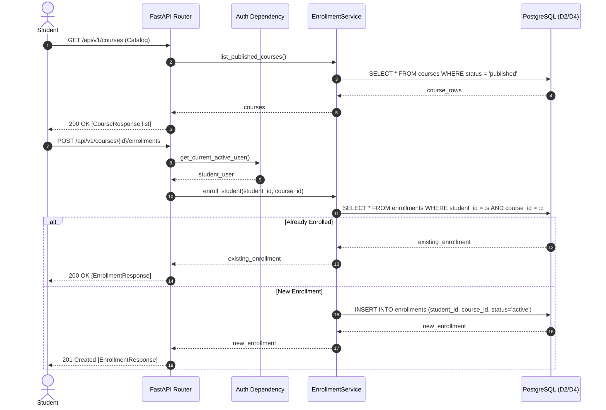
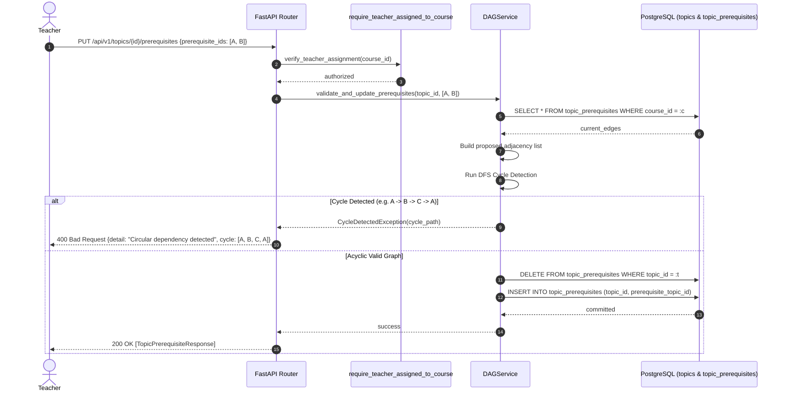

# Phase 04 Plan — Curriculum, Enrollment, and Resources

**Phase:** Phase 4 — Curriculum, Enrollment, and Resources  
**Stage:** Stage A (Planning & Audit Only — No Implementation Code Written)  
**Governing Standard:** `agent-prompt.md` Section 4; `Learnova_Master_Backend_Implementation_Blueprint.md` Section 8.2 & 13; `docs/phases/PHASE-04_CURRICULUM_ENROLLMENT_RESOURCES.md`.  
**Date:** 2026-11-09  
**Status:** **SUBMITTED FOR PROJECT OWNER REVIEW**

---

## 1. Objective of Phase 4

The objective of Phase 4 is to transition course discovery, curriculum hierarchy management, topic prerequisite DAG validation, student course enrollment, and lesson completion tracking from mock frontend state (`storageService.ts`) into authoritative, relational PostgreSQL persistence backed by FastAPI domain services.

Phase 4 fulfills three foundational system sequence workflows:
1. **SSD-01 (Course Enrollment & Curriculum Loading):** Enables students to browse published courses in the catalog, inspect course details, enroll in courses (with duplicate prevention), and load structured course curricula.
2. **SSD-02 (Topic Selection & Prerequisite Graph / Learning Map):** Generates curriculum dependency graphs with authoritative topic readiness states calculated from prerequisite completions.
3. **SSD-07 (Teacher Course & Content Management):** Empowers teachers and administrators to manage courses, topics, lessons, resources, and prerequisite edges with strict DAG cycle detection and course-scoped authorization boundaries.

---

## 2. Requirement and Workflow Traceability

### SRS Requirements
- **`FR-CRS-01` (Course Catalog & Information Browsing):** Public/student users browse published courses; teachers browse their assigned/created courses; administrators browse all courses.
- **`FR-CRS-02` (Course Enrollment):** Authenticated students enroll in published courses; unique constraint `(student_id, course_id)` prevents duplicates.
- **`FR-CRS-03` (Curriculum Hierarchy & Lifecycle):** Create, read, update, delete courses, topics, lessons, and resources. Support `draft`, `published`, and `archived` statuses with publication validation gates.
- **`FR-CRS-04` (Prerequisite DAG & Cycle Rejection):** Define prerequisite relationships among topics. Strictly reject self-edges and circular dependencies ($A \rightarrow B \rightarrow A$ or $A \rightarrow B \rightarrow C \rightarrow A$) at the domain service layer.
- **`FR-CRS-05` (Learning Map & Topic Readiness):** Evaluate topic readiness based on prerequisite topic mastery or completion status.
- **`FR-CRS-06` (Lesson Completion Tracking):** Record individual student lesson completions and update enrollment progress percentages.
- **`FR-AUTH-05` (Teacher Authorization Boundary):** Teachers may create courses, but can modify only courses they own or are assigned to via `course_teachers`.

### System Sequence Workflows
- **`SSD-01` (Course Enrollment & Curriculum Loading):**
  - `browseCourseCatalog()` $\rightarrow$ `GET /api/v1/courses`
  - `selectCourse(courseId)` $\rightarrow$ `GET /api/v1/courses/{course_id}`
  - `enrollInCourse(courseId)` $\rightarrow$ `POST /api/v1/courses/{course_id}/enrollments`
  - `loadCurriculum(courseId)` $\rightarrow$ `GET /api/v1/courses/{course_id}` (with hierarchy)
- **`SSD-02` (Topic Selection & Prerequisite Diagnostic):**
  - `loadLearningMap(courseId)` $\rightarrow$ `GET /api/v1/courses/{course_id}/learning-map`
  - Returns topic graph nodes, prerequisite edges, and student readiness evaluation.
- **`SSD-07` (Teacher Course & Content Management):**
  - Course CRUD: `POST /api/v1/courses`, `PATCH /api/v1/courses/{id}`
  - Topic CRUD & Prerequisites: `POST /api/v1/courses/{id}/topics`, `PATCH /api/v1/topics/{id}`, `PUT /api/v1/topics/{id}/prerequisites`
  - Lesson & Resource CRUD: `POST /api/v1/topics/{id}/lessons`, `PATCH /api/v1/lessons/{id}`, `POST /api/v1/lessons/{id}/resources`, `PATCH /api/v1/resources/{id}`
  - Course Publication Gate: `POST /api/v1/courses/{id}/publish`

---

## 3. Architecture, Domain Invariants, and Business Rules

### 3.1 Relational Schema Extension (D2 & D4 Domains)
Phase 4 directly builds upon the accepted Phase 2 and Phase 3 schema without duplication:
- **`enrollments` (D4 Domain):**
  - `id`: UUID (PK)
  - `student_id`: UUID (FK `users.id` CASCADE, index)
  - `course_id`: UUID (FK `courses.id` CASCADE, index)
  - `status`: String(32) ('active', 'completed', 'dropped')
  - `enrolled_at`: DateTime(timezone=True)
  - `completed_at`: DateTime(timezone=True), nullable
  - `progress_percent`: Float / Numeric(5, 2) default 0.0
  - Constraint: `UNIQUE (student_id, course_id)` (`uq_enrollments_student_course`)
  - Constraint: `CHECK (status IN ('active', 'completed', 'dropped'))`
  - Constraint: `CHECK (progress_percent >= 0.0 AND progress_percent <= 100.0)`
- **`lesson_completions` (D4 Domain):**
  - `id`: UUID (PK)
  - `student_id`: UUID (FK `users.id` CASCADE, index)
  - `course_id`: UUID (FK `courses.id` CASCADE, index)
  - `topic_id`: UUID (FK `topics.id` CASCADE, index)
  - `lesson_id`: UUID (FK `lessons.id` CASCADE, index)
  - `completed_at`: DateTime(timezone=True)
  - Constraint: `UNIQUE (student_id, lesson_id)` (`uq_lesson_completions_student_lesson`)
- **`resource_activities` (D4 Domain):**
  - `id`: UUID (PK)
  - `student_id`: UUID (FK `users.id` CASCADE, index)
  - `resource_id`: UUID (FK `learning_resources.id` CASCADE, index)
  - `activity_type`: String(32) default 'view'
  - `duration_seconds`: Integer default 0
  - `created_at`: DateTime(timezone=True)

### 3.2 Key Architectural Decisions (ADRs)
1. **`DEC-P4-001`: Relational Normalization vs. Redundant `course_id`:** Maintain clean 3NF in database (`lessons` reference `topic_id`; `learning_resources` reference `lesson_id`). Pydantic serializers synthesize `course_id` to guarantee 100% frontend contract compatibility.
2. **`DEC-P4-002`: Authoritative Prerequisite DAG Cycle Detection:** Self-edges are blocked at DB level (`CHECK (topic_id <> prerequisite_topic_id)`). Transitive cycles ($A \rightarrow B \rightarrow C \rightarrow A$) are verified using Depth-First Search (DFS) with recursion stack tracking in `dag_service.py`. Cycles are rejected with `400 Bad Request` and exact cycle path output.
3. **`DEC-P4-003`: Course Publication Quality Gate:** A course can transition from `draft` to `published` only if:
   - Course has at least one topic.
   - Every topic has at least one lesson.
   - The prerequisite graph is acyclic.
   - Caller is an assigned teacher or administrator.
4. **`DEC-P4-004`: Idempotent Student Enrollment:** Calling `POST /api/v1/courses/{course_id}/enrollments` when already enrolled returns the existing active enrollment with `200 OK` rather than failing, providing robust idempotency.
5. **`DEC-P4-005`: Dynamic Enrollment Progress Calculation:** When `POST /api/v1/lessons/{lesson_id}/complete` is executed:
   $$\text{progress\_percent} = \left(\frac{\text{count of completed lessons in course}}{\text{total published lessons in course}}\right) \times 100$$
   The enrollment progress is updated atomically in the same transaction. If 100% is reached, `status` transitions to `completed`.

---

## 4. Existing Code Inspection

- **Backend Models (`backend/app/models/`):**
  - `Course`: Contains `id`, `title`, `description`, `status`, `creator_id`. Needs relationships to `enrollments` and `lesson_completions`.
  - `Topic`: Contains `id`, `course_id`, `title`, `order`, `mastery_threshold`. Contains relationship to `prerequisites`.
  - `Lesson`: Contains `id`, `topic_id`, `title`, `description`, `order`. Contains relationship to `resources`.
  - `LearningResource`: Contains `id`, `lesson_id`, `title`, `type`, `content_or_url`.
- **Backend Dependencies (`backend/app/core/dependencies.py`):**
  - Already contains `require_teacher_assigned_to_course(course_id)` verified in Phase 3.
  - Can be directly injected into course mutation endpoints.
- **Frontend Pages (`frontend/src/pages/`):**
  - `CourseCatalogPage.tsx`: Displays course cards, categories, enrollment badges.
  - `CourseDetailsPage.tsx`: Displays syllabus, topic list, "Enroll in Course" button.
  - `CourseLearningMapPage.tsx`: Displays interactive prerequisite DAG nodes with status ("locked", "ready", "in_progress", "mastered").
  - `CurriculumEditorPage.tsx`: Teacher UI for creating/ordering topics and lessons.
  - `PrerequisiteManagerPage.tsx`: Teacher UI for connecting prerequisite edges with cycle warning banner.
  - `ResourceManagerPage.tsx`: Teacher UI for uploading text, video, links, code snippets.

---

## 5. File Change Specification (Stage B Planned Files)

### Files to Create
1. **`backend/app/models/enrollment.py`:** `Enrollment` SQLAlchemy model with constraints and relationships.
2. **`backend/app/models/lesson_completion.py`:** `LessonCompletion` and `ResourceActivity` SQLAlchemy models.
3. **`backend/alembic/versions/20261109_0006_d4_enrollments_and_completions.py`:** Alembic migration creating `enrollments`, `lesson_completions`, and `resource_activities` tables.
4. **`backend/app/schemas/curriculum.py`:** Pydantic schemas for Course, Topic, Lesson, Resource request/response bodies.
5. **`backend/app/schemas/enrollment.py`:** Pydantic schemas for Enrollment, LessonCompletion, LearningMap, Readiness.
6. **`backend/app/services/course_service.py`:** Course creation, updating, catalog filtering, publication validation.
7. **`backend/app/services/dag_service.py`:** Acyclic prerequisite graph validation, cycle detection, topological sorting.
8. **`backend/app/services/curriculum_service.py`:** Topic, Lesson, Resource CRUD, reordering, and cascade management.
9. **`backend/app/services/enrollment_service.py`:** Enrollment creation, duplicate handling, lesson completion, progress recalculation.
10. **`backend/app/api/v1/endpoints/courses.py`:** Course endpoints (`GET /courses`, `POST /courses`, `GET /courses/{id}`, `PATCH /courses/{id}`, `POST /courses/{id}/publish`).
11. **`backend/app/api/v1/endpoints/topics.py`:** Topic endpoints (`POST /courses/{id}/topics`, `PATCH /topics/{id}`, `DELETE /topics/{id}`, `PUT /topics/{id}/prerequisites`).
12. **`backend/app/api/v1/endpoints/lessons.py`:** Lesson & Resource endpoints (`POST /topics/{id}/lessons`, `PATCH /lessons/{id}`, `DELETE /lessons/{id}`, `POST /lessons/{id}/resources`, `POST /lessons/{id}/complete`).
13. **`backend/app/api/v1/endpoints/enrollments.py`:** Enrollment & Learning map endpoints (`POST /courses/{id}/enrollments`, `GET /students/me/enrollments`, `GET /courses/{id}/learning-map`).
14. **`backend/tests/test_curriculum_endpoints.py`:** Automated tests for course catalog, details, teacher CRUD, and publication gates.
15. **`backend/tests/test_prerequisite_dag.py`:** Unit & integration tests for DAG cycle detection, multi-hop transitive cycles, and self-edge prevention.
16. **`backend/tests/test_enrollment_lifecycle.py`:** Tests for student enrollment, duplicate handling, lesson completions, and progress calculation.

### Files to Modify
1. **`backend/app/models/course.py`:** Add relationships for `enrollments` and `lesson_completions`.
2. **`backend/app/models/user.py`:** Add relationships for `enrollments` and `lesson_completions`.
3. **`backend/app/models/__init__.py`:** Export `Enrollment`, `LessonCompletion`, `ResourceActivity`.
4. **`backend/app/api/v1/router.py`:** Mount `courses`, `topics`, `lessons`, and `enrollments` routers.
5. **`API_CONTRACT.md`:** Synchronize Section 3.2 with exact endpoint specs.
6. **`IMPLEMENTATION_STATUS.md`:** Update traceability matrix for Phase 4 capabilities.
7. **`DECISIONS.md`:** Append `DEC-P4-001` through `DEC-P4-005`.

---

## 6. Sequence Diagrams

### 6.1 Course Enrollment & Curriculum Loading (SSD-01)

### 6.2 Topic Prerequisite Definition & Cycle Prevention (SSD-07 / FR-CRS-04)

---

## 7. Acceptance Criteria (15 Gates)

| ID | Acceptance Gate | Verification Method |
|---|---|---|
| **AC-P4-01** | Public/student catalog shows only published courses. | `tests/test_curriculum_endpoints.py::test_catalog_filters_draft_courses` |
| **AC-P4-02** | Teachers can view draft courses they created or are assigned to. | `tests/test_curriculum_endpoints.py::test_teacher_views_own_draft_courses` |
| **AC-P4-03** | Course details returns full hierarchy (topics, lessons, resources). | `tests/test_curriculum_endpoints.py::test_get_course_hierarchy` |
| **AC-P4-04** | Teachers cannot modify unassigned courses (`403 Forbidden`). | `tests/test_curriculum_endpoints.py::test_teacher_cannot_edit_unassigned_course` |
| **AC-P4-05** | Students cannot create or modify courses or curriculum items. | `tests/test_curriculum_endpoints.py::test_student_forbidden_from_curriculum_crud` |
| **AC-P4-06** | Course publish gate blocks empty course (0 topics). | `tests/test_curriculum_endpoints.py::test_publish_empty_course_rejected` |
| **AC-P4-07** | Course publish gate blocks course with empty topics (0 lessons). | `tests/test_curriculum_endpoints.py::test_publish_course_with_empty_topic_rejected` |
| **AC-P4-08** | Prerequisite self-edge ($A \rightarrow A$) is rejected. | `tests/test_prerequisite_dag.py::test_self_prerequisite_rejected` |
| **AC-P4-09** | Direct circular dependency ($A \rightarrow B$ and $B \rightarrow A$) is rejected. | `tests/test_prerequisite_dag.py::test_direct_cycle_rejected` |
| **AC-P4-10** | Transitive circular dependency ($A \rightarrow B \rightarrow C \rightarrow A$) is rejected. | `tests/test_prerequisite_dag.py::test_transitive_cycle_rejected` |
| **AC-P4-11** | Student enrollment creates record in `enrollments` table. | `tests/test_enrollment_lifecycle.py::test_student_enrollment_success` |
| **AC-P4-12** | Duplicate student enrollment is handled idempotently. | `tests/test_enrollment_lifecycle.py::test_duplicate_enrollment_idempotent` |
| **AC-P4-13** | Lesson completion persists and recalculates course progress. | `tests/test_enrollment_lifecycle.py::test_lesson_completion_progress_update` |
| **AC-P4-14** | Learning map evaluates topic readiness correctly. | `tests/test_enrollment_lifecycle.py::test_learning_map_readiness` |
| **AC-P4-15** | Zero regression: all 52 backend tests and 29 frontend tests pass. | Pytest and Vitest test suites |

---

## 8. Testing and Rollback Strategy

### Testing Strategy
1. **Automated Unit & Integration Tests:** 3 new test suites (`test_curriculum_endpoints.py`, `test_prerequisite_dag.py`, `test_enrollment_lifecycle.py`).
2. **Disposable PostgreSQL Test:** Execute `alembic upgrade head` and downgrade lifecycle on real disposable PostgreSQL container.
3. **Frontend Regression:** Run `npm test`, `npm run lint`, `npm run build`.

### Rollback Strategy
If any issues are discovered during implementation:
1. Alembic downgrade: `alembic downgrade 20261108_0005` safely removes `resource_activities`, `lesson_completions`, and `enrollments` tables without touching Phase 1, 2, or 3 tables.
2. Git restore cleanly reverts uncommitted files.
3. Persistent volume `postgres_data` is untouched.
