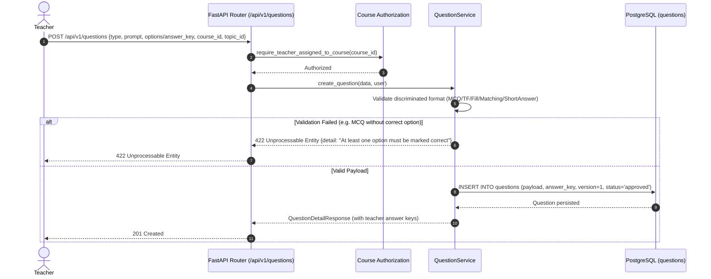
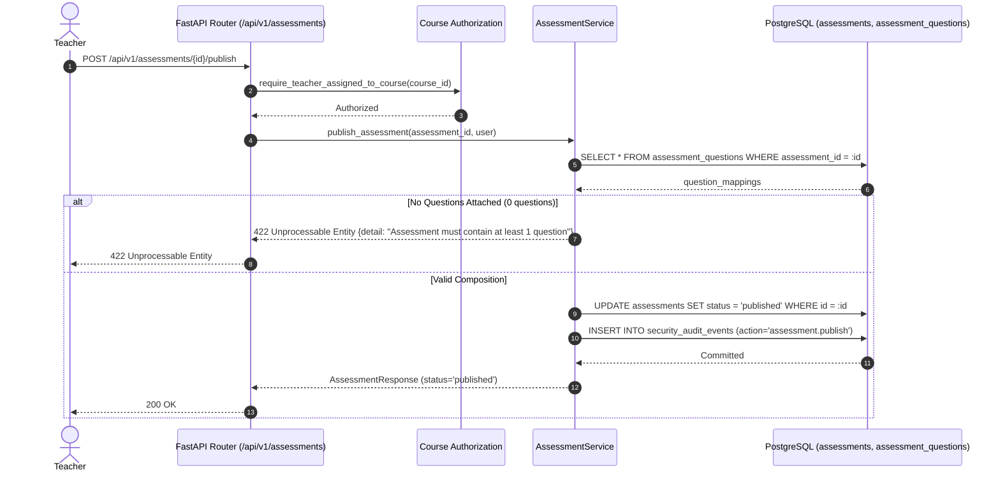

# Phase 05 Plan — Question Bank and Assessment Authoring

**Phase:** Phase 5 — Question Bank and Assessment Authoring  
**Stage:** Stage C (Implementation Completed & Verified)  
**Governing Standard:** `UNIVERSAL_ANTIGRAVITY_PROMPT.md`; `agent-prompt.md` Section 4; `Learnova_Master_Backend_Implementation_Blueprint.md` Sections 5.6, 7.2, 8.3 & 13; `docs/phases/PHASE-05_QUESTION_BANK_ASSESSMENT_AUTHORING.md`.  
**Date:** 2026-11-09  
**Status:** **IMPLEMENTATION COMPLETED AND 100% VERIFIED**

---

## 1. Objective of Phase 5

The objective of Phase 5 is to transition Question Bank authoring, question format validation, and teacher assessment composition from mock frontend state (`storageService.ts`) into authoritative, relational PostgreSQL persistence backed by FastAPI domain services.

Phase 5 fulfills the authoring portion of:
1. **SSD-08 (Teacher Assessment & Question Management):** Enables teachers and administrators to create, validate, update, archive, and filter questions across five distinct formats, and compose, order, configure, and publish structured assessments for courses and topics.
2. **SSD-07 (Teacher Content & Course Management):** Connects curriculum topics to assessed questions and evaluations.
3. **Question Definitions Consumed by Later Phases:** Authoritatively establishes the question and assessment definitions consumed by Phase 6 (Attempts & Grading), Phase 7 (Mastery & Adaptive Learning), and Phase 8 (Gamification).

> [!IMPORTANT]
> **Strict Phase 5 Scope Boundary:**
> - Phase 5 defines **what an assessment contains**.
> - It does **NOT** start student attempts, record interim responses, execute server-side grading, calculate scores, or update mastery (strictly reserved for Phase 6).
> - It does **NOT** calculate Bayesian Knowledge Tracing or Elo mastery (strictly reserved for Phase 7).
> - It does **NOT** process XP or award badges (strictly reserved for Phase 8).
> - It does **NOT** migrate or replace the Express AI generation routes on port 3000 (`POST /api/ai/generate-questions`) (strictly preserved until Phase 9).

---

## 2. Requirement and Workflow Traceability

### SRS Requirements
- **`FR-ASM-01` (Question Bank Authoring):** Support all five SRS question formats (`multiple_choice`, `true_false`, `fill_blank`, `matching`, `short_answer`). Enforce course and topic scoping, difficulty levels (`easy`, `medium`, `hard`), points/marks, explanation, author ID, timestamps, status (`draft`, `pending_review`, `approved`, `rejected`, `archived`), and provenance (`teacher`, `ai_generated`).
- **`FR-ASM-02` (Assessment Creation & Composition):** Support assessment categories (`diagnostic`, `formative`, `summative`, `adaptive`, `final`). Allow teachers to select authorized questions from the bank, define authoring order, points/weights, instructions, time limits, max attempts, and passing thresholds.
- **`FR-ASM-03` (Assessment Publication Quality Gate):** Transactionally validate assessment completeness before transitioning to `published` (must have $\ge 1$ question, all questions approved, total points $> 0$, questions belong to the same course).
- **`FR-ASM-04` (Student-Safe Projection):** Exclude correct option flags, boolean answers, accepted answer lists, matching answer keys, and grading rubrics from student-facing endpoints.
- **`FR-ASM-05` (Immutable Versioning & Attempt Safety):** Ensure that subsequent edits to a question in the bank do not silently alter a published assessment or historical attempt.
- **`FR-AUTH-05` (Teacher Authorization Boundary):** Teachers may create and manage questions and assessments only within courses they are assigned to or own.

### System Sequence Workflows
- **`SSD-08` (Teacher Assessment & AI Question Management):**
  - `loadQuestionBank(filters)` $\rightarrow$ `GET /api/v1/questions`
  - `saveQuestion(data)` $\rightarrow$ `POST /api/v1/questions` or `PATCH /api/v1/questions/{id}`
  - `archiveQuestion(id)` $\rightarrow$ `POST /api/v1/questions/{id}/archive`
  - `createAssessment(data)` $\rightarrow$ `POST /api/v1/assessments`
  - `updateAssessment(id, data)` $\rightarrow$ `PATCH /api/v1/assessments/{id}`
  - `publishAssessment(id)` $\rightarrow$ `POST /api/v1/assessments/{id}/publish`

---

## 3. Architecture, Domain Invariants, and Business Rules

### 3.1 Relational Schema Extension (D3 Domain)
Building upon the accepted Phase 1–4 foundation:

1. **`questions` Table:**
   - `id`: UUID (PK, default `uuid.uuid4`)
   - `course_id`: UUID (FK `courses.id` CASCADE, index, non-nullable)
   - `topic_id`: UUID (FK `topics.id` CASCADE, index, non-nullable)
   - `author_id`: UUID (FK `users.id` SET NULL, index, nullable)
   - `type`: String(32) (`multiple_choice`, `true_false`, `fill_blank`, `matching`, `short_answer`)
   - `difficulty`: String(16) (`easy`, `medium`, `hard`)
   - `points`: Integer (default 1, check `points > 0`)
   - `prompt`: Text (non-nullable, except matching where prompt can be default or empty if pairs are provided)
   - `explanation`: Text (nullable)
   - `status`: String(32) (`draft`, `pending_review`, `approved`, `rejected`, `archived`, default `'approved'`)
   - `source`: String(32) (`teacher`, `ai_generated`, default `'teacher'`)
   - `version`: Integer (default 1, monotonically incremented on edit)
   - `payload`: JSONB (student-deliverable content: options with IDs and text, matching left/right items, template)
   - `answer_key`: JSONB (server-only grading criteria: correct option IDs, correctBool, acceptedAnswers, matching solution mapping, expectedRubric, grading_mode)
   - `created_at`: DateTime(timezone=True)
   - `updated_at`: DateTime(timezone=True)
   - Constraints:
     - `CheckConstraint("type IN ('multiple_choice', 'true_false', 'fill_blank', 'matching', 'short_answer')", name="ck_questions_type")`
     - `CheckConstraint("difficulty IN ('easy', 'medium', 'hard')", name="ck_questions_difficulty")`
     - `CheckConstraint("status IN ('draft', 'pending_review', 'approved', 'rejected', 'archived')", name="ck_questions_status")`
     - `CheckConstraint("source IN ('teacher', 'ai_generated')", name="ck_questions_source")`
     - `CheckConstraint("points > 0", name="ck_questions_points_positive")`

2. **`assessments` Table:**
   - `id`: UUID (PK, default `uuid.uuid4`)
   - `course_id`: UUID (FK `courses.id` CASCADE, index, non-nullable)
   - `topic_id`: UUID (FK `topics.id` SET NULL, index, nullable — diagnostic/final can span whole course)
   - `creator_id`: UUID (FK `users.id` SET NULL, index, nullable)
   - `title`: String(255, non-nullable)
   - `type`: String(32) (`diagnostic`, `formative`, `summative`, `adaptive`, `final`)
   - `instructions`: Text (nullable)
   - `time_limit_minutes`: Integer (nullable, check `time_limit_minutes > 0`)
   - `max_attempts`: Integer (nullable, check `max_attempts > 0`)
   - `passing_score_percent`: Integer (nullable, check `>= 0 AND <= 100`)
   - `schedule_date`: DateTime(timezone=True, nullable)
   - `status`: String(32) (`draft`, `published`, `scheduled`, `completed`, `archived`, default `'draft'`)
   - `total_points`: Integer (default 0)
   - `created_at`: DateTime(timezone=True)
   - `updated_at`: DateTime(timezone=True)
   - Constraints:
     - `CheckConstraint("type IN ('diagnostic', 'formative', 'summative', 'adaptive', 'final')", name="ck_assessments_type")`
     - `CheckConstraint("status IN ('draft', 'published', 'scheduled', 'completed', 'archived')", name="ck_assessments_status")`

3. **`assessment_questions` Table (Junction with Order & Version Pinning):**
   - `id`: UUID (PK, default `uuid.uuid4`)
   - `assessment_id`: UUID (FK `assessments.id` CASCADE, index, non-nullable)
   - `question_id`: UUID (FK `questions.id` CASCADE, index, non-nullable)
   - `order`: Integer (default 0, non-nullable)
   - `points`: Integer (default 1, check `points > 0`)
   - `question_version`: Integer (default 1, captures question version at composition time)
   - `created_at`: DateTime(timezone=True)
   - Constraints:
     - `UniqueConstraint("assessment_id", "question_id", name="uq_assessment_questions_assessment_question")`
     - `CheckConstraint('"order" >= 0', name="ck_assessment_questions_order_nonnegative")`
     - `CheckConstraint("points > 0", name="ck_assessment_questions_points_positive")`

---

### 3.2 Five Question Formats & Strict Validation Rules

1. **Multiple Choice (`multiple_choice`):**
   - `options`: List of `{ id: str, text: str, is_correct: bool }`.
   - Validation: Minimum 2 options required. Option text cannot be empty. At least one option must have `is_correct = True`. If `is_multiple_correct_allowed = False`, exactly one option must be correct.
2. **True / False (`true_false`):**
   - `correct_bool`: Boolean (`True` or `False`).
   - Validation: Must be explicit boolean (not None).
3. **Fill in the Blank (`fill_blank`):**
   - `accepted_answers`: List of strings.
   - `case_sensitive`: Boolean (default `False`).
   - Validation: At least one non-empty accepted answer string required.
4. **Matching (`matching`):**
   - `matching_pairs`: List of `{ id: str, left: str, right: str }`.
   - Validation: Minimum 2 pairs required. `left` and `right` text must be non-empty. Left items must be unique; right items must be unique.
5. **Short Answer (`short_answer`):**
   - `expected_rubric`: String (grading criteria or sample answer).
   - `grading_mode`: String (`'manual_review'` or `'exact_match'`, default `'manual_review'`).
   - `accepted_answers`: Optional list of strings (required if `grading_mode == 'exact_match'`).
   - Validation: `expected_rubric` is required and non-empty. No implicit LLM grading (`DEC-06`).

---

### 3.3 Proposed Architectural Decisions (ADRs for Phase 5)

1. **`DEC-P5-001`: Segregated Question Content (`payload`) and Grading Configuration (`answer_key`):**
   - In PostgreSQL, question deliverable content (`prompt`, `options` without `is_correct`, `matchingPairs` without solutions) is stored in a `payload` JSONB column. The authoritative grading configuration (`is_correct` flags, `correct_bool`, `accepted_answers`, matching solution, `expected_rubric`) is stored in an `answer_key` JSONB column.
   - Benefit: Student-facing serializers project only `payload` and core metadata, guaranteeing that correct answers can never leak into student responses.
2. **`DEC-P5-002`: Short-Answer Grading Mode Governance (DEC-06):**
   - Follows DEC-06: Never use an LLM implicitly for automated grading.
   - Explicit `grading_mode` field:
     - `'exact_match'`: Compares student input against normalized `accepted_answers`.
     - `'manual_review'`: Preserves student submission and flags attempt for teacher evaluation against `expected_rubric`.
3. **`DEC-P5-003`: Assessment Publication Quality Gate:**
   - An assessment cannot transition to `published` status unless:
     1. It contains at least one question ($\ge 1$).
     2. All assigned questions belong to the assessment's course.
     3. Total points $> 0$.
     4. Caller is an authorized teacher or administrator.
   - Once published, the assessment configuration is locked. Edits create a new draft or update unpublished draft configurations.
4. **`DEC-P5-004`: Monotonic Question Version Pinning:**
   - Each question has a monotonically increasing `version: int`.
   - `assessment_questions` pins `question_version`.
   - Subsequent teacher edits to a question in the bank increment `version`, preserving historical assessment configurations and preventing retroactive changes to active or historical assessments.

---

## 4. Sequence Diagrams

### 4.1 Question Bank Authoring & Type Validation (SSD-08)

### 4.2 Assessment Composition & Publication Gate (SSD-08 / FR-ASM-03)

---

## 5. File Change Specification (Planned for Stage B Implementation)

### Files to Create (10 files)
1. `backend/app/models/question.py` — `Question` SQLAlchemy model with check constraints, versioning, and JSONB payload/answer_key.
2. `backend/app/models/assessment.py` — `Assessment` and `AssessmentQuestion` SQLAlchemy models with relationships, unique constraints, and check constraints.
3. `backend/alembic/versions/20261109_0007_d3_questions_and_assessments.py` — Additive migration 7 creating `questions`, `assessments`, and `assessment_questions` tables and indexes.
4. `backend/app/schemas/question.py` — Discriminated Pydantic schemas for the 5 question formats, teacher authoring schemas, and student-safe projection schemas.
5. `backend/app/schemas/assessment.py` — Pydantic schemas for Assessment creation, updating, composition, and publication.
6. `backend/app/services/question_service.py` — Question bank CRUD, format validation, course filtering, and archival.
7. `backend/app/services/assessment_service.py` — Assessment authoring, composition, total points calculation, and publication quality gate.
8. `backend/app/api/v1/endpoints/questions.py` — Question bank API endpoints (`GET /questions`, `POST /questions`, `GET /questions/{id}`, `PATCH /questions/{id}`, `POST /questions/{id}/archive`).
9. `backend/app/api/v1/endpoints/assessments.py` — Assessment API endpoints (`GET /assessments`, `POST /assessments`, `GET /assessments/{id}`, `PATCH /assessments/{id}`, `POST /assessments/{id}/publish`).
10. `backend/tests/test_question_bank.py` — Automated tests for all 5 question formats, validation errors, student answer key secrecy, and teacher scoping.
11. `backend/tests/test_assessment_authoring.py` — Automated tests for assessment composition, ordering, publication quality gates, and version pinning.

### Files to Modify (6 files)
1. `backend/app/models/course.py` — Add relationships to `questions` and `assessments`.
2. `backend/app/models/topic.py` — Add relationships to `questions` and `assessments`.
3. `backend/app/models/user.py` — Add relationships to authored `questions` and created `assessments`.
4. `backend/app/models/__init__.py` — Export `Question`, `Assessment`, and `AssessmentQuestion`.
5. `backend/app/api/v1/router.py` — Mount `questions.router` and `assessments.router`.
6. `backend/tests/test_migrations_postgres.py` — Update migration assertions to include Phase 5 tables and test downgrade `-1` (0007 -> 0006).

---

## 6. Acceptance Criteria (15 Gates: AC-P5-01 through AC-P5-15)

| Gate ID | Acceptance Gate | Verification Method |
|---|---|---|
| **AC-P5-01** | Multiple Choice: validates $\ge 2$ options, at least one correct option, and respects `is_multiple_correct_allowed`. | `test_question_bank.py::test_mcq_validation` |
| **AC-P5-02** | True/False: validates canonical boolean answer (`True` or `False`). | `test_question_bank.py::test_true_false_validation` |
| **AC-P5-03** | Fill in the Blank: validates non-empty accepted answers list and normalization settings. | `test_question_bank.py::test_fill_blank_validation` |
| **AC-P5-04** | Matching: validates $\ge 2$ pairs with non-empty left and right items. | `test_question_bank.py::test_matching_validation` |
| **AC-P5-05** | Short Answer: validates required `expected_rubric` and explicit `grading_mode`. | `test_question_bank.py::test_short_answer_validation` |
| **AC-P5-06** | Student question projection strictly omits all answer keys, correct flags, accepted answers, and rubrics. | `test_question_bank.py::test_student_projection_secrecy` |
| **AC-P5-07** | Teachers can create and view questions only in courses they own or are assigned to (`403 Forbidden` for unassigned). | `test_question_bank.py::test_teacher_course_scoping` |
| **AC-P5-08** | Students cannot create, edit, or view draft/authoring question bank items (`403 Forbidden`). | `test_question_bank.py::test_student_forbidden_from_question_authoring` |
| **AC-P5-09** | Assessment authoring allows selecting questions, configuring order, and dynamically calculates total points. | `test_assessment_authoring.py::test_assessment_composition_and_points` |
| **AC-P5-10** | Assessment cannot include questions from an unrelated course (`400 Bad Request`). | `test_assessment_authoring.py::test_cross_course_questions_rejected` |
| **AC-P5-11** | Publishing an empty assessment (0 questions) is rejected with `422 Unprocessable Entity`. | `test_assessment_authoring.py::test_publish_empty_assessment_rejected` |
| **AC-P5-12** | Valid assessment transitions to `published` status and records a security audit event. | `test_assessment_authoring.py::test_publish_valid_assessment_success` |
| **AC-P5-13** | Editing a question increments `version` and does not mutate previously published assessment question versions. | `test_assessment_authoring.py::test_question_version_pinning` |
| **AC-P5-14** | Archiving a question marks `status = 'archived'` without breaking historical references. | `test_question_bank.py::test_archive_question_preserves_integrity` |
| **AC-P5-15** | Zero regression: all 73 existing backend tests and 29 frontend tests pass; Express AI routes untouched. | Full test suite execution |

---

## 7. Testing and Rollback Strategy

### Testing Strategy
1. **Isolated Unit & Integration Tests:** 2 new dedicated test files (`test_question_bank.py`, `test_assessment_authoring.py`) targeting all 5 question types and authoring workflows.
2. **Security Leak Probes:** Explicit assertions validating that student-facing models never expose `answer_key`, `is_correct`, `accepted_answers`, or `expected_rubric`.
3. **Migration Lifecycle:** Tested via Alembic upgrade head and downgrade `-1` on disposable database.
4. **Full Regression:** Execute complete pytest suite (74+ tests) and Vitest suite (29 tests).

### Rollback Strategy
1. **Alembic Downgrade:** `alembic downgrade 20261109_0006` cleanly drops `assessment_questions`, `assessments`, and `questions` tables without touching Phase 1–4 tables (`users`, `courses`, `enrollments`, `sessions`, etc.).
2. **Git Reversion:** `git restore` safely reverts uncommitted code files.
3. **Data Safety:** Persistent volume `postgres_data` is untouched.

---

## 8. Non-Modification Invariant Confirmation for Stage A

- **Zero frontend source code files** (`frontend/src/**/*`, `frontend/package.json`, `frontend/server.ts`) were modified.
- **Zero application backend source files** were modified or created.
- **Zero database migrations** were executed.
- **Zero persistent database tables or data** were deleted or altered.
- Only Phase 5 specification and planning documentation files were written.
