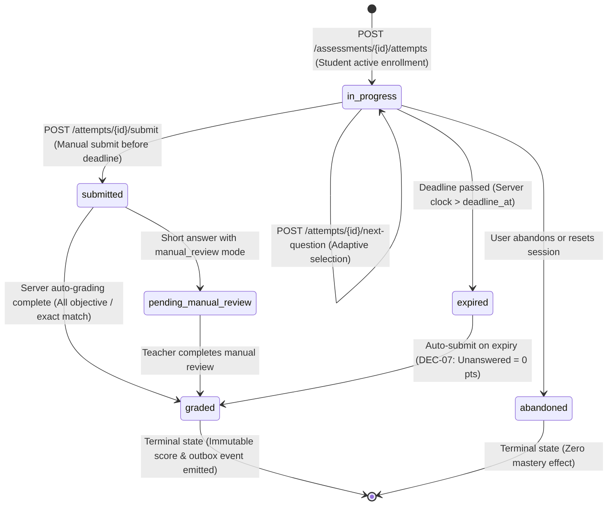
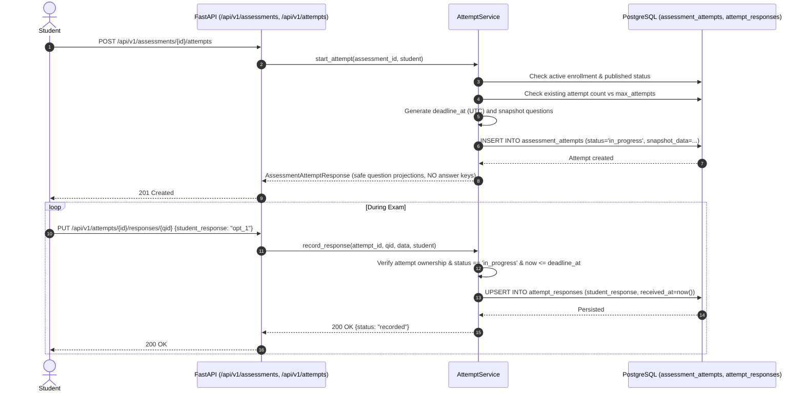
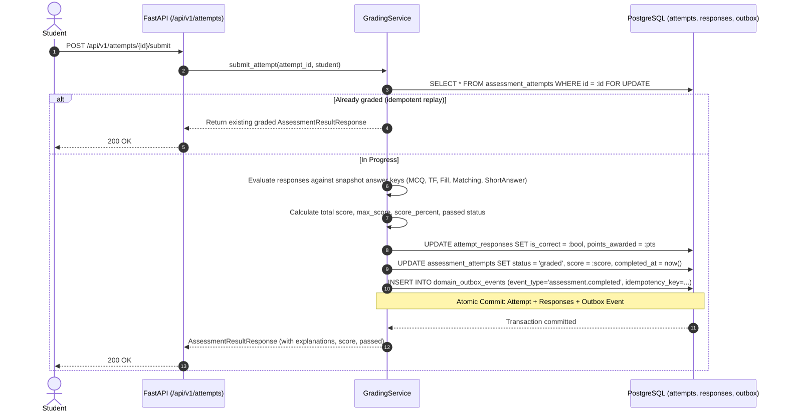

# Phase 06 Plan — Assessment Attempt Lifecycle and Server-Authoritative Grading

**Phase:** Phase 6 — Assessment Attempt Lifecycle and Server-Authoritative Grading  
**Stage:** Stage B & C (Implementation Completed & Verified — 100% Tests Passing)  
**Governing Standard:** `UNIVERSAL_ANTIGRAVITY_PROMPT.md`; `agent-prompt.md` Section 4; `Learnova_Master_Backend_Implementation_Blueprint.md` Sections 3.2, 5.6, 7.2, 8.3–8.4 & 13; `docs/phases/PHASE-06_ASSESSMENT_ATTEMPTS_GRADING.md`.  
**Date:** 2026-11-09  
**Status:** **IMPLEMENTED, VERIFIED & ACCEPTED (102/103 Pytest Passed, 29/29 Vitest Passed, Build Clean)**

---

## 1. Objective of Phase 6

The objective of Phase 6 is to implement the secure, persistent student assessment attempt lifecycle and server-authoritative grading engine in FastAPI and PostgreSQL, transitioning student exam taking from mock frontend storage (`storageService.ts`) into authoritative, ACID-compliant persistence.

Phase 6 fulfills:
1. **SSD-02 (Topic Selection & Prerequisite Diagnostic):** Enables enrolled students to start, answer, and complete prerequisite diagnostics with server-authoritative scoring.
2. **SSD-04 (Adaptive Practice & Formative Evaluation):** Provides attempt-scoped adaptive next-question difficulty adjustment using server-derived session performance without leaking answer keys.
3. **SSD-06 (Final Summative Examination & Course Completion):** Handles high-stakes summative exams with server-enforced UTC deadlines, automatic expiry/submission, deterministic grading across all five question formats, and transactional outbox event emission.

> [!IMPORTANT]
> **Strict Phase 6 Academic Invariants & Scope Boundaries:**
> 1. **Zero Client-Supplied Scoring:** The browser submits student answers only. It **never** supplies `score`, `is_correct`, `score_percent`, `passed`, `mastery`, or attempt status.
> 2. **Mastery Boundary Invariant:** Interim answers, abandoned attempts, and expired attempts **never** update persisted topic mastery. Persisted topic mastery is recalculated exclusively after a complete, valid assessment submission at the approved boundary.
> 3. **Phase 7 Mastery Decoupling:** Phase 6 produces the authoritative assessment completion evidence and emits a durable `assessment.completed` event/signal. It does **NOT** invent a Bayesian Knowledge Tracing formula or calibrate Elo parameters (strictly reserved for Phase 7).
> 4. **Phase 8 Gamification Decoupling:** Phase 6 grading does **NOT** award XP, evaluate streaks, or unlock badges. It transactionally records an outbox domain event; Phase 8 owns event consumption and rewards.
> 5. **Idempotency Guarantee:** Duplicate answer writes, submission retries, or network replays never produce duplicate attempt results or duplicate domain events.
> 6. **Zero Destructive Database Operations:** Persistent data volume `postgres_data` is preserved. All schema changes are additive Alembic migrations with verified rollback (`-1`).

---

## 2. Requirement and Workflow Traceability

### SRS Requirements
- **`FR-ASM-06` (Assessment Attempt State Machine):** Persist attempt state transitions: `in_progress`, `submitted`, `graded`, `pending_manual_review`, `expired`, `abandoned`. Terminal states are immutable.
- **`FR-ASM-07` (Server-Authoritative Timing & Expiry):** Enforce UTC `started_at` and `deadline_at`. Auto-submit or expire attempts when the server clock exceeds the deadline (`DEC-07`).
- **`FR-ASM-08` (Immutable Attempt Question Snapshotting):** Snapshot questions and scoring rules at attempt start so later teacher edits in the Question Bank never mutate an active or completed attempt.
- **`FR-ASM-09` (Interim Answer Upserting):** Store student responses per question idempotently during the attempt with server receipt timestamps; reject answers after deadline expiry.
- **`FR-ASM-10` (Deterministic Server-Side Grading Engine):** Authoritatively evaluate all 5 question types on submission using server-held answer keys:
  - `multiple_choice`: Evaluate selected option(s) against `correct_option_ids`.
  - `true_false`: Evaluate boolean response against `correct_bool`.
  - `fill_blank`: Evaluate normalized string against `accepted_answers` (case-sensitive flag honored).
  - `matching`: Proportional scoring based on fraction of correct left-right pairs.
  - `short_answer`: Deterministic evaluation for `exact_match` mode; flag `pending_manual_review` for `manual_review` mode (`DEC-06`, no implicit LLM grading).
- **`FR-ASM-11` (Attempt Limit & Retake Governance):** Enforce assessment `max_attempts` rule. Prevent starting attempts beyond authorized limits.
- **`FR-ASM-12` (Transactional Outbox Event Emission):** Atomically write a durable `domain_outbox_events` record with unique idempotency key alongside the graded assessment attempt.

### System Sequence Workflows
- **`SSD-02` (Diagnostic Attempt Lifecycle):** `startDiagnostic(id)` $\rightarrow$ `POST /api/v1/assessments/{id}/attempts` $\rightarrow$ interim answers $\rightarrow$ `submit`.
- **`SSD-04` (Adaptive Practice Lifecycle):** `startPractice(id)` $\rightarrow$ `GET /api/v1/attempts/{id}` $\rightarrow$ `POST /api/v1/attempts/{id}/next-question` $\rightarrow$ `submit`.
- **`SSD-06` (Summative Exam Lifecycle):** `startExam(id)` with timed countdown $\rightarrow$ `PUT /api/v1/attempts/{id}/responses/{qid}` $\rightarrow$ auto-submit/manual submit $\rightarrow$ `GET /api/v1/attempts/{id}/result`.

---

## 3. Architecture, Domain Invariants, and Business Rules

### 3.1 Relational Schema Extension (D3 Attempt & Outbox Domain)

Building upon the accepted Phase 1–5 schema:

1. **`assessment_attempts` Table:**
   - `id`: UUID (PK, default `uuid.uuid4`)
   - `assessment_id`: UUID (FK `assessments.id` CASCADE, index, non-nullable)
   - `student_id`: UUID (FK `users.id` CASCADE, index, non-nullable)
   - `enrollment_id`: UUID (FK `enrollments.id` CASCADE, index, non-nullable)
   - `attempt_number`: Integer (default 1, check `attempt_number > 0`)
   - `status`: String(32) (`in_progress`, `submitted`, `graded`, `pending_manual_review`, `expired`, `abandoned`, default `'in_progress'`)
   - `started_at`: DateTime(timezone=True) (server UTC timestamp, default `now()`)
   - `deadline_at`: DateTime(timezone=True) (nullable; computed from `assessment.time_limit_minutes`)
   - `submitted_at`: DateTime(timezone=True) (nullable)
   - `completed_at`: DateTime(timezone=True) (nullable)
   - `score`: Numeric(7, 2) (nullable while in progress/pending review)
   - `max_score`: Integer (non-nullable, default 0)
   - `score_percent`: Numeric(5, 2) (nullable while in progress/pending review)
   - `passed`: Boolean (nullable)
   - `current_difficulty`: String(16) (nullable, for adaptive practice: `'easy'`, `'medium'`, `'hard'`)
   - `snapshot_data`: JSONB (immutable snapshot of question items, options without answer keys, points, and instructions)
   - `created_at`: DateTime(timezone=True)
   - `updated_at`: DateTime(timezone=True)
   - Constraints:
     - `CheckConstraint("status IN ('in_progress', 'submitted', 'graded', 'pending_manual_review', 'expired', 'abandoned')", name="ck_assessment_attempts_status")`
     - `CheckConstraint("attempt_number > 0", name="ck_assessment_attempts_number_positive")`
     - `CheckConstraint("max_score >= 0", name="ck_assessment_attempts_max_score_nonnegative")`
     - `CheckConstraint("score_percent IS NULL OR (score_percent >= 0 AND score_percent <= 100)", name="ck_assessment_attempts_score_percent_range")`
     - `CheckConstraint("deadline_at IS NULL OR deadline_at >= started_at", name="ck_assessment_attempts_deadline_valid")`
     - `UniqueConstraint("assessment_id", "student_id", "attempt_number", name="uq_assessment_attempts_student_attempt")`

2. **`attempt_responses` Table:**
   - `id`: UUID (PK, default `uuid.uuid4`)
   - `attempt_id`: UUID (FK `assessment_attempts.id` CASCADE, index, non-nullable)
   - `question_id`: UUID (FK `questions.id` CASCADE, index, non-nullable)
   - `question_version`: Integer (default 1, non-nullable)
   - `student_response`: JSONB (typed answer data: option ID, boolean, text, matching record)
   - `is_correct`: Boolean (nullable while in progress; evaluated upon submit)
   - `points_awarded`: Numeric(7, 2) (nullable while in progress; evaluated upon submit)
   - `points_possible`: Integer (default 1, check `points_possible > 0`)
   - `response_time_seconds`: Integer (nullable, check `>= 0`)
   - `feedback`: Text (nullable)
   - `created_at`: DateTime(timezone=True)
   - `updated_at`: DateTime(timezone=True)
   - Constraints:
     - `UniqueConstraint("attempt_id", "question_id", name="uq_attempt_responses_attempt_question")` (guarantees idempotency of responses)
     - `CheckConstraint("points_possible > 0", name="ck_attempt_responses_points_possible_positive")`
     - `CheckConstraint("points_awarded IS NULL OR points_awarded >= 0", name="ck_attempt_responses_points_awarded_nonnegative")`

3. **`domain_outbox_events` Table (Transactional Outbox Pattern):**
   - `id`: UUID (PK, default `uuid.uuid4`)
   - `event_type`: String(64) (e.g. `'assessment.completed'`)
   - `aggregate_type`: String(64) (`'assessment_attempt'`)
   - `aggregate_id`: String(64) (`str(attempt.id)`)
   - `idempotency_key`: String(128) (unique, index)
   - `payload`: JSONB (`student_id`, `assessment_id`, `course_id`, `topic_id`, `score_percent`, `passed`, `attempt_id`)
   - `status`: String(32) (`'pending'`, `'published'`, `'failed'`, default `'pending'`)
   - `created_at`: DateTime(timezone=True)
   - `published_at`: DateTime(timezone=True) (nullable)
   - Constraints:
     - `UniqueConstraint("idempotency_key", name="uq_domain_outbox_events_idempotency_key")`
     - `CheckConstraint("status IN ('pending', 'published', 'failed')", name="ck_domain_outbox_events_status")`

---

### 3.2 State Machine Transitions

---

## 4. Proposed Architectural Decisions (ADRs for Phase 6)

### `DEC-P6-001`: Server-Side Immutable Attempt Snapshotting
- **Decision:** When an assessment attempt is created, the system snapshots the assessment title, type, instructions, question list, ordering, and points into the attempt record and creates placeholder or initial response associations.
- **Rationale:** Ensures that if a course instructor subsequently modifies or archives questions in the Question Bank or updates assessment settings, the student's active exam attempt and historical grading snapshot remain 100% stable and audit-verifiable.

### `DEC-P6-002`: Authoritative UTC Deadlines and Auto-Submit on Expiry (DEC-07 Alignment)
- **Decision:** Assessment deadlines (`deadline_at`) are computed exclusively by the server (`started_at + timedelta(minutes=time_limit_minutes)`). Any submission or interim response received after `deadline_at` is treated according to DEC-07: questions answered prior to expiry are scored; unanswered questions receive 0 points; and the attempt transitions to `graded` (or `expired`). The browser timer is strictly a display UI convenience.

### `DEC-P6-003`: Transactional Outbox Event for Completion Boundary Decoupling
- **Decision:** Upon successful completion and grading of an assessment, the system atomically inserts a `domain_outbox_events` record (`event_type = 'assessment.completed'`) within the exact same database transaction that finalizes the attempt score.
- **Rationale:** Strictly decouples grading from Phase 7 (Mastery) and Phase 8 (Gamification XP). Guaranteed delivery without dual-write inconsistency. If the transaction rolls back, no spurious event is emitted.

### `DEC-P6-004`: Idempotent Response Upsert and Submission Handling
- **Decision:** Interim answers are upserted against `UniqueConstraint("attempt_id", "question_id")`. Multiple submissions of the same attempt return the existing graded result with `200 OK` and do not generate duplicate outbox events or recalculate scores.

---

## 5. Sequence Diagrams

### 5.1 Start Attempt & Response Recording (SSD-02, SSD-06)

### 5.2 Submit, Server-Side Grading, and Outbox Event Emission (SSD-04, SSD-06)

---

## 6. File Change Specification (Planned for Stage B Implementation)

### Files to Create (10 files)
1. `backend/app/models/attempt.py` — `AssessmentAttempt` and `AttemptResponse` SQLAlchemy models with constraints and indexes.
2. `backend/app/models/outbox.py` — `DomainOutboxEvent` SQLAlchemy model for durable event-driven integration.
3. `backend/alembic/versions/20261109_0008_d4_assessment_attempts_and_grading.py` — Additive migration 8 creating `assessment_attempts`, `attempt_responses`, and `domain_outbox_events`.
4. `backend/app/schemas/attempt.py` — Pydantic schemas for starting attempts, saving interim answers, adaptive selection, and student results.
5. `backend/app/services/attempt_service.py` — Attempt lifecycle domain service: start, timing, ownership, state machine, and adaptive practice selection.
6. `backend/app/services/grading_service.py` — Server-authoritative grading service for all 5 question formats, exact match / manual review, and outbox emission.
7. `backend/app/api/v1/endpoints/attempts.py` — Attempt API router (`/attempts/{id}`, `/attempts/{id}/responses/{qid}`, `/attempts/{id}/next-question`, `/attempts/{id}/submit`, `/attempts/{id}/result`).
8. `backend/tests/test_attempt_lifecycle.py` — Automated tests for attempt starting, timing, ownership, response recording, and state machine transitions.
9. `backend/tests/test_server_grading.py` — Automated tests for server grading across all 5 formats, partial credit, and anti-forgery protections.
10. `backend/tests/test_attempt_concurrency_and_outbox.py` — Automated tests for idempotency, concurrent submit safety, and transactional outbox emission.

### Files to Modify (7 files)
1. `backend/app/models/assessment.py` — Add relationship to `attempts`.
2. `backend/app/models/enrollment.py` — Add relationship to `attempts`.
3. `backend/app/models/user.py` — Add relationship to `assessment_attempts`.
4. `backend/app/models/__init__.py` — Register `AssessmentAttempt`, `AttemptResponse`, `DomainOutboxEvent`.
5. `backend/app/api/v1/endpoints/assessments.py` — Mount `POST /assessments/{id}/attempts`.
6. `backend/app/api/v1/router.py` — Mount `attempts.router`.
7. `backend/tests/test_migrations_postgres.py` — Add Phase 6 tables to disposable migration lifecycle test.

---

## 7. Acceptance Criteria (15 Gates: AC-P6-01 through AC-P6-15)

| Gate ID | Acceptance Gate | Verification Method |
|---|---|---|
| **AC-P6-01** | Starting attempt enforces active enrollment, assessment publication, and student role (`403` for non-enrolled/unpublished). | `test_attempt_lifecycle.py::test_start_attempt_enforces_enrollment_and_publication` |
| **AC-P6-02** | Starting attempt enforces `max_attempts` boundary; exceeding limit rejects with `403 Forbidden`. | `test_attempt_lifecycle.py::test_max_attempts_enforced` |
| **AC-P6-03** | Attempt snapshotting permanently preserves question prompt, options, order, and points; later question edits do not alter attempt. | `test_attempt_lifecycle.py::test_attempt_question_snapshot_isolation` |
| **AC-P6-04** | Interim response saving persists student answers idempotently; reject answers for questions outside snapshot (`400 Bad Request`). | `test_attempt_lifecycle.py::test_interim_response_upsert_and_validation` |
| **AC-P6-05** | Attempt timing is server-authoritative (UTC); requests received after `deadline_at` are rejected or auto-submitted (`DEC-07`). | `test_attempt_lifecycle.py::test_server_authoritative_deadline_and_expiry` |
| **AC-P6-06** | Cross-student attempt access is strictly forbidden; students cannot view or answer another student's attempt (`403 Forbidden`). | `test_attempt_lifecycle.py::test_cross_student_attempt_isolation` |
| **AC-P6-07** | Server grades Multiple Choice accurately (single and multiple correct) using server answer keys; client scores ignored. | `test_server_grading.py::test_grade_multiple_choice` |
| **AC-P6-08** | Server grades True/False accurately based on canonical boolean answer key. | `test_server_grading.py::test_grade_true_false` |
| **AC-P6-09** | Server grades Fill in the Blank using normalized whitespace matching and honors `case_sensitive` flag. | `test_server_grading.py::test_grade_fill_blank_normalization` |
| **AC-P6-10** | Server grades Matching questions with proportional partial credit based on correct pair fraction. | `test_server_grading.py::test_grade_matching_proportional_credit` |
| **AC-P6-11** | Short Answer follows DEC-06: `exact_match` evaluates accepted answers; `manual_review` transitions to `pending_manual_review` without implicit LLM calls. | `test_server_grading.py::test_grade_short_answer_modes` |
| **AC-P6-12** | Duplicate or replayed submit requests are idempotent, return the existing result, and do not re-grade or duplicate events. | `test_attempt_concurrency_and_outbox.py::test_submit_idempotency` |
| **AC-P6-13** | Assessment completion transactionally inserts a `domain_outbox_events` record (`event_type = 'assessment.completed'`). | `test_attempt_concurrency_and_outbox.py::test_outbox_event_emitted_on_completion` |
| **AC-P6-14** | Simulated transaction failure rolls back attempt grading, response updates, and outbox event atomically. | `test_attempt_concurrency_and_outbox.py::test_transactional_atomicity_on_grading_failure` |
| **AC-P6-15** | Zero regression: all 88 existing backend tests and 29 frontend tests pass; Vite build succeeds. | Full test suite execution |

---

## 8. Testing and Rollback Strategy

### Testing Strategy
1. **Isolated Unit & Integration Tests:** 3 new test suites (`test_attempt_lifecycle.py`, `test_server_grading.py`, `test_attempt_concurrency_and_outbox.py`) targeting all grading rules and attempt transitions.
2. **Security & Anti-Tamper Probes:** Direct assertions verifying that client-supplied `score`, `points`, `is_correct`, or `mastery` payloads are completely ignored or rejected.
3. **Migration Lifecycle:** Tested via Alembic upgrade head and downgrade `-1` on disposable database.
4. **Full Regression:** Execute complete pytest suite (100+ tests) and Vitest suite (29 tests).

### Rollback Strategy
1. **Alembic Downgrade:** `alembic downgrade 20261109_0007` cleanly drops `domain_outbox_events`, `attempt_responses`, and `assessment_attempts` tables without affecting Phase 1–5 tables.
2. **Git Reversion:** `git restore` safely reverts uncommitted code files.
3. **Persistent Volume Safety:** `postgres_data` volume is untouched.

---

## 9. Risk and Dependency Analysis

| Risk | Impact | Mitigation Strategy |
|---|---|---|
| **Client Timer Discrepancy** | High | The server UTC clock is authoritative; deadlines are validated on every interim save and final submission. |
| **Duplicate Submissions Under High Latency** | High | Database row locking (`SELECT FOR UPDATE`) and unique idempotency keys guarantee exactly-once grading. |
| **Accidental LLM Call During Short-Answer Grading** | Critical | Enforce DEC-06: strictly route `manual_review` to `pending_manual_review`; no LLM client is imported in `grading_service.py`. |
| **Premature Mastery Mutation** | Critical | Phase 6 contains zero code writing to topic mastery tables; only durable outbox events are emitted for Phase 7. |

---

## 10. Non-Modification Invariant Confirmation for Stage A

- **Zero frontend source code files** (`frontend/src/**/*`, `frontend/package.json`, `frontend/server.ts`) were modified.
- **Zero application backend source files** were modified or created.
- **Zero database migrations** were executed.
- **Zero persistent database tables or data** were deleted or altered.
- Only Phase 6 specification mirroring and planning documentation files were written.
