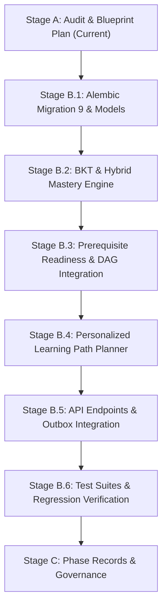

# Phase 07 Plan — Knowledge Tracing & Dynamic Mastery Engine

**Phase:** Phase 7 — Knowledge Tracing & Dynamic Mastery Engine  
**Stage:** Stage C (Governance & Phase Sign-Off Complete)  
**Governing Standard:** `UNIVERSAL_ANTIGRAVITY_PROMPT.md`; `agent-prompt.md` Section 4; `Learnova_Master_Backend_Implementation_Blueprint.md` Sections 3.2, 5.5, 7.3, 8.4 & 9 (Phase 7); `Readme.md` Lines 30–48 & 1713–1731; `Learnova_Final_SSDs_V2.xml` (SSD-02, SSD-03, SSD-04); `docs/phases/PHASE-07_KNOWLEDGE_TRACING_DYNAMIC_MASTERY.md`.  
**Date:** 2026-11-09  
**Status:** **IMPLEMENTED, VERIFIED & ACCEPTED (119/120 Pytest Passed, 29/29 Vitest Passed, Build Clean)**

---

## 1. Objective of Phase 7

The objective of Phase 7 is to implement the authoritative, persistent Knowledge Tracing & Dynamic Mastery Engine in FastAPI and PostgreSQL, elevating student topic mastery from client-side `localStorage` calculations (`calculateAcademicMastery` in `studentLogic.ts`) into a resilient, mathematically sound, server-authoritative domain service.

Phase 7 fulfills:
1. **SSD-02 (Topic Selection & Prerequisite Diagnostic Assessment):** Evaluates topic readiness by traversing the prerequisite DAG against persisted topic mastery states; triggers diagnostic evaluation of prerequisite skills to unlock ready topics.
2. **SSD-03 (Personalized Learning Path Generation & Resource Study):** Dynamically plans an individualized sequential learning path across curriculum topics and lessons; provides remediation loops for developing mastery and acceleration for mastered topics.
3. **SSD-04 (Formative Practice Mastery Recalibration):** Processes completed assessment attempts, executing Bayesian Knowledge Tracing (BKT) and weighted performance scoring to recalibrate topic mastery states upon full attempt submission.
4. **Outbox Event Integration (`DEC-P6-003`):** Reliably consumes `assessment.completed` domain events, updating topic mastery states transactionally without coupling grading to gamification (Phase 8).

> [!IMPORTANT]
> **Strict Phase 7 Academic Invariants & Scope Boundaries:**
> 1. **Assessment-Level Mastery Boundary Invariant:** Mastery recalculation occurs **strictly upon full, valid assessment completion and submission**. Interim question responses, in-progress attempts, abandoned attempts, and expired attempts without submission NEVER update persisted mastery.
> 2. **Explicit Representation of Unassessed Topics:** No unassessed topic is silently treated as zero mastery or failure. An unassessed topic carries `status = 'not_assessed'`, `mastery_score = 0.0000` with unassessed status flag, and `attempts_count = 0`.
> 3. **Normalized Internal Representation ([`DEC-001`](file:///d:/Learnova/DECISIONS.md#dec-001)):** Stored internally in PostgreSQL as `Numeric(5, 4)` in the range `[0.0000, 1.0000]`. Exposed at API boundaries as integer percentages `0–100` alongside status labels (`not_assessed`, `developing`, `competent`, `mastered`).
> 4. **Standard Mastery Status Thresholds:**
>    - `mastered`: $\ge 0.8500$ ($\ge 85\%$)
>    - `competent`: $\ge 0.7000$ ($\ge 70\%$) — Default readiness and passing threshold
>    - `developing`: $< 0.7000$ ($< 70\%$) — Triggers remediation
>    - `not_assessed`: 0 completed attempts
> 5. **Zero Academic Gamification Coupling:** Gamification entities (XP, streaks, badges) must **never** be used as inputs to topic mastery calculations, prerequisite compliance, or topic readiness.
> 6. **Performance Target:** The recommendation / learning path generation endpoint must execute under **1,000 ms** for a full course graph.
> 7. **Zero Destructive Database Operations:** Persistent data volume `postgres_data` is preserved. All schema changes are additive Alembic migrations with verified rollback (`-1`).

---

## 2. Requirement and Workflow Traceability

### SRS Requirements
- **`FR-MAS-01` (Topic Mastery State Model):** Persist student mastery records per `(user_id, topic_id)` with normalized score `[0.0000, 1.0000]`, percentage `0-100`, status enum (`not_assessed`, `developing`, `competent`, `mastered`), BKT posterior, and attempt history.
- **`FR-MAS-02` (Bayesian Knowledge Tracing Engine):** Implement Corbett & Anderson BKT formulation with deterministic transition parameters ($P(L_0), P(T), P(G), P(S)$) updating sequentially on submitted responses.
- **`FR-MAS-03` (Assessment-Level Mastery Boundary):** Recalculate mastery strictly on complete assessment submission; interim responses, in-progress attempts, and abandoned attempts must not alter persisted mastery states (`DEC-03`).
- **`FR-MAS-04` (Prerequisite Graph Traversal & Readiness Gate):** Inspect all direct prerequisite edges from `TopicPrerequisite`. Evaluate student's mastery in each prerequisite against `Topic.mastery_threshold` (default `0.7000`). Topic is `Ready` if and only if all prerequisites meet the passing threshold (`SSD-02`).
- **`FR-MAS-05` (Diagnostic Assessment Baseline):** Diagnostic assessments targeting prerequisite topics update prerequisite mastery states, unlocking dependent topics upon passing score $\ge 70\%$ (`SSD-02`).
- **`FR-MAS-06` (Dynamic Personalized Learning Path Planner):** Topologically sort course topics. Inspect completed lessons, prerequisite readiness, and topic mastery. Identify the immediate next recommended action (`lesson`, `diagnostic`, `adaptive_practice`, or `final_exam`) (`SSD-03`).
- **`FR-MAS-07` (Remediation & Acceleration Feedback Loops):** When topic lessons are completed but topic mastery is `< 70%` (`developing`), loop student to targeted `adaptive_practice`. When mastery is $\ge 85\%$ (`mastered`), accelerate student to subsequent curriculum nodes.
- **`FR-MAS-08` (Mastery Audit Ledger):** Persist an immutable chronological ledger record for every mastery recalibration event, logging previous/new scores, assessment type, and algorithm version for analytics and explainability.

### System Sequence Workflows
- **`SSD-02` (Prerequisite Diagnostic & Readiness):** `selectTopic(id)` $\to$ `GET /api/v1/topics/{id}/readiness` $\to$ if unmet prerequisites, recommend `diagnosticAssessment` $\to$ submit diagnostic $\to$ update prerequisite mastery $\to$ unlock target topic as `Ready`.
- **`SSD-03` (Personalized Path & Resource Study):** `requestLearningPath(courseId)` $\to$ `GET /api/v1/courses/{course_id}/learning-path` $\to$ dynamic plan with `recommendedNextStep` $\to$ study lesson $\to$ `POST /lessons/{id}/complete` $\to$ dynamic path updates.
- **`SSD-04` (Adaptive Practice & Mastery Recalibration):** `submitAttempt(id)` $\to$ evaluate exam $\to$ outbox event `assessment.completed` $\to$ `MasteryService.recalculate_from_attempt()` $\to$ recalibrate topic mastery $\to$ regenerate path.

---

## 3. Architecture, Domain Invariants, and Business Rules

### 3.1 Relational Schema Extension (D4 Mastery Domain)

Building upon the accepted Phase 1–6 schema:

1. **`student_topic_mastery` Table:**
   - `id`: UUID primary key, default `uuid.uuid4`.
   - `user_id`: UUID ForeignKey to `users.id`, `ondelete="CASCADE"`, indexed.
   - `course_id`: UUID ForeignKey to `courses.id`, `ondelete="CASCADE"`, indexed.
   - `topic_id`: UUID ForeignKey to `topics.id`, `ondelete="CASCADE"`, indexed.
   - `mastery_score`: Numeric(5, 4), default `0.0000`, constrained `[0.0000, 1.0000]`.
   - `score_percent`: Integer, default `0`, constrained `[0, 100]`.
   - `status`: String(32), default `'not_assessed'`, constrained to `('not_assessed', 'developing', 'competent', 'mastered')`.
   - `bkt_probability`: Numeric(5, 4), nullable, constrained `[0.0000, 1.0000]`.
   - `attempts_count`: Integer, default `0`, non-negative.
   - `last_attempt_id`: UUID ForeignKey to `assessment_attempts.id`, `ondelete="SET NULL"`, nullable.
   - `last_assessed_at`: DateTime(timezone=True), nullable.
   - `created_at`: DateTime(timezone=True), default UTC `now()`.
   - `updated_at`: DateTime(timezone=True), default UTC `now()`, updated on change.
   - Constraints:
     - `ck_topic_mastery_score`: `mastery_score >= 0.0000 AND mastery_score <= 1.0000`
     - `ck_topic_mastery_percent`: `score_percent >= 0 AND score_percent <= 100`
     - `ck_topic_mastery_status`: `status IN ('not_assessed', 'developing', 'competent', 'mastered')`
     - `uq_student_topic_mastery`: `UNIQUE (user_id, topic_id)`

2. **`mastery_audit_ledger` Table:**
   - `id`: UUID primary key, default `uuid.uuid4`.
   - `user_id`: UUID ForeignKey to `users.id`, `ondelete="CASCADE"`, indexed.
   - `topic_id`: UUID ForeignKey to `topics.id`, `ondelete="CASCADE"`, indexed.
   - `attempt_id`: UUID ForeignKey to `assessment_attempts.id`, `ondelete="CASCADE"`.
   - `previous_score`: Numeric(5, 4), nullable.
   - `new_score`: Numeric(5, 4), non-null, constrained `[0.0000, 1.0000]`.
   - `previous_status`: String(32), nullable.
   - `new_status`: String(32), non-null.
   - `assessment_type`: String(32), non-null (`formative`, `diagnostic`, `adaptive`, `final`).
   - `algorithm_used`: String(64), default `'BKT_HYBRID_V1'`.
   - `created_at`: DateTime(timezone=True), default UTC `now()`.

### 3.2 Additive Migration 9 (`20261109_0009_d4_student_topic_mastery.py`)
- Down revision: `20261109_0008` (Phase 6).
- Creates `student_topic_mastery` and `mastery_audit_ledger` with check constraints and foreign keys.
- Verified on disposable SQLite database for clean upgrade and downgrade (`-1`).

---

## 4. Key Architectural Decisions for Project Owner Approval

### `DEC-P7-001`: Hybrid BKT & Assessment-Weighted Mastery Formula
- **Context:** Blueprint Section 7.3 notes that the literature identifies Bayesian Knowledge Tracing (BKT), Elo ratings, and recent performance as candidate mastery algorithms. An ideal educational engine must combine item-by-item Bayesian belief updating with empirical exam performance so that scores are both statistically robust and intuitive to students.
- **Options:**
  1. Pure classical BKT: Use only posterior $P(L)$ derived from sequence of binary item correctness.
  2. Pure assessment average: Average percentage of completed assessments (as in mock frontend).
  3. Hybrid BKT + Assessment weighting: Compute final posterior $P(L)$ from sequential item responses ($P(L_0)=0.10, P(T)=0.20, P(G)=0.20, P(S)=0.10$) and blend:
     $$\text{MasteryScore} = 0.60 \times (\text{Assessment Score Ratio}) + 0.40 \times P(L_{\text{final}})$$
     Map result to `[0.0000, 1.0000]` and integer percent `0–100`.
- **Recommendation:** Option 3. Guarantees deterministic, repeatable Bayesian knowledge progression while ensuring that getting 100% on a test yields high mastery and 0% yields low mastery, satisfying both theoretical rigor and student expectations.
- **Affected Files:** `backend/app/services/mastery_service.py`, `backend/app/models/mastery.py`.
- **Status:** PROPOSED FOR OWNER APPROVAL.

### `DEC-P7-002`: Topic Readiness Prerequisite Evaluation Policy & Diagnostic Bypass
- **Context:** `SSD-02` specifies that when a student selects a topic with unmet prerequisites, the system must indicate what is missing and offer a diagnostic assessment. If the student passes the diagnostic on prerequisite topics, the target topic unlocks.
- **Options:**
  1. Require students to take the entire prerequisite course lessons before unlocking.
  2. Evaluate readiness dynamically against `TopicPrerequisite` graph edges. A prerequisite is satisfied if the student's mastery in that prerequisite topic is $\ge \text{mastery\_threshold}$ (default `0.7000` / `70%`). Passing a prerequisite diagnostic immediately elevates prerequisite mastery to competent, unlocking dependent topics.
- **Recommendation:** Option 2. Conforms exactly to `SSD-02` and `Readme.md` lines 1728–1731 (preserves diagnostic scope on prerequisites).
- **Affected Files:** `backend/app/services/dag_service.py`, `backend/app/services/mastery_service.py`, `backend/app/api/v1/endpoints/topics.py`.
- **Status:** PROPOSED FOR OWNER APPROVAL.

### `DEC-P7-003`: Personalized Learning Path Planner & Remediation Loop Architecture
- **Context:** In `SSD-03`, students request a personalized learning path for an enrolled course. The system must determine the single immediate next recommended step (`recommendedNextStep`) and sequence the syllabus.
- **Options:**
  1. Static curriculum sequence: Always return the next lesson in numerical order regardless of student mastery.
  2. Dynamic graph-aware planner: Topologically sort course topics. In the first accessible topic with uncompleted lessons, recommend the next lesson. If all lessons are completed but mastery is $< 70\%$ (`developing`), initiate a **Remediation Loop** recommending `adaptive_practice`. When mastery reaches $\ge 85\%$ (`mastered`), **Accelerate** past remedial steps to the next topic. When all topics are mastered, recommend `final_exam`.
- **Recommendation:** Option 2. Satisfies `SSD-03` and `Readme.md` (Larman Activity Diagram with remediation loop back to study/practice).
- **Affected Files:** `backend/app/services/learning_path_service.py`, `backend/app/api/v1/endpoints/learning_path.py`.
- **Status:** PROPOSED FOR OWNER APPROVAL.

### `DEC-P7-004`: Outbox Consumer / Atomic Assessment-to-Mastery Pipeline
- **Context:** In Phase 6, `submit_attempt` writes a `domain_outbox_events` record (`event_type = 'assessment.completed'`). In Phase 7, topic mastery must be updated from this completed assessment attempt.
- **Options:**
  1. Rely exclusively on an external polling daemon or cron job to process outbox events (introduces delay in tests and user UI).
  2. Dual execution pattern: Provide an in-process event dispatcher that synchronously updates mastery within the completion flow (or immediately via `POST /api/v1/mastery/recalculate/{attempt_id}`) while also updating `domain_outbox_events.processed_at`. This provides instant UI feedback in API responses while maintaining durable outbox auditing.
- **Recommendation:** Option 2. Provides immediate consistency for the user taking an assessment while honoring the asynchronous transactional outbox contract for Phase 8 gamification.
- **Affected Files:** `backend/app/services/grading_service.py`, `backend/app/services/mastery_service.py`.
- **Status:** PROPOSED FOR OWNER APPROVAL.

---

## 5. Proposed API Endpoints & Schemas

### 5.1 Schemas (`backend/app/schemas/mastery.py`)
- `TopicMasteryResponse`:
  - `topic_id: UUID`
  - `topic_title: str`
  - `course_id: UUID`
  - `mastery_score: float` (0.0000 - 1.0000)
  - `score_percent: int` (0 - 100)
  - `status: str` (`not_assessed`, `developing`, `competent`, `mastered`)
  - `bkt_probability: Optional[float]`
  - `attempts_count: int`
  - `last_assessed_at: Optional[datetime]`
- `TopicReadinessResponse`:
  - `topic_id: UUID`
  - `topic_title: str`
  - `is_ready: bool`
  - `unmet_prerequisites: List[TopicPrerequisiteItem]`
  - `diagnostic_assessment_id: Optional[UUID]`
- `LearningPathItemResponse`:
  - `id: str`
  - `course_id: UUID`
  - `topic_id: UUID`
  - `topic_title: str`
  - `lesson_id: Optional[UUID]`
  - `lesson_title: Optional[str]`
  - `type: str` (`lesson`, `diagnostic`, `adaptive_practice`, `final_exam`, `course_completed`)
  - `title: str`
  - `reason: str`
  - `is_completed: bool`
- `CourseLearningPathResponse`:
  - `course_id: UUID`
  - `course_title: str`
  - `recommended_next_step: LearningPathItemResponse`
  - `items: List[LearningPathItemResponse]`
  - `total_topics: int`
  - `mastered_topics: int`
  - `progress_percent: float`

### 5.2 API Routers
- `GET /api/v1/courses/{course_id}/mastery`: Returns student's topic mastery list for the course.
- `GET /api/v1/courses/{course_id}/learning-path`: Generates personalized learning path with recommended next step.
- `GET /api/v1/topics/{topic_id}/readiness`: Evaluates prerequisite graph and returns readiness status.
- `POST /api/v1/mastery/recalculate/{attempt_id}`: Recalculates and persists mastery from completed assessment attempt.

---

## 6. Implementation Stages & Execution Sequence

---

## 7. Automated Test Plan

### Test Suites to Author
1. `backend/tests/test_mastery_bkt.py`:
   - `test_bkt_posterior_calculation_step_by_step`: Verifies Corbett & Anderson mathematical formulas across consecutive correct/incorrect responses.
   - `test_hybrid_mastery_score_and_status_mapping`: Verifies formula mapping to `developing`, `competent`, `mastered`.
   - `test_unassessed_topic_explicit_handling`: Verifies unassessed topics report `not_assessed` and are never silently treated as 0% failures.
2. `backend/tests/test_topic_readiness.py`:
   - `test_topic_readiness_no_prerequisites`: Ready by default.
   - `test_topic_readiness_unmet_prerequisites_blocks`: Locked if prerequisite mastery $< 70\%$.
   - `test_topic_readiness_met_prerequisites_unlocks`: Unlocks when prerequisite reaches competent status.
   - `test_diagnostic_assessment_updates_prerequisite_mastery`: Completing diagnostic updates prerequisite mastery and unlocks target topic.
3. `backend/tests/test_learning_path_planner.py`:
   - `test_learning_path_sequential_lesson_progression`: Recommends first uncompleted lesson.
   - `test_learning_path_remediation_loop`: Recommends `adaptive_practice` when lessons completed but mastery is developing.
   - `test_learning_path_acceleration`: Recommends subsequent topic when previous is mastered.
   - `test_learning_path_final_exam_and_completion`: Recommends final exam when all topics are competent/mastered.
   - `test_learning_path_latency_under_1000ms`: Measures execution time on full syllabus.
4. `backend/tests/test_mastery_outbox_integration.py`:
   - `test_assessment_completion_triggers_mastery_recalculation`: Submitting attempt updates `student_topic_mastery` and `mastery_audit_ledger`.
   - `test_interim_answers_do_not_mutate_mastery`: Interim responses leave mastery untouched.
   - `test_recalculation_idempotency`: Multiple recalculations on same attempt produce identical mastery without score drift.

---

## 8. Frontend Regression Safety
- Phase 7 endpoints strictly extend the backend API and adhere to `MasteryState` and `LearningPathItem` types in `frontend/src/types/index.ts`.
- Existing Vitest tests (`src/utils/studentLogic.test.ts`, `src/utils/dag.test.ts`, `src/utils/assessment.test.ts`) must pass 100% (29/29).
- Frontend production build (`npm run build`) must continue to succeed with zero errors.

---

## 9. Data and Security Safety
- Zero destructive database operations: `postgres_data` volume is preserved.
- Alembic migration 9 is strictly additive with clean rollback (`-1`).
- All topic mastery and learning path endpoints strictly enforce student course enrollment and user isolation.
