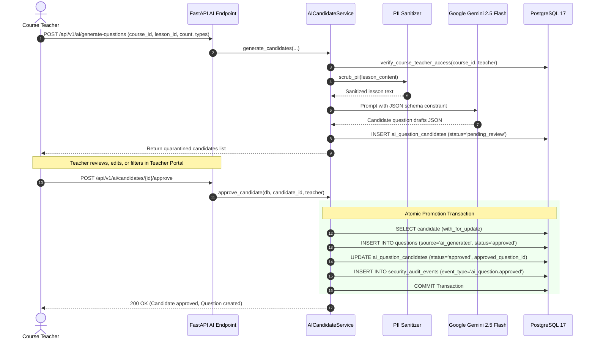

# Learnova System Architecture Specification

This document provides the definitive architectural blueprint for **Learnova**, specifying its topology, component boundaries, concurrency models, transactional guarantees, and communication flows.

---

## 1. High-Level System Architecture: Option B Modular Monolith

Learnova implements an **Option B Modular Monolith** topology. The entire backend application runs as a single, unified FastAPI process hosting both RESTful HTTP handlers and an **in-process Durable Outbox Processor** running inside the FastAPI application `lifespan`.

```mermaid
flowchart TB
    subgraph ClientBrowser ["Browser Client"]
        SP["Student Portal"]
        TP["Teacher Portal"]
        AP["Admin Portal"]
        PP["Public Landing Pages"]
    end

    subgraph FrontendHost ["Frontend Host (Port 3000)"]
        Exp["Express 4.21 Server"]
        Vite["Vite 8.3 Dev Middleware / Static Host"]
        Proxy["Transparent Reverse Proxy (/api/v1/*, /api/ai/*)"]
        Exp --> Vite
        Exp --> Proxy
    end

    subgraph BackendHost ["FastAPI Backend (Port 8000)"]
        Main["FastAPI Application (app/main.py)"]
        Router["APIRouter (app/api/v1/router.py)"]
        
        subgraph Endpoints ["16 Route Endpoints"]
            AuthEP["/auth & /users"]
            CurricEP["/courses, /topics, /lessons"]
            AssessEP["/assessments & /attempts"]
            AiEP["/ai"]
            AdminEP["/admin & /health"]
            GameEP["/gamification & /students"]
        end

        subgraph ServiceLayer ["18 Domain Services (app/services/)"]
            AuthSvc["AuthService"]
            CurricSvc["CourseService & CurriculumService"]
            DagSvc["DAGService (Kahn's / DFS)"]
            GradingSvc["GradingService"]
            AttemptSvc["AttemptService"]
            MasterySvc["MasteryService (BKT Engine)"]
            GameSvc["GamificationService"]
            AiCandSvc["AICandidateService"]
            AuditSvc["AuditService"]
        end

        subgraph Workers ["In-Process Background Workers (app/workers/)"]
            OutboxProc["OutboxProcessor (FastAPI Lifespan)"]
        end

        Main --> Router
        Router --> Endpoints
        Endpoints --> ServiceLayer
        Main -.->|Lifespan Start/Stop| OutboxProc
    end

    subgraph Persistence ["Persistence Layer (PostgreSQL 17 / SQLite)"]
        DB[(16 Normalized Relational Tables)]
        OutboxTable[("domain_outbox_events")]
        Lock[("Advisory Lock: 742918")]
    end

    subgraph ExternalAI ["External AI Services"]
        Gemini["Google Gemini 2.5 Flash API"]
        AGY["Antigravity CLI Subprocess (agy / agentapi)"]
    end

    ClientBrowser -->|HTTP Requests| FrontendHost
    Proxy -->|Forwarded Requests| Main
    ServiceLayer -->|Synchronous SQL & Row Locks| DB
    ServiceLayer -->|Transactional Enqueue| OutboxTable
    OutboxProc -->|Poll & Claim (SKIP LOCKED)| OutboxTable
    OutboxProc -->|Advisory Lock Election| Lock
    OutboxProc -->|Dispatch Events (XP, Badges)| ServiceLayer
    AiCandSvc -->|Sanitized Prompts| ExternalAI
```

---

## 2. Component Boundaries & Responsibilities

### 2.1 Frontend Boundary
- **Client Application:** React 19 single-page application written in TypeScript.
- **Express Server (`frontend/server.ts`):** Acts as the ingress server on port 3000. It serves Vite client assets and transparently proxies `/api/v1/*` requests directly to `http://127.0.0.1:8000`. Legacy routes (`/api/ai/generate-questions` and `/api/ai/simplify-lesson`) are routed to `/api/v1/ai/*` while preserving client authentication cookies and headers.
- **Zero Business Logic Invariant:** The frontend never connects to databases, hashes passwords, or performs authoritative grading.

### 2.2 Backend API Boundary
- **FastAPI Core (`backend/app/main.py`):** ASGI server hosted on Uvicorn. Configures CORS, mounts `api_router`, defines root health checks (`GET /health`, `GET /ready`), and manages application lifespan.
- **Service Layer (`backend/app/services/`):** All business logic is encapsulated in stateless service classes. Routes do not execute business rules directly; they delegate to service methods.
- **Dependency Injection:** Centralized in `app.core.dependencies` (`get_db`, `get_current_user`, `require_role`).

### 2.3 Transactional Persistence Boundary
- **Database Engine:** PostgreSQL 17 in production (Docker) and SQLite with foreign key pragmas in local development and unit tests.
- **Schema Isolation:** 16 domain models mapped with SQLAlchemy 2.0.
- **Transactional Atomicity:** All writes affecting multiple tables (e.g. attempt submission + outbox event enqueue, or candidate promotion + audit log) execute inside single, atomic database transactions.

---

## 3. Core System Workflows

### 3.1 Server-Authoritative Assessment Submission Flow

```mermaid
sequenceDiagram
    autonumber
    actor Student as Student Client
    participant Proxy as Express Proxy (:3000)
    participant FastAPI as FastAPI Attempts Endpoint
    participant AttemptSvc as AttemptService
    participant GradingSvc as GradingService
    participant DB as PostgreSQL 17
    participant OutboxWorker as OutboxProcessor (Lifespan)
    participant GameSvc as GamificationService

    Student->>Proxy: POST /api/v1/attempts/{id}/submit (responses payload)
    Proxy->>FastAPI: Forward request with Bearer JWT
    FastAPI->>AttemptSvc: submit_attempt(db, attempt_id, actor)
    
    rect rgb(240, 248, 255)
        Note over AttemptSvc,DB: Single Atomic Transaction
        AttemptSvc->>DB: Lock Attempt Row (with_for_update)
        AttemptSvc->>GradingSvc: Grade responses against segregated answer_key
        GradingSvc-->>AttemptSvc: Final Score, Percentage, Passed (bool)
        AttemptSvc->>DB: Update attempt (status='completed', score, submitted_at)
        AttemptSvc->>DB: INSERT domain_outbox_events (event_type='assessment.completed')
        AttemptSvc->>DB: COMMIT Transaction
    end

    AttemptSvc-->>FastAPI: AssessmentResultDTO (score, passed)
    FastAPI-->>Student: 200 OK (Score, feedback; NO answer key leaked)

    rect rgb(255, 250, 240)
        Note over OutboxWorker,GameSvc: Asynchronous Event Dispatching
        OutboxWorker->>DB: Claim pending events (FOR UPDATE SKIP LOCKED)
        OutboxWorker->>GameSvc: handle_assessment_completed(event.payload)
        GameSvc->>DB: Award XP (idempotency key check), check streaks & badges
        OutboxWorker->>DB: Mark outbox event status='completed'
    end
```

### 3.2 Teacher-Governed AI Question Generation Flow (SSD-08)



---

## 4. Concurrency & Concurrency Control

1. **Transactional Outbox Worker:**
   - Multi-worker or multi-process deployments are protected by PostgreSQL session advisory locks: `OUTBOX_ADVISORY_LOCK_ID = 742918`. Only the elected leader node processes the outbox queue.
   - Batch claiming employs `SELECT ... FOR UPDATE SKIP LOCKED` to allow worker scaling without row contention.
2. **Atomic Attempt Response Upserts:**
   - As students practice and save intermediate answers (`POST /api/v1/attempts/{id}/responses`), responses are upserted idempotently on `(attempt_id, question_id)`.
3. **DAG Prerequisite Validation:**
   - Adding a curriculum prerequisite performs a cycle check using DFS / Kahn's algorithm before saving. If adding edge $U \to V$ creates a path $V \rightsquigarrow U$, the transaction is aborted with `422 Unprocessable Entity`.
