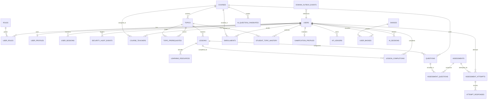

# Learnova Database Schema Specification

This document provides the authoritative reference for the Learnova relational database schema, based on the **16 SQLAlchemy declarative models** and **13 Alembic migration revisions** applied to PostgreSQL 17 and SQLite.

---

## 1. Entity-Relationship Overview

---

## 2. Table Specifications by Domain

### 2.1 Identity, Users & RBAC

#### `users`
Core user identity account entity.
| Column | Type | Nullable | Constraints & Defaults | Notes |
| :--- | :--- | :--- | :--- | :--- |
| `id` | `UUID` | No | Primary Key (`uuid4`) | Surrogate identifier |
| `email` | `VARCHAR(255)` | No | Unique, Indexed | Lowercased normalized email |
| `hashed_password`| `VARCHAR(255)` | No | | Bcrypt password hash |
| `first_name` | `VARCHAR(100)` | No | | Given name |
| `last_name` | `VARCHAR(100)` | No | | Family name |
| `is_active` | `BOOLEAN` | No | Default `TRUE` | Account state flag |
| `is_superuser` | `BOOLEAN` | No | Default `FALSE` | System superadmin flag |
| `created_at` | `TIMESTAMP(TZ)`| No | Default `now(utc)` | UTC timestamp |
| `updated_at` | `TIMESTAMP(TZ)`| No | Default `now(utc)` | Auto-updating timestamp |

#### `roles`
System authorization roles (`admin`, `teacher`, `student`).
| Column | Type | Nullable | Constraints & Defaults |
| :--- | :--- | :--- | :--- |
| `id` | `UUID` | No | Primary Key (`uuid4`) |
| `name` | `VARCHAR(50)` | No | Unique, Indexed |
| `description` | `VARCHAR(255)` | Yes | |

#### `user_roles`
Junction table linking users to active roles.
| Column | Type | Nullable | Constraints & Defaults |
| :--- | :--- | :--- | :--- |
| `user_id` | `UUID` | No | FK `users.id` (ON DELETE CASCADE), PK |
| `role_id` | `UUID` | No | FK `roles.id` (ON DELETE CASCADE), PK |

#### `user_profiles`
Extended profile information and preferences.
| Column | Type | Nullable | Constraints & Defaults |
| :--- | :--- | :--- | :--- |
| `id` | `UUID` | No | Primary Key (`uuid4`) |
| `user_id` | `UUID` | No | Unique FK `users.id` (ON DELETE CASCADE) |
| `avatar_url` | `VARCHAR(512)` | Yes | |
| `bio` | `TEXT` | Yes | |
| `timezone` | `VARCHAR(64)` | No | Default `'UTC'` |

#### `user_sessions`
Active and revocable JWT session tracking.
| Column | Type | Nullable | Constraints & Defaults |
| :--- | :--- | :--- | :--- |
| `id` | `UUID` | No | Primary Key (`uuid4`) |
| `user_id` | `UUID` | No | FK `users.id` (ON DELETE CASCADE), Indexed |
| `refresh_token_hash`| `VARCHAR(255)`| No | Unique, Indexed |
| `is_revoked` | `BOOLEAN` | No | Default `FALSE` |
| `expires_at` | `TIMESTAMP(TZ)`| No | Indexed |
| `created_at` | `TIMESTAMP(TZ)`| No | Default `now(utc)` |

#### `security_audit_events`
Immutable security and governance event ledger.
| Column | Type | Nullable | Constraints & Defaults |
| :--- | :--- | :--- | :--- |
| `id` | `UUID` | No | Primary Key (`uuid4`) |
| `actor_id` | `UUID` | Yes | FK `users.id` (ON DELETE SET NULL) |
| `event_type` | `VARCHAR(64)` | No | Indexed (e.g. `login`, `ai_question.approved`) |
| `resource_type`| `VARCHAR(64)` | Yes | Target entity type |
| `resource_id` | `VARCHAR(128)`| Yes | Target entity identifier |
| `ip_address` | `VARCHAR(45)` | Yes | Client IP |
| `metadata` | `JSON/JSONB` | Yes | Event payload details |
| `created_at` | `TIMESTAMP(TZ)`| No | Default `now(utc)`, Indexed |

---

### 2.2 Curriculum & Learning Hierarchy

#### `courses`
Curriculum course container.
| Column | Type | Nullable | Constraints & Defaults |
| :--- | :--- | :--- | :--- |
| `id` | `UUID` | No | Primary Key (`uuid4`) |
| `title` | `VARCHAR(255)` | No | Indexed |
| `code` | `VARCHAR(32)` | No | Unique, Indexed (e.g. `CS-101`) |
| `description` | `TEXT` | Yes | |
| `is_published` | `BOOLEAN` | No | Default `FALSE` |
| `created_at` | `TIMESTAMP(TZ)`| No | Default `now(utc)` |

#### `course_teachers`
Junction table scoping teachers to specific courses (DEC-P2-002, DEC-P10-001).
| Column | Type | Nullable | Constraints & Defaults |
| :--- | :--- | :--- | :--- |
| `course_id` | `UUID` | No | FK `courses.id` (ON DELETE CASCADE), PK |
| `teacher_id` | `UUID` | No | FK `users.id` (ON DELETE CASCADE), PK |

#### `topics`
Curriculum modules within a course.
| Column | Type | Nullable | Constraints & Defaults |
| :--- | :--- | :--- | :--- |
| `id` | `UUID` | No | Primary Key (`uuid4`) |
| `course_id` | `UUID` | No | FK `courses.id` (ON DELETE CASCADE), Indexed |
| `title` | `VARCHAR(255)` | No | |
| `order_index` | `INTEGER` | No | Default `0` |
| `description` | `TEXT` | Yes | |

#### `topic_prerequisites`
Acyclic DAG prerequisite dependencies between topics.
| Column | Type | Nullable | Constraints & Defaults |
| :--- | :--- | :--- | :--- |
| `topic_id` | `UUID` | No | FK `topics.id` (ON DELETE CASCADE), PK |
| `prerequisite_topic_id`| `UUID` | No | FK `topics.id` (ON DELETE CASCADE), PK |

#### `lessons`
Individual study units within a topic.
| Column | Type | Nullable | Constraints & Defaults |
| :--- | :--- | :--- | :--- |
| `id` | `UUID` | No | Primary Key (`uuid4`) |
| `topic_id` | `UUID` | No | FK `topics.id` (ON DELETE CASCADE), Indexed |
| `title` | `VARCHAR(255)` | No | |
| `content` | `TEXT` | Yes | Markdown lesson text |
| `order_index` | `INTEGER` | No | Default `0` |

#### `learning_resources`
Attachments and supplementary study items within a lesson.
| Column | Type | Nullable | Constraints & Defaults |
| :--- | :--- | :--- | :--- |
| `id` | `UUID` | No | Primary Key (`uuid4`) |
| `lesson_id` | `UUID` | No | FK `lessons.id` (ON DELETE CASCADE), Indexed |
| `title` | `VARCHAR(255)` | No | |
| `resource_type`| `VARCHAR(32)` | No | Check constraint: `pdf`, `video`, `link`, `doc` |
| `url` | `VARCHAR(1024)`| Yes | Resource link or file path |

---

### 2.3 Question Bank, Assessments & Attempts

#### `questions`
Official Question Bank items. Segregates deliverable `payload` from grading `answer_key`.
| Column | Type | Nullable | Constraints & Defaults |
| :--- | :--- | :--- | :--- |
| `id` | `UUID` | No | Primary Key (`uuid4`) |
| `course_id` | `UUID` | No | FK `courses.id` (ON DELETE CASCADE), Indexed |
| `topic_id` | `UUID` | Yes | FK `topics.id` (ON DELETE SET NULL), Indexed |
| `lesson_id` | `UUID` | Yes | FK `lessons.id` (ON DELETE SET NULL), Indexed |
| `type` | `VARCHAR(32)` | No | Check: `multiple_choice`, `true_false`, `fill_blank`, `matching`, `short_answer` |
| `difficulty` | `VARCHAR(16)` | No | Check: `easy`, `medium`, `hard` |
| `points` | `INTEGER` | No | Default `1`, Check `points > 0` |
| `source` | `VARCHAR(32)` | No | Check: `manual`, `ai_generated`, `imported` |
| `status` | `VARCHAR(32)` | No | Check: `draft`, `approved`, `archived` |
| `payload` | `JSON/JSONB` | No | Public deliverable (prompt, options; NO answers) |
| `answer_key` | `JSON/JSONB` | No | Segregated grading answers (server-authoritative) |
| `explanation` | `TEXT` | Yes | Pedagogical rationale revealed after grading |

#### `assessments`
Assessment composition and configuration.
| Column | Type | Nullable | Constraints & Defaults |
| :--- | :--- | :--- | :--- |
| `id` | `UUID` | No | Primary Key (`uuid4`) |
| `course_id` | `UUID` | No | FK `courses.id` (ON DELETE CASCADE), Indexed |
| `title` | `VARCHAR(255)` | No | |
| `type` | `VARCHAR(32)` | No | Check: `quiz`, `exam`, `practice` |
| `time_limit_minutes`| `INTEGER` | Yes | Nullable for untimed |
| `passing_score` | `DECIMAL(5,2)` | No | Default `70.00` |
| `is_published` | `BOOLEAN` | No | Default `FALSE` |

#### `assessment_questions`
Question composition within an assessment.
| Column | Type | Nullable | Constraints & Defaults |
| :--- | :--- | :--- | :--- |
| `assessment_id` | `UUID` | No | FK `assessments.id` (ON DELETE CASCADE), PK |
| `question_id` | `UUID` | No | FK `questions.id` (ON DELETE RESTRICT), PK |
| `order_index` | `INTEGER` | No | Default `0` |
| `points_override`| `INTEGER` | Yes | Optional score override |

#### `assessment_attempts`
Student assessment sessions.
| Column | Type | Nullable | Constraints & Defaults |
| :--- | :--- | :--- | :--- |
| `id` | `UUID` | No | Primary Key (`uuid4`) |
| `assessment_id` | `UUID` | No | FK `assessments.id` (ON DELETE CASCADE), Indexed |
| `student_id` | `UUID` | No | FK `users.id` (ON DELETE CASCADE), Indexed |
| `status` | `VARCHAR(32)` | No | Check: `in_progress`, `submitted`, `abandoned`, `expired` |
| `score` | `DECIMAL(5,2)` | Yes | Calculated grade |
| `passed` | `BOOLEAN` | Yes | |
| `started_at` | `TIMESTAMP(TZ)`| No | Default `now(utc)` |
| `submitted_at` | `TIMESTAMP(TZ)`| Yes | |
| `expires_at` | `TIMESTAMP(TZ)`| Yes | Deadline for timed attempts |

#### `attempt_responses`
Recorded student answers for an attempt.
| Column | Type | Nullable | Constraints & Defaults |
| :--- | :--- | :--- | :--- |
| `id` | `UUID` | No | Primary Key (`uuid4`) |
| `attempt_id` | `UUID` | No | FK `assessment_attempts.id` (ON DELETE CASCADE), Indexed |
| `question_id` | `UUID` | No | FK `questions.id` (ON DELETE RESTRICT), Indexed |
| `response_data`| `JSON/JSONB` | No | Submitted student answer |
| `is_correct` | `BOOLEAN` | Yes | Computed server-side by GradingService |
| `points_awarded`| `DECIMAL(5,2)`| Yes | |

---

### 2.4 Mastery & Gamification

#### `student_topic_mastery`
Persistent Bayesian Knowledge Tracing estimates.
| Column | Type | Nullable | Constraints & Defaults |
| :--- | :--- | :--- | :--- |
| `id` | `UUID` | No | Primary Key (`uuid4`) |
| `student_id` | `UUID` | No | FK `users.id` (ON DELETE CASCADE), Indexed |
| `topic_id` | `UUID` | No | FK `topics.id` (ON DELETE CASCADE), Indexed |
| `mastery_score`| `DECIMAL(5,4)` | No | Normalized `0.0000` to `1.0000` float |
| `status` | `VARCHAR(32)` | No | Check: `novice`, `developing`, `proficient`, `mastered` |
| `practice_count`| `INTEGER` | No | Default `0` |
| `last_practiced_at`| `TIMESTAMP(TZ)`| Yes | |

#### `xp_ledger`
Append-only transactional XP credit ledger.
| Column | Type | Nullable | Constraints & Defaults |
| :--- | :--- | :--- | :--- |
| `id` | `UUID` | No | Primary Key (`uuid4`) |
| `user_id` | `UUID` | No | FK `users.id` (ON DELETE CASCADE), Indexed |
| `amount` | `INTEGER` | No | Check `amount > 0` |
| `source` | `VARCHAR(64)` | No | (e.g. `assessment.completed`, `daily_streak`) |
| `idempotency_key`| `VARCHAR(128)`| No | Unique, Indexed |
| `created_at` | `TIMESTAMP(TZ)`| No | Default `now(utc)` |

#### `gamification_profiles`
Consolidated gamification state.
| Column | Type | Nullable | Constraints & Defaults |
| :--- | :--- | :--- | :--- |
| `id` | `UUID` | No | Primary Key (`uuid4`) |
| `user_id` | `UUID` | No | Unique FK `users.id` (ON DELETE CASCADE) |
| `total_xp` | `INTEGER` | No | Default `0` |
| `current_level`| `INTEGER` | No | Default `1` |
| `current_streak`| `INTEGER` | No | Default `0` |
| `longest_streak`| `INTEGER` | No | Default `0` |
| `is_leaderboard_anonymous`| `BOOLEAN`| No | Default `FALSE` |

---

### 2.5 Outbox & AI Governance

#### `domain_outbox_events`
Transactional outbox event queue for asynchronous dispatch.
| Column | Type | Nullable | Constraints & Defaults |
| :--- | :--- | :--- | :--- |
| `id` | `UUID` | No | Primary Key (`uuid4`) |
| `event_type` | `VARCHAR(64)` | No | Indexed (e.g. `assessment.completed`) |
| `payload` | `JSON/JSONB` | No | Serialized event payload |
| `status` | `VARCHAR(32)` | No | Default `'pending'`, Check: `pending`, `processing`, `completed`, `dead_letter` |
| `retry_count` | `INTEGER` | No | Default `0` |
| `max_retries` | `INTEGER` | No | Default `5` |
| `error_log` | `TEXT` | Yes | Last exception message |
| `created_at` | `TIMESTAMP(TZ)`| No | Default `now(utc)`, Indexed |
| `processed_at`| `TIMESTAMP(TZ)`| Yes | |

#### `ai_question_candidates`
Quarantined AI-generated questions awaiting teacher review (SSD-08).
| Column | Type | Nullable | Constraints & Defaults |
| :--- | :--- | :--- | :--- |
| `id` | `UUID` | No | Primary Key (`uuid4`) |
| `course_id` | `UUID` | No | FK `courses.id` (ON DELETE CASCADE), Indexed |
| `topic_id` | `UUID` | Yes | FK `topics.id` (ON DELETE CASCADE) |
| `lesson_id` | `UUID` | Yes | FK `lessons.id` (ON DELETE CASCADE), Indexed |
| `status` | `VARCHAR(32)` | No | Check: `pending_review`, `approved`, `rejected` |
| `type` | `VARCHAR(32)` | No | Check: `multiple_choice`, `true_false`, `fill_blank`, `matching`, `short_answer` |
| `difficulty` | `VARCHAR(16)` | No | Check: `easy`, `medium`, `hard` |
| `points` | `INTEGER` | No | Default `1`, Check `points > 0` |
| `payload` | `JSON/JSONB` | No | Deliverable question payload |
| `answer_key` | `JSON/JSONB` | No | Candidate solution key |
| `explanation` | `TEXT` | Yes | Rationale |
| `approved_question_id`| `UUID` | Yes | FK `questions.id` (linked upon approval) |
| `created_at` | `TIMESTAMP(TZ)`| No | Default `now(utc)` |

#### `ai_content_cache`
Cryptographic SHA-256 fingerprint cache for generated lesson simplifications.
| Column | Type | Nullable | Constraints & Defaults |
| :--- | :--- | :--- | :--- |
| `id` | `UUID` | No | Primary Key (`uuid4`) |
| `cache_key` | `VARCHAR(128)`| No | Unique, Indexed (SHA-256 fingerprint) |
| `content_hash` | `VARCHAR(64)` | No | Indexed |
| `response_content`| `TEXT` | No | Cached explanation text |
| `model_name` | `VARCHAR(64)` | No | Default `'gemini-2.5-flash'` |
| `created_at` | `TIMESTAMP(TZ)`| No | Default `now(utc)` |
| `expires_at` | `TIMESTAMP(TZ)`| Yes | Optional expiration timestamp |
