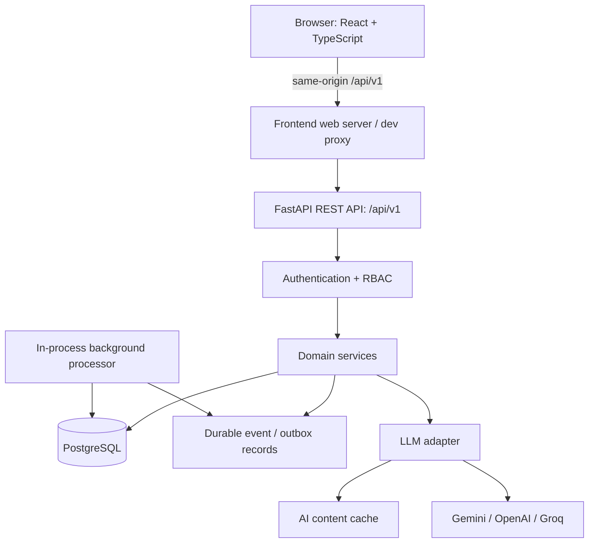

# LEARNOVA
# Master Backend Implementation & Frontend Integration Blueprint

**Document type:** Consolidated engineering blueprint and implementation control document  
**Status:** Recommended baseline — review and approve unresolved decisions before implementation  
**Project:** Learnova — An Adaptive and Gamified Learning Platform  
**Primary implementation approach:** Contract-first, modular monolith, incremental vertical slices, test-driven integration

---

## 1. Purpose and authority of this document

This document consolidates and corrects the Antigravity repository audit against the project materials supplied for Learnova:

1. `Learnova_SRS_Final_Aligned_V2.docx`
2. `Learnova_Final_SSDs_V2.xml`
3. `Readme.md` (architecture and diagram documentation)
4. `Implementation-Plan.txt`
5. The current `Learnova-main.zip` repository
6. The Antigravity audit report supplied for review

Use this document as the **working engineering blueprint** for backend implementation and frontend integration. It is not a replacement for the SRS or SSDs. If a proposed implementation detail conflicts with a source requirement, stop and resolve the conflict rather than silently changing the requirement.

### 1.1 Evidence labels used in this document

- **[VERIFIED CURRENT]** — observed in the supplied repository or Antigravity's recorded inspection. Re-check the exact current branch before modifying a file.
- **[SOURCE REQUIREMENT]** — explicitly described in the SRS, SSDs, or architecture README.
- **[RECOMMENDATION]** — engineering approach recommended to implement the requirements safely.
- **[DECISION REQUIRED]** — a business or technical ambiguity that must be approved before the relevant feature is implemented.
- **[NOT IMPLEMENTED]** — a target capability that must not be represented as already working.

The Antigravity report is useful evidence of its inspection, but it is not itself an authoritative requirements document. All target behavior must be traced to the Learnova sources or approved decisions.

---

# 2. Executive assessment

## 2.1 Current implementation

| Area | Current observed state | Engineering assessment |
|---|---|---|
| Frontend | React 19, TypeScript, Vite 8, Tailwind CSS 4 | Substantial existing UI; preserve it |
| Portals | Student, teacher, administrator | Existing screens and interactions must be regression-tested |
| Frontend server | Express 4 with Vite middleware | Currently serves the frontend and owns two AI routes |
| Backend | FastAPI scaffold | Only a basic health endpoint; not a functioning business API yet |
| Database | PostgreSQL 17 in Docker Compose | Service and persistent volume configured; application schema/migrations not established |
| Frontend persistence | `storageService.ts`, seeded data, browser localStorage | Mock/local persistence is the main migration boundary |
| AI | Gemini integration in Express | Move backend-owned AI behavior to FastAPI in a controlled migration |
| Existing logic | DAG, assessment, student-learning, and admin utility modules | Reuse and test behavior before porting authoritative rules |
| Tests | Existing Node-based frontend logic tests | Preserve as regression tests; establish verified baseline output |
| Deployment | Docker Compose with frontend, backend, database | Existing topology is a useful starting point, not production-hardened |

**Important:** The frontend is not currently connected to a complete FastAPI/PostgreSQL application. The existence of Docker services and a health endpoint must not be described as a completed backend.

## 2.2 Main recommendation

Build Learnova as a **modular monolith**:

- React remains the presentation layer.
- FastAPI owns backend APIs, authorization, domain workflows, and integrations.
- PostgreSQL is the authoritative persistent store.
- SQLAlchemy and Alembic manage persistence and schema evolution.
- Background processing is initially implemented within the same application deployment using durable database-backed events/outbox records.
- External LLM providers are accessed through an adapter interface.
- Existing frontend screens are migrated feature by feature, not rewritten.

Do not introduce microservices, Kafka, or Redis as mandatory first-phase infrastructure. Add infrastructure only when a measured requirement justifies it.

---

# 3. Source requirements and architecture invariants

The following rules are foundational. Antigravity must preserve them in every implementation phase.

## 3.1 Three-layer separation

**[SOURCE REQUIREMENT]** The architecture README describes three logical layers:

1. **Presentation:** Web and portal interfaces, rendering, navigation, and client interaction.
2. **Domain:** Curriculum, adaptive engine, prerequisites, assessment, users, gamification, and analytics.
3. **Technical Services:** Persistence, security, LLM integration, and logging.

Domain logic must not depend on React components, browser widgets, or UI-specific objects. API routers should translate HTTP requests into domain-service calls; they should not become the location for complex business rules.

## 3.2 Assessment and mastery rule

**[SOURCE REQUIREMENT]** The architecture README states that mastery recalculation occurs only after a complete assessment is submitted. Individual interim question responses may be recorded, but must not independently update the persisted topic mastery estimate.

The SSDs refine this behavior:

- SSD-04: while an assessment is active, record each response; after complete submission, evaluate and recalibrate mastery, then regenerate the learning path.
- SSD-06: final examination submission triggers evaluation, final mastery update, readiness evaluation, and course-completion determination.
- SSD-02: prerequisite diagnostics determine readiness.
- The SRS describes adaptive practice as adjusting subsequent question difficulty based on sequential responses.

**Required distinction:**

- The adaptive question selector may use the current practice session's recent answers to choose the next question difficulty.
- The authoritative, persisted topic mastery calculation must occur only at the completion boundary defined for the assessment/session.
- An aborted or invalid assessment must not update mastery.
- Interim responses and response times can be recorded for activity history and audit/analytics.

Do not confuse *difficulty adaptation during an active session* with *persisted mastery recalculation*.

## 3.3 Asynchronous gamification

**[SOURCE REQUIREMENT]** XP, levels, streaks, badges, and challenges are decoupled from academic evaluation and triggered by qualifying learning events. The SRS identifies lesson completion, resource reviews, and quiz passes as examples. The README and SSDs also identify lesson/exam completion events.

The assessment grader must not directly calculate or award XP. It should record a qualifying event or outbox entry; a separate handler processes it idempotently.

A duplicate event must not award duplicate XP.

## 3.4 AI governance and adapter

**[SOURCE REQUIREMENT]**

- External LLMs such as Gemini, OpenAI, or Groq are accessed behind an adapter interface (`ILLMServiceAdapter` in the architecture README).
- AI explanations and generated material should be cached.
- AI-generated questions must remain distinguishable from official curriculum questions.
- Teacher review must support approval, editing, and rejection before generated questions are published or added to the official question bank.
- If the external provider is unavailable, use verified cached content or a controlled fallback; do not pretend an unavailable AI response was generated successfully.

Never expose an LLM API key in browser code or client-side requests.

## 3.5 Role and data boundaries

**[SOURCE REQUIREMENT]** Learnova has student, teacher, and administrator actors. Teacher access is restricted to assigned courses. Analytics must enforce role-appropriate visibility. Administrative actions and security-critical operations must be audited.

Enforce authorization in FastAPI services/routes and data queries, not only through frontend route guards.

## 3.6 Performance and reliability requirements

The SRS specifies:

- Standard web pages should load within 2 seconds.
- Adaptive recommendation API requests should return within 1,000 ms.
- Graceful degradation when external LLM APIs are unavailable, including cached explanations and local question banks.
- Secure password hashing using bcrypt.
- JWT authentication and HTTPS transport.
- Strict RBAC.

These are acceptance targets to measure under a documented test setup. They are not claims that the current application already meets them.

---

# 4. SSD workflow traceability

The eight supplied SSDs must be treated as workflow references, not decorative diagrams.

| SSD | Workflow | Required backend behavior | Important acceptance condition |
|---|---|---|---|
| SSD-01 | Course enrollment and curriculum loading | Browse published courses, retrieve details, enroll, load course hierarchy | Enrollment persists and remains after refresh/re-login |
| SSD-02 | Topic selection and prerequisite diagnostic | Inspect prerequisite graph, provide diagnostic where required, evaluate readiness | A topic is not marked ready when required prerequisites are unmet |
| SSD-03 | Personalized path and resource study | Generate ordered path, serve resource, record study/completion activity | Path is based on current validated learning state; resource event is recorded |
| SSD-04 | Adaptive practice and mastery recalibration | Start attempt, record interim responses, adapt next item, submit complete attempt, recalculate mastery, regenerate path | Interim answers do not update persisted mastery |
| SSD-05 | AI learning support | Request contextual explanation or supplementary practice through LLM adapter | Provider failure uses cached/controlled fallback; API key remains server-side |
| SSD-06 | Final examination and course completion | Start timed exam, record responses, submit or auto-submit at expiry, evaluate and determine readiness/completion | Server validates attempt and timing; final evaluation is authoritative |
| SSD-07 | Teacher course/content management | Create course/topic/lesson, define prerequisites, add resources, publish | Only authorized teacher can manage assigned course |
| SSD-08 | Teacher assessment and AI question management | Generate candidate questions, edit/approve/reject, create/configure/publish assessment | Generated questions cannot bypass teacher review |

## 4.1 Important SSD/SRS interpretation

The SRS says adaptive practice can adjust difficulty from sequential responses. The architecture README and SSD-04 specify that persisted mastery recalculation occurs after complete assessment submission. Implement both by maintaining **session-local adaptation state** during the attempt and performing **authoritative mastery recalculation** at final submission.

If the team later decides that a particular diagnostic or practice mode has a different completion boundary, document that mode explicitly and obtain approval. Do not silently apply per-question mastery updates.

---

# 5. Corrected findings in the Antigravity audit

The audit is useful, but the following changes are required before it becomes an implementation specification.

## 5.1 Screen count and inventory

The report identifies 38 interfaces across the portals. Its target architecture diagram later says 18 student + 11 teacher + 8 administrator views, which totals 37. The inventory table includes an additional administrator access-denied page.

**Correction:** Describe the report's inventory as 38 listed user-facing screens/components, subject to verification against actual route rendering. Do not hard-code portal counts in architecture diagrams until a route-by-route inventory is confirmed.

## 5.2 Current AI API ownership

**[VERIFIED CURRENT]** The Express server currently owns:

- `POST /api/ai/generate-questions`
- `POST /api/ai/simplify-lesson`

**Correction:** These are existing routes, not the target API contract. FastAPI should become the sole owner of backend business and AI APIs. During migration, keep the existing routes operational until the new FastAPI routes are tested and the frontend is switched. Then remove or proxy the old handlers deliberately. Do not leave two independent implementations active.

## 5.3 Proxy routing

The audit recommends Vite proxying in development and Express reverse proxying in production. That is reasonable only if the runtime modes are clearly separated.

**Correction:**

- Browser code should use a same-origin relative API base such as `/api/v1`.
- In development, the active frontend development server/proxy forwards `/api` to FastAPI.
- If Express is the production web server, Express must forward `/api` to FastAPI in that deployment.
- Do not add multiple competing proxy layers without documenting which one is active.
- Never use the Docker hostname `backend` in browser-side code; it is only resolvable inside the Docker network.
- Configure local and container targets through environment variables.
- Preserve existing Vite/HMR behavior unless a tested change is necessary.

The exact proxy implementation must be checked against the actual `frontend/server.ts`, `vite.config.ts`, and Docker Compose runtime before editing.

## 5.4 Database schema is a domain model, not a fixed table-count target

The audit lists 22 tables and proposes creating all of them in the first migration. This is premature.

**Correction:** First create an approved entity/relationship model mapped to the SRS and D1–D8 logical stores. Then implement the schema in small migrations by domain. The number of physical tables is an implementation decision; it is not a requirement that exactly 22 tables exist.

The proposed 22-table model omits or under-specifies several documented needs, including:

- Assessment response/activity history suitable for per-question timing and analytics.
- Assessment session lifecycle and server-side timing.
- Persisted personalized learning paths/recommendations, if required for history or reproducibility.
- AI explanation/practice cache.
- Resource interaction/study-duration records.
- Time-bound challenges and challenge progress.
- Durable event/outbox processing and idempotency.
- User sessions/token revocation if logout/session termination must be enforced.
- Course ownership/teacher assignment if a course can have multiple authorized teachers.
- File metadata/storage references if uploaded documents are supported.

Some of these may be modeled as columns or JSON structures rather than separate tables, but the requirement must be covered explicitly.

## 5.5 Mastery scale and algorithm

The Antigravity report proposes `mastery_threshold INT DEFAULT 75` and `score_percent INT`. The architecture README describes mastery as an interval `[0.0, 1.0]` and notes 0.70 / 70% as a typical threshold. The README also identifies the exact adaptation algorithm as an ambiguity: BKT, Elo, or weighted recent performance.

**Correction:**

- Do not hard-code 75 or 0.70 as a universal business rule.
- Preserve topic-specific configurable thresholds.
- Decide and document one internal scale before implementation. Recommended: normalized decimal `0.0–1.0` internally, with percentage conversion at API/UI boundaries.
- Validate the existing frontend's `Topic.masteryThreshold` representation and migration behavior.
- Select the mastery algorithm only after academic approval. Keep the policy replaceable behind an interface such as `IAdaptivePolicy` / `MasteryPolicy`.
- Record the algorithm name/version and relevant inputs with a mastery update where reproducibility is important.

**[DECISION REQUIRED]** Confirm the actual threshold and algorithm with the project supervisor/team. A 70% default may be a starting proposal, not an approved universal value.

## 5.6 Assessment data and grading

The proposed `assessment_attempts` table stores `responses JSONB` and a non-null score, but this is not enough to describe all attempt states safely.

**Correction:** An in-progress attempt must be representable before a score exists. The schema/API must support start time, completion time, status, server-side deadline, attempt number, and validated submission. Preserve individual response timestamps/durations where required by the SRS. Decide whether responses are normalized rows, JSON snapshots, or a hybrid based on analytics and audit needs.

Never trust a score, mastery value, correct-answer flag, or XP amount supplied by the browser. The backend grades using the server-side question/answer configuration.

## 5.7 Gamification events

The audit proposes asynchronous processing, which is correct, but its proposed schema does not define a durable event/outbox or unique idempotency key.

**Correction:** Persist the qualifying domain event/outbox record in the same database transaction as the business action where possible. Process it separately. Add a unique event key or equivalent constraint so retries cannot award XP twice. Keep gamification writes separate from academic scoring.

## 5.8 Audit log terminology

The proposed schema calls audit logs “tamper-evident,” but an ordinary append-only table is not automatically tamper-evident.

**Correction:** Initially implement append-only application behavior, restricted database permissions, actor/action/target/outcome/correlation metadata, and secure operational access. Only claim cryptographic tamper evidence if a hash-chain/signature mechanism and its verification procedure are actually implemented and tested.

## 5.9 Authentication and default accounts

The audit suggests seeding named administrator, teacher, and student accounts. Do not ship hard-coded credentials or passwords.

**Correction:**

- Use a controlled development-only seed process for test/demo users.
- Use an explicit one-time bootstrap command or deployment procedure to create the first administrator.
- Read initial secrets from environment/secret management; never commit real secrets.
- Hash passwords using the SRS-approved bcrypt requirement.
- Define logout/session revocation behavior. A purely stateless access JWT cannot be individually revoked unless a session/revocation strategy exists.
- Prefer short-lived access tokens and a carefully secured refresh/session mechanism. The exact browser storage strategy must be threat-reviewed; do not casually put long-lived credentials in localStorage.
- Never log passwords, raw tokens, API keys, or sensitive answer keys.

## 5.10 Dependencies and migrations

The Antigravity report proposes a specific package list and exact version floors. Those should not be copied blindly.

**Correction:**

- Select compatible, maintained dependencies when the backend foundation task begins.
- Use one database driver strategy consistently. A synchronous SQLAlchemy session with a synchronous PostgreSQL driver is a simple initial choice for this project; an async stack is also possible but must be chosen deliberately.
- Avoid adding both async and sync drivers without a reason.
- Use a dependency lock/controlled version strategy.
- Run migration upgrade/downgrade tests only against a disposable test database. Never run `alembic downgrade base` against a shared or persistent project database as a routine test.
- Do not generate every domain table in the first migration before the domain model is reviewed.

## 5.11 Testing claims

The report mentions 29 frontend tests and a runtime measurement. Treat exact test counts and timings as baseline facts only after the current branch is rerun and output is recorded.

**Correction:** Before implementation, record actual command output for lint, tests, and build. After every milestone, compare against that baseline. A successful TypeScript build alone does not prove end-to-end behavior.

## 5.12 First task safety claim

The audit states that adding backend dependencies and migration scaffolding guarantees 100% backward compatibility and zero downtime.

**Correction:** That guarantee is not supportable. The first task can be designed to avoid frontend changes and minimize regression risk, but Docker builds, dependency resolution, configuration, and database connectivity can still fail. Require tests and a rollback point; do not promise zero downtime or zero bugs.

---

# 6. Target architecture



## 6.1 Ownership boundaries

| Concern | Owner |
|---|---|
| UI rendering, navigation, transient UI state | React frontend |
| Browser-to-server communication | Central frontend API client |
| HTTP validation, response serialization, API versioning | FastAPI routers + Pydantic schemas |
| Business rules | Domain services |
| Identity, password verification, JWT/session policy, RBAC | Backend security services |
| Authoritative application persistence | PostgreSQL |
| Schema evolution | Alembic |
| AI provider selection and fallback | LLM adapter/service |
| Durable asynchronous reward processing | Outbox/event handler |
| Audit of security-critical operations | Backend audit service |

Express must not become a second business API. Its role is limited to frontend serving and the explicitly configured reverse proxy where needed.

## 6.2 Recommended backend structure

Start with a small structure and grow it as modules are implemented:

```text
backend/
├── app/
│   ├── main.py
│   ├── core/
│   │   ├── config.py
│   │   ├── security.py
│   │   ├── logging.py
│   │   └── exceptions.py
│   ├── db/
│   │   ├── session.py
│   │   └── base.py
│   ├── models/
│   ├── schemas/
│   ├── api/
│   │   ├── deps.py
│   │   └── v1/
│   │       ├── router.py
│   │       ├── auth.py
│   │       ├── users.py
│   │       ├── courses.py
│   │       ├── curriculum.py
│   │       ├── lessons.py
│   │       ├── questions.py
│   │       ├── assessments.py
│   │       ├── learning.py
│   │       ├── adaptive.py
│   │       ├── ai.py
│   │       ├── gamification.py
│   │       ├── analytics.py
│   │       └── admin.py
│   ├── services/
│   └── tests/
│       ├── unit/
│       ├── api/
│       └── integration/
├── alembic/
│   └── versions/
├── alembic.ini
├── requirements.txt
└── Dockerfile
```

Do not create empty abstractions or speculative modules just to match this tree. Add files when a real feature requires them.

---

# 7. Database design approach

## 7.1 Map to the source logical data stores

The architecture README documents eight logical data stores. The physical relational schema should cover them.

| Logical store | Documented purpose | Candidate domain entities |
|---|---|---|
| D1 — User Accounts & Roles | Credentials, profiles, roles, sessions | users, roles/user_roles, preferences, sessions/revocations |
| D2 — Courses, Curriculum & Resources | Courses, topics, prerequisite DAG, lessons, media | courses, teacher/course assignments, enrollments, topics, prerequisites, lessons, resources |
| D3 — Question Bank & Assessments | Questions, answer keys, difficulty, assessment configurations | questions, options, matching pairs, assessments, assessment-question mapping |
| D4 — Enrollments & Learning Activity | Enrollment, completions, question logs, attempts, durations | enrollments, lesson/resource activity, assessment attempts, responses |
| D5 — Topic Mastery & Learning Paths | Mastery states and personalized paths | topic mastery, learning path snapshots/items, recommendations |
| D6 — AI Content Cache | Cached AI-generated educational material | AI cache entries, provider metadata, content type, topic/difficulty tags |
| D7 — Gamification | XP, levels, streaks, badges, challenges | XP ledger, profiles, badges, user badges, challenges, challenge progress, outbox events |
| D8 — Analytics & Audit | Reports, security events, operational/audit data | audit events, analytics views/aggregates, correlation metadata |

The table names are candidates, not a mandatory exact physical schema.

## 7.2 Modeling requirements

Before creating migrations, define:

- Entity ownership and cardinality.
- Primary keys and foreign keys.
- Unique constraints and check constraints.
- Indexes for common filters and joins.
- Delete/archive behavior.
- Required audit/history retention.
- Which fields are immutable after publication/submission.
- Which data is derived and can be recalculated.
- Which data must be stored as a historical snapshot.

### Important entity design points

**Users and roles**
- Support the SRS actors consistently: `student`, `teacher`, `administrator`.
- Decide whether each user has exactly one role or can have multiple roles. The audit's single `role` column assumes one role; the architecture store mentions assigned roles. Confirm before schema creation.
- Model teacher-to-course authorization explicitly if teachers can only access assigned courses.
- Do not rely on frontend role flags.

**Curriculum**
- Courses contain topics; topics contain lessons; lessons contain resources and associated assessments/practice.
- Store prerequisite edges in a junction table with self-reference prevention and DAG cycle validation in the domain service.
- Add uniqueness/order constraints where needed.
- Decide whether a lesson needs both `topic_id` and `course_id`; avoid redundant foreign keys unless integrity is enforced.

**Questions**
- Support all five SRS question formats: MCQ, True/False, Fill in the Blank, Matching, Short Answer.
- Validate type-specific payloads through discriminated Pydantic schemas.
- Keep correct answers and grading configuration server-side.
- Record source/provenance and publication/review status for AI-generated candidates.
- Define short-answer grading policy; do not assume an LLM automatically grades it.

**Assessments and attempts**
- Model draft/published/scheduled/active/closed states as required by the UI and SRS.
- Model attempt status: at minimum in-progress, submitted/completed, expired, and invalid/abandoned if applicable.
- Allow score and completion timestamps to be absent while an attempt is in progress.
- Store server-side start time, deadline, attempt number, and completion time.
- Capture individual responses and response timing needed for analytics.
- Define how questions are snapshotted or versioned so a teacher editing a question later does not silently change an already-started attempt.
- Enforce max attempts and duplicate-submit protection in the backend.

**Mastery and learning paths**
- Persist mastery by student and topic.
- Persist enough metadata to explain when/how mastery was last updated.
- Store path snapshots only if history, reproducibility, or audit requires them; otherwise derive the current path from current mastery and curriculum.
- Never label an unassessed topic as zero mastery unless the approved algorithm explicitly says so. The SRS says unattempted topics should be labeled unassessed.

**AI cache**
- Cache by a stable, privacy-safe key that includes relevant topic/context/provider/model/prompt version where appropriate.
- Store generated content type, topic/difficulty tags, creation/expiry metadata, and provenance.
- Do not store unnecessary personal information or secrets in prompts/cache.
- Clearly label AI content as AI-generated and not official curriculum.

**Gamification**
- XP ledger entries should be immutable business records.
- Add a uniqueness/idempotency constraint for the source event.
- Model challenge definitions and per-user progress if time-bound challenges are implemented.
- Define timezone and streak-day boundaries before implementing streak logic.

**Audit**
- Record actor, action, target, outcome, timestamp, correlation ID, and safe metadata.
- Restrict update/delete privileges on audit records.
- Do not store raw credentials, tokens, or sensitive answer keys in audit payloads.

## 7.3 Mastery representation and algorithm decision

**Recommendation:** Use normalized internal values from `0.0` to `1.0`, and convert to percentages at the API/UI boundary. This avoids mixing 0–1 and 0–100 representations across backend modules.

However, the sources do not approve one universal mastery formula. The README explicitly identifies BKT, Elo, and weighted recent-performance approaches as alternatives.

Before implementation, approve:
1. The algorithm/policy.
2. Topic-level readiness threshold.
3. Prerequisite threshold.
4. Remediation threshold and termination rule.
5. Acceleration threshold.
6. How diagnostics differ from formative practice and final exams.
7. How response time and attempt count influence mastery, if at all.

Keep the algorithm behind a replaceable policy interface. Do not bake a guessed formula into routes, SQL triggers, or frontend components.

---

# 8. API contract plan

All business APIs should use a versioned prefix such as `/api/v1`, JSON request/response schemas, consistent error responses, and backend authorization.

The following is a **proposed endpoint inventory**, not a claim that these routes already exist. Finalize request/response payloads, pagination, status codes, and permissions in `API_CONTRACT.md` before implementing each module.

## 8.1 Authentication and profile

| Method | Proposed endpoint | Purpose |
|---|---|---|
| POST | `/api/v1/auth/register` | Register permitted account type |
| POST | `/api/v1/auth/login` | Authenticate and issue session/token |
| POST | `/api/v1/auth/logout` | End/revoke current session as designed |
| GET | `/api/v1/auth/me` | Current authenticated user |
| PUT | `/api/v1/users/me` | Update permitted profile fields |
| PUT | `/api/v1/users/me/preferences` | Update preferences |
| PUT | `/api/v1/users/me/password` | Change password and audit action |

Do not allow public registration to create administrator accounts. Define whether teachers are self-registering, invited, or administrator-provisioned.

## 8.2 Courses, enrollment, curriculum, and resources

| Method | Proposed endpoint | Purpose |
|---|---|---|
| GET | `/api/v1/courses` | Published catalog or authorized teacher course list |
| POST | `/api/v1/courses` | Create course (authorized teacher/admin) |
| GET | `/api/v1/courses/{course_id}` | Course details and authorized hierarchy |
| PATCH | `/api/v1/courses/{course_id}` | Update course |
| POST | `/api/v1/courses/{course_id}/publish` | Publish after validation |
| POST | `/api/v1/courses/{course_id}/enrollments` | Student enrollment |
| GET | `/api/v1/students/me/enrollments` | Current student's enrollments |
| POST | `/api/v1/courses/{course_id}/topics` | Create topic |
| PATCH | `/api/v1/topics/{topic_id}` | Update topic |
| GET | `/api/v1/courses/{course_id}/learning-map` | Curriculum graph and readiness |
| PUT | `/api/v1/topics/{topic_id}/prerequisites` | Replace prerequisite edges after DAG validation |
| POST | `/api/v1/topics/{topic_id}/lessons` | Create lesson |
| GET | `/api/v1/lessons/{lesson_id}` | Lesson content/resources |
| POST | `/api/v1/lessons/{lesson_id}/complete` | Record lesson completion |
| POST | `/api/v1/resources/{resource_id}/activity` | Record resource interaction/study duration where required |

Define course ownership and teacher assignment rules before enabling teacher CRUD.

## 8.3 Questions and assessments

| Method | Proposed endpoint | Purpose |
|---|---|---|
| GET | `/api/v1/questions` | Filter question bank |
| POST | `/api/v1/questions` | Create validated question |
| PATCH | `/api/v1/questions/{question_id}` | Update question |
| GET | `/api/v1/assessments` | List authorized assessments |
| POST | `/api/v1/assessments` | Create assessment |
| GET | `/api/v1/assessments/{assessment_id}` | Assessment metadata |
| PATCH | `/api/v1/assessments/{assessment_id}` | Update draft/configuration |
| POST | `/api/v1/assessments/{assessment_id}/publish` | Publish assessment |
| POST | `/api/v1/assessments/{assessment_id}/attempts` | Start an attempt |
| PUT | `/api/v1/attempts/{attempt_id}/responses/{question_id}` | Save/update an interim response |
| POST | `/api/v1/attempts/{attempt_id}/next-question` | Obtain next adaptive item |
| POST | `/api/v1/attempts/{attempt_id}/submit` | Finalize and grade complete attempt |
| GET | `/api/v1/attempts/{attempt_id}/result` | Retrieve result/feedback |

The attempt-scoped route is preferred over an assessment-scoped `adaptive/next` route because it binds adaptive behavior to a specific authenticated attempt.

**Security rule:** The client submits answers, not scores. The server retrieves the official question and answer configuration, grades the response, checks attempt ownership/status/deadline, and calculates the result.

## 8.4 Adaptive learning and student experience

| Method | Proposed endpoint | Purpose |
|---|---|---|
| GET | `/api/v1/students/me/dashboard` | Aggregated student dashboard |
| GET | `/api/v1/students/me/learning-path` | Current personalized path |
| GET | `/api/v1/students/me/mastery` | Topic mastery states |
| GET | `/api/v1/students/me/analytics` | Personal learning analytics |
| GET | `/api/v1/assessment-results/{result_id}` | Detailed result |
| GET | `/api/v1/students/me/activity` | Learning/attempt history |

The backend determines readiness and recommendations. The frontend displays the returned state and should not independently authorize access to locked topics.

## 8.5 AI

| Method | Proposed endpoint | Purpose |
|---|---|---|
| POST | `/api/v1/ai/simplify-lesson` | Contextual explanation/simplification |
| POST | `/api/v1/ai/generate-questions` | Generate teacher-review candidates |
| GET | `/api/v1/ai/candidates` | Teacher review queue |
| PATCH | `/api/v1/ai/candidates/{candidate_id}` | Edit/approve/reject candidate |
| POST | `/api/v1/ai/supplementary-practice` | Generate contextual practice where approved |

The AI service must enforce provider timeout, bounded retries, rate limiting/cost controls, cache lookup, safe error handling, and clear provenance. Teacher approval must be enforced server-side.

## 8.6 Gamification

| Method | Proposed endpoint | Purpose |
|---|---|---|
| GET | `/api/v1/gamification/profile` | XP, level, streak |
| GET | `/api/v1/gamification/xp-history` | Paginated XP ledger |
| GET | `/api/v1/gamification/badges` | Badge catalog and earned state |
| GET | `/api/v1/gamification/leaderboard` | Privacy-aware leaderboard |
| GET | `/api/v1/gamification/challenges` | Active challenges and progress |

Leaderboard queries must honor opt-in/privacy settings. Do not expose personal data beyond what the approved product design permits.

## 8.7 Teacher analytics and administration

| Method | Proposed endpoint | Purpose |
|---|---|---|
| GET | `/api/v1/teacher/dashboard` | Teacher KPIs |
| GET | `/api/v1/teacher/courses/{course_id}/analytics` | Course/class analytics |
| GET | `/api/v1/admin/dashboard` | Admin dashboard |
| GET | `/api/v1/admin/users` | User directory |
| GET | `/api/v1/admin/users/{user_id}` | User detail |
| PATCH | `/api/v1/admin/users/{user_id}/role` | Role governance |
| PATCH | `/api/v1/admin/users/{user_id}/status` | Activate/deactivate |
| GET | `/api/v1/admin/audit-logs` | Audit search |
| GET | `/api/v1/system/health` | Operational health |

Admin operations must include last-administrator and self-lockout protection enforced transactionally in the database/service layer.

## 8.8 API contract standards

Before implementation, document for every endpoint:

- HTTP method and path.
- Authentication requirement.
- Allowed roles and resource ownership rule.
- Request schema and validation.
- Response schema.
- Error codes and messages.
- Pagination/filter/sort behavior.
- Idempotency behavior.
- Database transaction boundary.
- Audit/event side effects.
- Frontend consumer(s).
- Unit/API/integration tests.

Use consistent error response structure and appropriate HTTP status codes. Do not return database model objects directly.

---

# 9. Frontend integration plan

## 9.1 Current-to-target flow

Current observed pattern:

```text
React page/component
      |
      v
storageService.ts
      |
      v
seeded in-memory data + browser localStorage
```

Target pattern:

```text
React page/component
      |
      v
Feature hook / feature service
      |
      v
Central typed API client
      |
      v
FastAPI /api/v1
      |
      v
Domain services
      |
      v
PostgreSQL
```

## 9.2 Do not replace `storageService.ts` in one operation

`frontend/src/services/storageService.ts` is a major integration seam and currently supports many existing workflows.

Recommended migration:

1. Inventory every exported storage method and its consumers.
2. Map each method to a target API operation and data contract.
3. Create a central `apiClient.ts`.
4. Create feature-level service modules.
5. Migrate one feature at a time.
6. Preserve existing UI props/types where sensible; add API DTOs and mapping functions where needed.
7. Remove mock behavior only after the corresponding real feature passes acceptance tests.
8. Keep a controlled development seed/mock adapter only where explicitly configured.
9. If a real API call fails, show an error/retry state. Never silently show stale mock data as if it were authoritative backend data.

## 9.3 Frontend behavior requirements

Every migrated feature must handle:

- Loading state.
- Empty state.
- Success state.
- Validation errors.
- Authorization errors.
- Network/backend unavailable state.
- Retry behavior where safe.
- Duplicate submit prevention.
- Refresh/re-login persistence.

Do not change the page layout or interaction model unless the feature requires it and the change is approved.

## 9.4 API client and authentication

Centralize:

- Base URL.
- Authorization/session attachment.
- JSON serialization.
- Error parsing.
- Request cancellation where appropriate.
- Request correlation ID where supported.
- 401/403 handling.
- Logout/session expiry behavior.

Do not put a long-lived refresh credential in localStorage. Choose and document a browser session strategy after security review. If access JWTs are stored client-side, keep their lifetime short and avoid logging them. HTTPS is mandatory outside local development.

## 9.5 Migration order by frontend feature

| Migration slice | Frontend areas |
|---|---|
| 1. Authentication | Sign-in, registration, protected route state, profile basics |
| 2. Course discovery/enrollment | Catalog, course details, enrollments, student dashboard |
| 3. Teacher curriculum | Course CRUD, topics, lessons, resources, prerequisite editor |
| 4. Question bank | Question list/editor, validation, teacher ownership |
| 5. Assessments | Assessment authoring, diagnostic, practice, exam, results |
| 6. Adaptive learning | Learning map, readiness, mastery, learning path |
| 7. Gamification | XP history, profile, badges, leaderboard, challenges |
| 8. AI | Student helper, teacher AI review queue |
| 9. Analytics/admin | Student/teacher analytics, admin governance, audit, health |

This is a migration order, not a requirement to postpone all backend development for one huge frontend phase. Each slice should include the UI connection as soon as its API is ready.

---

# 10. Implementation roadmap and acceptance gates

Use small vertical slices. Each phase must have a working, testable result before the next dependent phase expands.

## Phase 0 — Baseline and contract preparation

**Goal:** establish exactly what currently works before changes.

Tasks:
- Run frontend lint, unit tests, and production build.
- Run `docker compose config`.
- Record current container startup behavior and health endpoints.
- Inventory routes/screens, storage methods, TypeScript types, and API calls.
- Record current Express AI routes and their request/response shapes.
- Map every SRS use case and SSD workflow to current UI and target API.
- Create `API_CONTRACT.md` and `IMPLEMENTATION_STATUS.md`.
- Record known defects and baseline command output.

Acceptance:
- Baseline report contains actual command output and versions.
- Existing UI workflows are documented.
- No source code changed as part of the audit-only task.
- Every target capability is marked implemented, partial, mock-only, or not implemented.

## Phase 1 — Backend foundation

**Goal:** establish reliable FastAPI configuration and database connectivity without changing frontend behavior.

Tasks:
- Add validated environment configuration.
- Add SQLAlchemy engine/session setup.
- Add database health/readiness check.
- Add Alembic scaffold and environment-driven database URL.
- Add structured logging and safe exception handling.
- Add `/api/v1` router structure while preserving the existing `/health` endpoint during transition.
- Add backend unit tests and database connectivity integration test.
- Verify Docker networking and Compose environment configuration.

Acceptance:
- Backend starts in Docker.
- Backend can connect to PostgreSQL using the Compose service hostname.
- Health and readiness behavior distinguish app liveness from DB readiness.
- Alembic can create/apply a small initial migration on a disposable test DB.
- Existing frontend lint/tests/build still pass.
- No frontend behavior has been removed.

## Phase 2 — Initial domain schema and migrations

**Goal:** create only the reviewed foundational schema.

Tasks:
- Approve entity relationship model mapped to D1–D8.
- Implement users/roles/profile and foundational course/curriculum entities in staged migrations.
- Add constraints, indexes, and relationship tests.
- Add controlled development seed command with no committed real credentials.
- Add migration upgrade tests on disposable database.

Acceptance:
- Schema matches approved model.
- Constraints reject invalid relationships.
- Migrations apply cleanly from an empty disposable DB.
- Existing persistent volumes are preserved.
- No destructive reset or automatic schema creation in production.

## Phase 3 — Authentication and RBAC

**Goal:** secure identity and resource authorization.

Tasks:
- Registration policy and login.
- Bcrypt password hashing as required by SRS.
- JWT/session lifecycle and logout/revocation policy.
- Current-user endpoint.
- Role and ownership dependencies.
- Teacher course assignment authorization.
- Admin self-demotion/last-admin guardrails with transaction/locking.
- Frontend auth integration.

Acceptance:
- Student, teacher, and administrator permissions are tested.
- Unauthorized access is rejected by backend, even if frontend routes are bypassed.
- Passwords and tokens are never logged.
- Logout/session expiry behavior is verified.
- Concurrent admin changes cannot remove the last active administrator.
- No hard-coded production credentials.

## Phase 4 — Curriculum, enrollment, and resources

**Goal:** implement SSD-01, SSD-02 prerequisites, and SSD-07 content workflows.

Tasks:
- Course catalog and detail.
- Course enrollment with unique student/course constraint.
- Course/topic/lesson/resource CRUD.
- Draft/published state.
- Teacher ownership.
- DAG validation and prerequisite persistence.
- Lesson/resource activity and completion.
- Learning map/readiness response.

Acceptance:
- Duplicate enrollment is rejected or handled idempotently.
- Students see only published/authorized content.
- Teachers can modify only assigned courses.
- Cyclic prerequisites are rejected.
- Refresh/re-login retains course and completion data.
- Resource activity is persisted.

## Phase 5 — Question bank and assessment authoring

**Goal:** implement all five question types and teacher assessment management.

Tasks:
- Question bank CRUD and filters.
- Type-specific Pydantic validation.
- Correct answer/grading configuration.
- Assessment composition and question ordering.
- Draft/published/scheduled state.
- Teacher authorization and audit.
- Preserve existing frontend question editor behavior.

Acceptance:
- All five formats validate valid and invalid payloads.
- Correct answers are not exposed in student question payloads.
- Questions cannot be added to unauthorized course assessments.
- Published assessments have valid configuration.
- Existing assessment utility tests remain green; backend parity tests cover equivalent rules.

## Phase 6 — Assessment attempt lifecycle and grading

**Goal:** implement SSD-04 and SSD-06.

Tasks:
- Start attempt and enforce max attempts.
- Server-side timing/deadline.
- Record individual answers and timestamps.
- Adaptive next-question selection using session state.
- Complete submission, expiry/auto-submit, and duplicate-submit protection.
- Server-side grading.
- Persist result and response breakdown.
- Atomic mastery update at approved completion boundary.
- Publish durable completion event/outbox record.

Acceptance:
- Browser cannot submit a fabricated score or mastery value.
- A duplicate submit cannot create duplicate results or events.
- Expired exams follow the approved auto-submit policy.
- In-progress or aborted attempts do not update mastery.
- Interim answers do not update persisted mastery.
- Full valid submission triggers one mastery recalculation.
- Transaction rollback leaves no partial result state.

## Phase 7 — Adaptive engine and learning paths

**Goal:** implement the approved mastery policy and SSD-02/03 behavior.

Tasks:
- Approve mastery formula and thresholds.
- Implement policy interface and selected algorithm.
- Compute topic readiness.
- Enforce prerequisite graph.
- Generate personalized path.
- Remediation and acceleration.
- Diagnostic baseline behavior.
- Handle unassessed topics explicitly.
- Meet SRS adaptive response target.

Acceptance:
- Algorithm tests cover boundaries and repeatability.
- No unassessed topic is silently treated as zero mastery.
- Prerequisite lock/readiness matches approved rules.
- Path updates only from validated evidence.
- Recommendation endpoint meets the measured 1,000 ms target under documented test conditions.

## Phase 8 — Gamification and event processing

**Goal:** implement SRS gamification without coupling it to grading.

Tasks:
- XP ledger and profile.
- Durable outbox/event handler.
- Idempotency constraints.
- Levels, streaks, badges, and challenges.
- Leaderboard privacy/opt-in.
- Retry and failed-event handling.
- Event types for lesson completion, resource review, quiz pass, exam completion as approved.

Acceptance:
- Reprocessing an event does not award XP twice.
- Assessment grading does not directly update XP.
- Gamification failure does not corrupt academic result/mastery.
- Streak timezone/day boundary is documented and tested.
- Leaderboard respects opt-in and role/privacy policy.

## Phase 9 — AI adapter and governance

**Goal:** implement SSD-05 and SSD-08.

Tasks:
- LLM provider interface.
- Gemini adapter initially; other providers only if required.
- Server-side secret configuration.
- Cache lookup/store and cache invalidation/versioning.
- Contextual simplification/explanation.
- Supplementary practice generation.
- Candidate question generation.
- Teacher edit/approve/reject workflow.
- Provider timeout, rate limiting, bounded retry, and fallback.
- Migrate the two Express AI endpoints to FastAPI; remove old handlers only after frontend cutover.

Acceptance:
- No API key in frontend bundle/network payload.
- AI candidates are not official questions before teacher approval.
- Provider outage returns cached/controlled fallback or clear error.
- Cache behavior is tested.
- Prompt and output handling avoid unnecessary personal data.
- Old and new routes are not left as competing independent business implementations.

## Phase 10 — Analytics, teacher portal, and administration

**Goal:** complete documented role-specific reporting and governance.

Tasks:
- Student progress and attempt history.
- Teacher course/class mastery and score analytics.
- Weak-concept identification.
- Admin dashboard and user governance.
- Audit log querying.
- System health/diagnostics.
- Privacy-aware aggregation.

Acceptance:
- Teacher sees only assigned course data.
- Students see only their own personal analytics.
- Admin-only endpoints reject other roles.
- Audit records are created for security-critical operations.
- Empty/insufficient data states are meaningful and do not fabricate scores.

## Phase 11 — Complete frontend migration and regression

**Goal:** retire mock persistence feature by feature.

Tasks:
- Finish feature service/hook integration.
- Remove mock operations only after equivalent API acceptance tests pass.
- Keep explicit development seed/mock configuration where still useful.
- Add Playwright end-to-end journeys.
- Verify responsive UI and loading/error/empty states.
- Verify browser refresh and second-session persistence.

Acceptance:
- Student journey: register/login, browse/enroll, diagnostic, study, practice, submit, view mastery/results/rewards.
- Teacher journey: create course/content, define prerequisites, create questions, configure assessment, review AI candidates, inspect analytics.
- Admin journey: manage users/roles/status, inspect audit and system health.
- No critical existing UI workflow is lost.
- No API failure silently falls back to mock data.

## Phase 12 — Release hardening and deployment verification

**Goal:** produce a repeatable, demonstrable deployment.

Tasks:
- Production Docker build and runtime configuration.
- HTTPS/reverse proxy deployment assumptions.
- Secret management.
- Database backup/restore procedure.
- Migration runbook and rollback strategy.
- Health checks and logs.
- Performance checks.
- Full regression suite.
- Final documentation.

Acceptance:
- Clean deployment can be reproduced from documented steps.
- Persistent database survives container recreation.
- Backup and restore are demonstrated on a test environment.
- No secrets are committed or exposed in frontend artifacts.
- All required test suites pass.
- Known limitations are documented honestly.

---

# 11. Testing and regression strategy

## 11.1 Test levels

| Test level | What it verifies |
|---|---|
| Frontend unit tests | Existing DAG, assessment, student, and admin utilities |
| Backend unit tests | Grading, mastery policy, DAG, authorization rules, XP calculations |
| API tests | Validation, status codes, authentication, RBAC, response contracts |
| Database integration tests | Constraints, migrations, transactions, concurrency, idempotency |
| End-to-end tests | Actual student, teacher, and administrator journeys in browser |
| Performance tests | Page load and adaptive recommendation response targets |
| Security checks | Secret exposure, access control, input validation, session handling |

## 11.2 Required regression commands

Run the commands supported by the current repository scripts. Verify exact script names before execution.

```bash
# Frontend
npm --prefix frontend run lint
npm --prefix frontend test
npm --prefix frontend run build

# Backend
cd backend
pytest

# Docker configuration and runtime
docker compose config
docker compose build
docker compose up -d
docker compose ps
```

Also verify:

- Backend health/readiness.
- Database connectivity.
- Migration status.
- No unauthorized access.
- No duplicate enrollments.
- No duplicate assessment completion or XP.
- No mastery update from incomplete attempts.
- No cross-teacher course access.
- No loss of persistent database data on container restart.
- No frontend crash when backend is unavailable.
- No accidental exposure of correct answers or secrets.

Do not report a command as passed unless it was actually run and its output checked.

## 11.3 Required critical business tests

1. A student cannot enroll twice in the same course.
2. A student cannot access an unpublished course unless explicitly authorized.
3. A teacher cannot edit another teacher's course.
4. A prerequisite cycle is rejected.
5. A student cannot retrieve correct answers before submission.
6. A client cannot choose its own score or mastery result.
7. Interim responses do not update persisted mastery.
8. A completed valid assessment updates mastery exactly once.
9. Duplicate submission does not duplicate XP events.
10. Retrying gamification processing does not award XP twice.
11. AI-generated questions require teacher approval.
12. Last active administrator cannot be removed through concurrent requests.
13. An unassessed topic is represented as unassessed.
14. AI provider outage is handled without breaking the learning UI.
15. Refresh/re-login does not erase persisted enrollment, progress, or results.

---

# 12. Docker, environment, and data safety

1. Preserve the existing PostgreSQL named volume.
2. Never run `docker compose down -v` as a routine repair or test command.
3. Never delete the database volume to fix a migration or connection issue.
4. Do not hard-code credentials in Dockerfiles, source files, or committed `.env` files.
5. Keep `.env.example` free of real secrets.
6. Validate Compose changes with `docker compose config`.
7. Use the Compose service name `database` for backend-to-database communication inside the Docker network, if that remains the configured service name.
8. Browser JavaScript must not connect directly to PostgreSQL or use internal Docker hostnames.
9. Use a disposable test database for destructive migration tests.
10. Document backup/restore before any production-like data migration.
11. Do not make schema creation at application startup the production migration mechanism.
12. Do not change ports, volume names, HMR, or server modes unless the task requires it and regression checks are run.

---

# 13. Antigravity operating rules

Antigravity is the implementation assistant. It must not make unapproved product or architecture decisions.

## 13.1 Required workflow for every task

1. Read this blueprint and the relevant source requirements.
2. Inspect the current branch and relevant files before editing.
3. State the task objective and acceptance criteria.
4. List files it intends to create/modify/delete.
5. Identify API, database, and frontend contracts affected.
6. Implement only the approved scope.
7. Run relevant tests and report exact commands/results.
8. Inspect the Git diff for unrelated changes.
9. Update `API_CONTRACT.md` and `IMPLEMENTATION_STATUS.md` when relevant.
10. Stop and report blockers instead of guessing.

## 13.2 Non-negotiable rules

- Do not rewrite the entire application.
- Do not redesign existing pages without approval.
- Do not modify unrelated files.
- Do not delete existing functionality to make a test pass.
- Do not replace real backend behavior with mocks.
- Do not silently change types, routes, payloads, or business rules.
- Do not trust client-supplied score, mastery, role, or XP values.
- Do not bypass backend authorization.
- Do not expose secrets.
- Do not delete or reset database volumes.
- Do not run destructive migrations against persistent data.
- Do not create hard-coded production accounts/passwords.
- Do not claim a test passed unless it was run.
- Do not claim an endpoint, database table, or feature exists unless verified.
- Do not continue to dependent features while the current acceptance gate is failing.
- Ask for approval when a source ambiguity affects business behavior.

## 13.3 Git and rollback

Use a feature branch or equivalent checkpoint for each milestone. Keep changes small and reviewable.

Suggested branch names:

```text
feature/backend-foundation
feature/database-foundation
feature/auth-rbac
feature/curriculum
feature/question-bank
feature/assessment-engine
feature/adaptive-learning
feature/gamification
feature/ai-integration
feature/analytics-admin
feature/frontend-integration
```

Before merging:
- Run the relevant test gates.
- Review the complete diff.
- Check for secrets and generated files.
- Confirm migrations are safe.
- Record known limitations.
- Create a commit that represents one coherent milestone.

---

# 14. Required project control documents

Maintain these documents at repository root.

## 14.1 `API_CONTRACT.md`

For each endpoint, record:
- Method/path.
- Purpose.
- Request and response schema.
- Auth/role/ownership policy.
- Error cases.
- Database effects.
- Event/audit effects.
- Frontend consumer.
- Test coverage and status.

## 14.2 `IMPLEMENTATION_STATUS.md`

Track each requirement with one of:
- Not started
- In progress
- Implemented
- Tested
- Accepted
- Blocked

Include:
- SRS/SSD reference.
- Backend files.
- Frontend files.
- Migration revision.
- Tests executed.
- Known issues.
- Reviewer/approval note.

Do not mark a feature “complete” because code was generated. Mark it complete only after acceptance criteria pass.

## 14.3 `DECISIONS.md`

Record approved decisions and unresolved questions, including:
- Mastery algorithm and thresholds.
- Single-role vs multi-role user model.
- Teacher course assignment model.
- Diagnostic/practice mastery completion boundaries.
- Short-answer grading policy.
- Streak timezone/day boundary.
- JWT/session storage and revocation.
- Resource file storage strategy.
- AI provider/model and caching policy.
- Course completion rule.

---

# 15. Decisions that must be resolved before relevant implementation

| ID | Decision | Why it matters | Recommended handling |
|---|---|---|---|
| DEC-01 | Mastery algorithm: BKT, Elo, or weighted score | Changes learning outcomes and tests | Obtain academic approval; keep pluggable |
| DEC-02 | Mastery scale and topic thresholds | Prevents 0–1 vs 0–100 mismatch | Internal 0–1; UI/API percent; confirm thresholds |
| DEC-03 | Mastery update boundary for each assessment mode | SRS says continuous signals; README/SSD-04 says full submission | No persisted mastery on interim answers; explicitly define each mode |
| DEC-04 | Single or multiple roles per user | Changes identity schema and authorization | Confirm from product and current UI |
| DEC-05 | Teacher-to-course assignment cardinality | Required for teacher data isolation | Model explicit ownership/assignment |
| DEC-06 | Short-answer grading | May require manual review or rubric | Define accepted answers/rubric/manual review |
| DEC-07 | Exam timeout behavior | SSD-06 requires timed exam and auto-submit on expiry | Server-side deadline and documented auto-submit rules |
| DEC-08 | Streak timezone and day cutoff | Prevents inconsistent streak counts | Define user/institution timezone and midnight policy |
| DEC-09 | Course completion criteria | Needed for final mastery and reporting | Define required lessons/assessments/mastery |
| DEC-10 | Browser token/session strategy | Security and logout behavior | Threat-review access/refresh/session design |
| DEC-11 | Resource file storage | SRS includes PDFs/slides/documents | Decide local dev storage vs object storage and file limits |
| DEC-12 | Adaptive remediation termination | README identifies unresolved loop termination | Define max cycles/escalation to teacher |
| DEC-13 | AI fallback policy | Must not misrepresent generated content | Cached verified content or explicit unavailable response |
| DEC-14 | Analytics retention and privacy | Student data protection | Define visibility, retention, aggregation, opt-in |

Do not block unrelated foundation work on every decision. Resolve each decision before implementing the feature it controls.

---

# 16. Exact first implementation task

## Task 1 — Backend foundation and migration scaffold only

**Objective:** Establish backend configuration and PostgreSQL connectivity while preserving the existing frontend and Docker data.

### Scope

Inspect and, if needed, create/update only the minimum files required for:

- Backend settings/configuration.
- SQLAlchemy engine and session management.
- Alembic initialization/configuration.
- A minimal database connectivity/readiness check.
- Backend tests for configuration and database connectivity.
- Dependency declarations and Docker compatibility.

Possible files (confirm against actual repository before editing):

```text
backend/requirements.txt
backend/app/main.py
backend/app/core/config.py
backend/app/db/session.py
backend/app/db/base.py
backend/alembic.ini
backend/alembic/env.py
backend/alembic/versions/
backend/tests/
```

Do not force this exact folder naming if the existing repository has a better compatible structure. Avoid duplicate `core/database.py` and `db/session.py` abstractions; choose one consistent location.

### Explicit exclusions

Do not implement:
- Authentication.
- User tables or all domain tables.
- Full database schema.
- Frontend API integration.
- AI migration.
- Course/assessment business logic.
- New UI.
- Destructive database reset.
- Production seed accounts.

### Acceptance criteria

1. Existing frontend lint, tests, and build still pass.
2. Backend starts successfully in the existing Docker setup.
3. Backend can connect to the configured PostgreSQL service.
4. Configuration is environment-driven and validates required settings.
5. No secrets are committed or logged.
6. Alembic is configured and can apply a minimal test migration to a disposable test database.
7. Existing database volume is preserved.
8. Existing `/health` behavior remains compatible while readiness is added.
9. `docker compose config` succeeds.
10. Antigravity reports exact files changed, commands executed, results, and remaining issues.

**Important:** This task reduces integration risk but does not guarantee zero downtime or zero regressions. The acceptance tests are the evidence of safety.

---

# 17. Copy-ready Antigravity prompt for Task 1

```text
PROJECT: LEARNOVA
TASK: BACKEND FOUNDATION + POSTGRESQL CONNECTIVITY + ALEMBIC SCAFFOLD

ROLE
Act as a senior FastAPI, SQLAlchemy, PostgreSQL, Docker, and test engineer.

SOURCE OF TRUTH
Read:
- This Master Backend Implementation & Frontend Integration Blueprint.
- Learnova_SRS_Final_Aligned_V2.docx.
- Learnova_Final_SSDs_V2.xml.
- Readme.md.
- The existing repository files.

OBJECTIVE
Implement only the minimum backend foundation needed to configure the FastAPI application, connect it to the existing PostgreSQL Docker service, and establish Alembic migration tooling.

MANDATORY FIRST STEP
Inspect the current branch, working tree, backend files, requirements, Docker Compose, Dockerfiles, environment example, and current health endpoint. Do not edit before reporting the current state and proposed file list.

SCOPE
- Environment-driven backend settings.
- One consistent SQLAlchemy engine/session strategy.
- Alembic scaffold configured from the same validated database settings.
- Minimal database connectivity/readiness check.
- Safe logging and configuration validation.
- Focused backend tests.
- Docker compatibility.

DO NOT
- Modify frontend pages or components.
- Rewrite storageService.ts.
- Implement authentication or RBAC yet.
- Create the full domain schema.
- Add all proposed database tables.
- Migrate AI routes.
- Add course, assessment, adaptive, or gamification business logic.
- Seed hard-coded administrator/teacher/student credentials.
- Change or delete Docker volumes.
- Run docker compose down -v.
- Reset, drop, or wipe the existing database.
- Run destructive Alembic downgrades against persistent data.
- Change unrelated frontend/Docker behavior.

TECHNICAL RULES
- Use maintained, compatible dependencies and one deliberate PostgreSQL driver strategy.
- Do not add both synchronous and asynchronous database drivers without a documented reason.
- Keep secrets out of source code, logs, and committed files.
- Use the existing Compose service name and environment conventions after verifying them.
- Preserve existing health endpoint compatibility.
- Do not claim zero downtime or zero regressions.
- Do not create speculative abstractions.

WORKFLOW
1. Inspect and report current state.
2. Propose exact files to change and why.
3. Wait for approval if changes exceed the stated scope.
4. Implement the smallest coherent change.
5. Run backend tests.
6. Run frontend lint, tests, and build.
7. Run docker compose config and safe Docker checks.
8. Inspect the final Git diff.
9. Report exact commands and actual outcomes.

ACCEPTANCE
- FastAPI starts.
- PostgreSQL connection succeeds inside Docker.
- Readiness check accurately reports database availability.
- Alembic can apply a minimal test migration on a disposable database.
- Existing frontend checks pass.
- Existing database volume and data are untouched.
- No secrets are exposed.
- All changed files and remaining risks are listed.

STOP if a required configuration value is ambiguous or if a command could destroy persistent data. Do not guess.
```

---

# 18. Final engineering recommendation

Adopt the following decisions:

| Decision | Recommendation |
|---|---|
| Overall architecture | Modular monolith |
| Frontend | Preserve existing React/TypeScript UI |
| Backend | FastAPI |
| Database | PostgreSQL |
| ORM/migrations | SQLAlchemy + Alembic |
| API | Versioned REST `/api/v1` |
| Frontend integration | Incremental feature services and central API client |
| Assessment | Server-authoritative grading and attempt lifecycle |
| Mastery | Recalculate at approved completed-assessment boundary |
| Adaptive practice | Session-local difficulty adjustment; persisted mastery at completion |
| Gamification | Durable asynchronous events with idempotency |
| AI | Backend adapter, cache, teacher review |
| Testing | Unit + API + DB integration + browser E2E |
| Deployment | Existing Docker Compose, hardened incrementally |
| Microservices/Kafka | Not required initially |

A zero-bug guarantee is not realistic. The practical goal is to make every change small, traceable, reversible, and testable so defects are found before they spread.

**Recommended next action:** Run the copy-ready Task 1 prompt in Antigravity. Review its proposed file list before approving edits. After it completes, inspect the diff and test results before starting authentication.

---

# 19. Source reference index

Use these supplied project files when reviewing or changing behavior:

| Source | Relevant content |
|---|---|
| `Learnova_SRS_Final_Aligned_V2.docx` | Product scope, functional requirements, non-functional requirements, use cases UC-01 onward |
| `Learnova_Final_SSDs_V2.xml` | SSD-01 course enrollment; SSD-02 prerequisite diagnostic; SSD-03 path/resource study; SSD-04 adaptive practice/mastery; SSD-05 AI support; SSD-06 final exam; SSD-07 teacher content management; SSD-08 assessment and AI question management |
| `Readme.md` | Three-layer architecture, assessment-level mastery rule, asynchronous gamification, LLM adapter, DFD processes/data stores, unresolved adaptive-policy decisions |
| `Implementation-Plan.txt` | Incremental vertical-slice approach, frontend migration strategy, implementation phases, testing and Antigravity workflow |
| `Learnova-main.zip` | Actual frontend/backend source, Docker configuration, Express server, FastAPI scaffold, storage service, types, utilities, and tests |

---

**End of document.**
