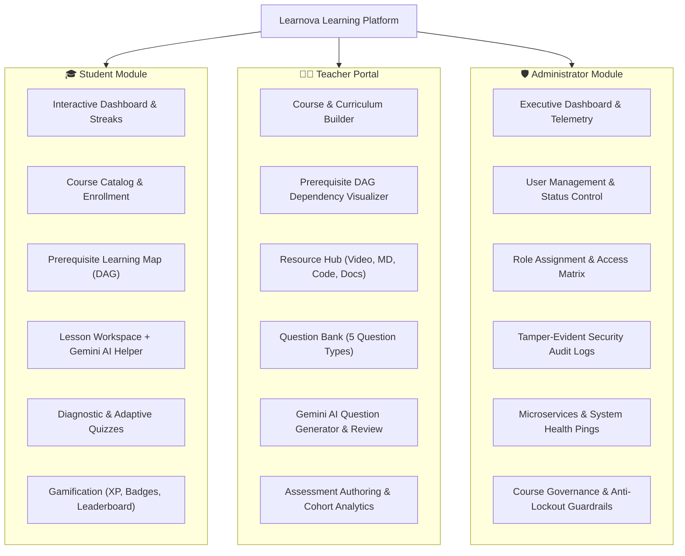

# Learnova Learning Platform

Learnova is a next-generation, adaptive, and gamified educational platform built with modern web technologies and Google Gemini AI. It provides an end-to-end learning ecosystem featuring three purpose-built role portals: **Student**, **Teacher**, and **Administrator**.

The platform combines directed acyclic graph (DAG) curriculum dependencies, real-time adaptive quiz algorithms, interactive gamification (XP, streaks, badges, leaderboards), an AI-powered study companion, automated assessment generation, and an enterprise-grade administrative governance and security layer.

---

## Table of Contents

- [Core Roles and Access Control](#core-roles-and-access-control)
  - [1. Student Role](#1-student-role)
  - [2. Teacher Role](#2-teacher-role)
  - [3. Administrator Role](#3-administrator-role)
- [Folder and File Structure](#folder-and-file-structure)
- [Key Architectural Systems](#key-architectural-systems)
  - [Curriculum Prerequisite DAG Engine](#curriculum-prerequisite-dag-engine)
  - [Adaptive Assessment Engine](#adaptive-assessment-engine)
  - [Gemini AI Integration & Caching](#gemini-ai-integration--caching)
  - [Administrative Security Guardrails & Audit Logging](#administrative-security-guardrails--audit-logging)
- [Technology Stack](#technology-stack)
- [Getting Started](#getting-started)
- [Running Tests](#running-tests)
- [Switching Between Portals](#switching-between-portals)

---

## Core Roles and Access Control

Learnova is architected around strict Role-Based Access Control (RBAC) with three primary user personas:



---

### 1. Student Role

The **Student** role provides a personalized, adaptive learning journey that motivates learners through gamified feedback loops and AI-assisted comprehension.

#### Key Features & Capabilities:
- **Personalized Student Dashboard (`StudentDashboardPage`)**: Displays active enrolled courses, overall completion percentages, daily learning streaks, current level, XP progress bar towards the next level, and quick links to resume learning.
- **Course Catalog & Enrollment (`CourseCatalogPage`, `CourseDetailsPage`, `MyLearningPage`)**:
  - Browse published courses with instructor info, topic breakdown, and enrollment statuses.
  - Review course syllabus, prerequisites, and enroll in one click.
  - Track in-progress and completed courses in a dedicated "My Learning" space.
- **Interactive Prerequisite Learning Map (`CourseLearningMapPage`)**:
  - Visual DAG path mapping out course topics.
  - Enforces prerequisite dependencies: downstream topics remain locked until prerequisite topics achieve a competent or mastered state (score $\ge 70\%$).
- **Lesson Workspace & Multi-Modal Resources (`LessonWorkspacePage`)**:
  - Rich reading workspace supporting embedded Markdown, video resources, code samples, and downloadable documentation.
  - One-click lesson completion tracking that dynamically updates course progress.
- **AI Learning Companion (`AIHelperPanel`)**:
  - Embedded side panel powered by Google Gemini 2.5 Flash (`server.ts`).
  - Four interactive assistance modes:
    1. **Simplify**: Converts complex academic concepts into plain language with bulleted takeaways.
    2. **Real-World Analogy**: Generates intuitive, everyday analogies to anchor conceptual understanding.
    3. **Worked Example**: Delivers annotated, step-by-step code and problem solutions.
    4. **Ask AI**: Allows students to submit custom inquiries grounded strictly in the lesson's context.
  - Features smart response caching to minimize duplicate API latency and costs.
- **Diagnostic & Adaptive Testing (`DiagnosticPlayerPage`, `AdaptivePracticePlayerPage`, `FinalExamPlayerPage`)**:
  - **Diagnostic Assessments**: Calibrate baseline topic proficiency upon entering new subjects.
  - **Adaptive Practice Engine**: Sequentially escalates or de-escalates question difficulty (`easy` $\leftrightarrow$ `medium` $\leftrightarrow$ `hard`) based on consecutive right or wrong answers.
  - **Timed Final Exams**: Comprehensive exams featuring live countdown timers, attempt tracking, and course graduation triggers.
- **Detailed Assessment Results (`AssessmentResultsPage`)**: Instant score breakdown, mastery level updates (`developing`, `competent`, `mastered`), XP earned, newly unlocked badges, and targeted next steps.
- **Gamification Suite (`AchievementsBadgesPage`, `XPActivityHistoryPage`, `LeaderboardPage`)**:
  - **XP & Levels**: Earn XP for completing lessons, diagnostic tests, adaptive practice sessions, daily streaks, and final exams.
  - **Badges**: Unlockable milestone achievements across categories (`achievement`, `streak`, `mastery`, `exam`).
  - **Leaderboard**: Peer ranking based on XP and earned badges with user privacy opt-in/opt-out preferences.
  - **Activity History**: Complete chronological ledger of all XP events and streak bonuses.
- **Student Profile & Settings (`ProfileSettingsPage`)**: Manage avatar, display name, bio, notification preferences, leaderboard visibility, and dark/light mode.

---

### 2. Teacher Role

The **Teacher** role equips educators with end-to-end curriculum design, content management, assessment authoring, and student performance analytics.

#### Key Features & Capabilities:
- **Teacher Overview Dashboard (`TeacherDashboardPage`)**: High-level metrics showing total courses, active assessments, student attempt activity, and AI candidate questions awaiting review.
- **Curriculum & Lesson Builder (`CoursesPage`, `CourseOverviewPage`, `CurriculumEditorPage`)**:
  - Structure courses hierarchically: **Course $\rightarrow$ Topics $\rightarrow$ Lessons**.
  - Reorder topics and lessons with custom mastery thresholds (e.g., $75\%$ passing requirement).
  - Draft, publish, or archive courses.
- **Visual Prerequisite DAG Manager (`PrerequisiteManagerPage`)**:
  - Assign and configure prerequisite topic dependencies.
  - Real-time graph validation algorithm (`src/utils/dag.ts`) prevents circular dependency cycles and self-dependencies before saving.
- **Multi-Format Resource Hub (`ResourceManagerPage`)**:
  - Attach learning resources directly to specific lessons.
  - Supports documents (PDF/DOCX), video streams/URLs, formatted Markdown guides, executable code blocks, and external references.
- **Centralized Question Bank (`QuestionBankPage`, `QuestionEditorPage`)**:
  - Centralized repository of assessment questions filtered by course, topic, question type, and difficulty.
  - Author and edit 5 distinct question types:
    1. **Multiple Choice** (single or multi-select correct answers).
    2. **True / False** (boolean verification).
    3. **Fill in the Blank** (case-sensitive or insensitive accepted answer lists).
    4. **Matching Pairs** (term-to-definition association).
    5. **Short Answer** (rubric and keyword evaluation).
- **AI-Assisted Question Generator & Review Queue (`AIReviewPage`)**:
  - Server-side integration with Gemini 2.5 Flash to automatically synthesize assessment questions based on lesson and course content.
  - Educators inspect, edit, approve, or reject candidate questions with feedback before committing them to the live question bank.
- **Assessment Builder & Scheduler (`AssessmentsPage`, `AssessmentEditorPage`)**:
  - Compose assessments across five pedagogical paradigms: **Diagnostic**, **Formative**, **Summative**, **Adaptive Practice**, and **Course Final**.
  - Configure duration (time limits), maximum attempt thresholds, passing percentages, and scheduled availability windows.
- **Cohort Learning Analytics (`AnalyticsPage`)**:
  - Topic mastery distributions across learners.
  - Score histograms, pass/fail ratios, and attempt history.

---

### 3. Administrator Role

The **Administrator** role provides enterprise governance, user account management, role-based security enforcement, tamper-evident audit logging, and platform infrastructure health monitoring.

#### Key Features & Capabilities:
- **Executive Admin Dashboard (`AdminDashboardPage`)**:
  - Real-time platform metrics: total user count, active vs. deactivated ratios, role distribution (Students, Teachers, Administrators).
  - Live system health telemetry, recent security audit streams, and quick management links.
- **User Directory & Account Management (`UserManagementPage`, `UserDetailsPage`)**:
  - Comprehensive user directory with live search (name, email), role filter, status filter, and multiple sort parameters.
  - View individual user profiles, assigned courses (teachers), enrolled courses (students), and complete audit timelines.
  - Modal-based role adjustments and account status toggles (activate/deactivate) requiring documented reasons.
- **Strict Administrative Safety Guardrails (`src/utils/adminLogic.ts`)**:
  - **Self-Demotion Prevention**: Administrators are strictly blocked from revoking their own administrator privileges to prevent accidental permission loss.
  - **Self-Lockout Prevention**: Logged-in administrators cannot deactivate their own active accounts.
  - **Last Administrator Protection**: The system prevents demoting or deactivating the platform’s last active administrator, guaranteeing continuous administrative access.
  - **Role-Based Permission Enforcement**: Role modifications and status toggles require confirmed administrator credentials.
- **Role & Access Governance Matrix (`RolesAccessPage`)**:
  - Comparative permission matrix outlining capabilities for Students, Teachers, and Administrators.
  - Quick action controls to assign and migrate user roles under administrative guardrails.
- **Tamper-Evident Security Audit Log (`SecurityAuditLogPage`, `AuditDetailDrawer`)**:
  - Immutable chronological record of critical security actions:
    - `ROLE_CHANGE`
    - `ACCOUNT_DEACTIVATED`
    - `ACCOUNT_ACTIVATED`
    - `ADMIN_LOGIN`
    - `SESSION_TERMINATED`
    - `PASSWORD_CHANGED`
    - `PERMISSION_OVERRIDE_ATTEMPT`
  - Every entry captures actor details, action type, target resource, outcome (`success`, `failure`, `blocked`), safe masked IP addresses, timestamp, reason, and a unique correlation ID (`corr-xxxx-xxxx`).
  - Search and filter by action type, outcome, or keyword; inspect raw JSON payload in a slide-out audit detail drawer.
- **System Health & Microservices Monitoring (`SystemHealthPage`)**:
  - Real-time health monitoring of key platform services:
    - **API Gateway**: Route latency and request handling.
    - **Core Database**: Persistence query latency and connection pools.
    - **Auth Service**: Token validation and session lifecycles.
    - **Gemini AI Service**: Google GenAI model responsiveness and error quotas.
    - **Response Cache**: In-memory explanation and candidate cache hit rates.
    - **Background Workers**: Asynchronous task and telemetry workers.
  - Displays status (`healthy`, `degraded`, `unavailable`), latency in milliseconds, uptime percentages, and last checked timestamps.
  - Live "Ping Health Checks" action to execute immediate diagnostic round-trips.
- **Curriculum & Course Oversight (`CourseOversightPage`)**:
  - Global overview of all courses across the institution.
  - Audit course publication status (`draft`, `published`, `archived`), topic/lesson volume, assigned instructor, and total student enrollment metrics.
- **Admin Profile & Security Center (`AdminProfileSecurityPage`)**:
  - Manage administrator profile details, department, and contact information.
  - Secure credential rotation (password update) with automated audit log generation.
  - Explicit administrative session termination (Sign Out) with security audit logging.
- **Access Denied Security Screen (`AccessDeniedPage`)**:
  - Strict security boundary displayed whenever unauthenticated access or unauthorized role elevation is attempted.

---

## Folder and File Structure

Below is an overview of the Learnova codebase:

```
Learnova/
├── .env.example                     # Environment template (GEMINI_API_KEY, APP_URL)
├── .gitignore                       # Git ignored files (node_modules, dist, .env)
├── bun.lock                         # Lockfile (Bun compatible)
├── index.html                       # Single-page application HTML entry
├── metadata.json                    # Project description and AI capabilities declaration
├── package.json                     # Dependencies, scripts, and test runners
├── README.md                        # Platform documentation (this file)
├── server.ts                        # Express API server + Vite middleware + Gemini AI endpoints
├── tsconfig.json                    # TypeScript compiler configuration
├── vite.config.ts                   # Vite configuration with React and Tailwind CSS v4 plugins
│
└── src/
    ├── App.tsx                      # Root component: portal routing, state management, toast handler
    ├── main.tsx                     # React DOM entry point wrapping App with ThemeProvider
    ├── index.css                    # Tailwind CSS v4 imports and custom utility styles
    │
    ├── components/                  # Reusable UI & role-specific layouts
    │   ├── admin/                   # Administrator Module components
    │   │   ├── AdminLayout.tsx          # Administrator shell with responsive sidebar & header
    │   │   ├── AuditDetailDrawer.tsx    # Slide-out drawer displaying detailed audit event payloads
    │   │   ├── ChangeRoleModal.tsx      # Modal with guardrails for modifying user roles
    │   │   ├── DeactivateAccountModal.tsx # Modal with guardrails for deactivating accounts
    │   │   └── RoleBadge.tsx            # Styled visual badge for Student/Teacher/Administrator
    │   │
    │   ├── teacher/                 # Teacher Portal components & layout
    │   │   └── TeacherLayout.tsx        # Teacher shell with course selector, nav tabs, & toasts
    │   │
    │   ├── student/                 # Student Module components
    │   │   ├── AIHelperPanel.tsx        # Slide-out Gemini AI companion (Simplify, Analogy, Code)
    │   │   ├── AssessmentPlayerShell.tsx # Quiz taking container with timer and step indicators
    │   │   ├── QuestionRenderer.tsx     # Renderer for 5 question formats with instant feedback
    │   │   └── StudentLayout.tsx        # Student shell with XP, streak counter, & breadcrumbs
    │   │
    │   └── ui/                      # Shared atomic and molecule components
    │       ├── Breadcrumbs.tsx          # Dynamic breadcrumb navigation
    │       ├── Button.tsx               # Standardized accessible button variants
    │       ├── ConfirmDialog.tsx        # Reusable modal confirmation dialog
    │       ├── EmptyState.tsx           # Placeholder view for empty lists/tables
    │       ├── FormField.tsx            # Form input wrapper with error states
    │       ├── PageHeader.tsx           # Consistent header with titles, badges, and action buttons
    │       ├── SearchFilterBar.tsx      # Search input with dropdown filter controls
    │       ├── StatusBadge.tsx          # Badges for publication and assessment statuses
    │       └── ThemeToggle.tsx          # Light / Dark / System theme switcher
    │
    ├── context/
    │   └── ThemeContext.tsx         # React Context managing light/dark/system theme modes
    │
    ├── pages/                       # Application Views
    │   │
    │   ├── teacher/                 # Teacher Portal Pages
    │   │   ├── AIReviewPage.tsx             # Candidate question review & approval queue
    │   │   ├── AnalyticsPage.tsx            # Student attempt analytics & topic mastery metrics
    │   │   ├── AssessmentEditorPage.tsx     # Assessment configuration (time limits, scoring)
    │   │   ├── AssessmentsPage.tsx          # Assessment directory & scheduler
    │   │   ├── CourseOverviewPage.tsx       # Course syllabus & content summary
    │   │   ├── CoursesPage.tsx              # Course list & course creation
    │   │   ├── CurriculumEditorPage.tsx     # Hierarchy builder for topics and lessons
    │   │   ├── DashboardPage.tsx            # Teacher overview dashboard
    │   │   ├── PrerequisiteManagerPage.tsx  # Interactive prerequisite DAG graph builder
    │   │   ├── QuestionBankPage.tsx         # Centralized question repository
    │   │   ├── QuestionEditorPage.tsx       # Authoring suite for 5 question types
    │   │   └── ResourceManagerPage.tsx      # Multi-format lesson resource repository
    │   │
    │   ├── admin/                   # Administrator Module Pages
    │   │   ├── AccessDeniedPage.tsx         # Unauthorized access fallback screen
    │   │   ├── AdminDashboardPage.tsx       # System overview, telemetry, & role metrics
    │   │   ├── AdminProfileSecurityPage.tsx # Admin credentials & password rotation
    │   │   ├── CourseOversightPage.tsx      # Platform-wide course governance & statistics
    │   │   ├── RolesAccessPage.tsx          # RBAC matrix and role assignment
    │   │   ├── SecurityAuditLogPage.tsx     # Tamper-evident audit log with correlation IDs
    │   │   ├── SystemHealthPage.tsx         # Microservices status and live health checks
    │   │   ├── UserDetailsPage.tsx          # Deep profile view and user activity history
    │   │   └── UserManagementPage.tsx       # User directory with filtering, sorting, & actions
    │   │
    │   └── student/                 # Student Module Pages
    │       ├── AchievementsBadgesPage.tsx   # Gamification badge showcase
    │       ├── AdaptivePracticePlayerPage.tsx # Dynamic difficulty-scaling practice engine
    │       ├── AssessmentResultsPage.tsx    # Quiz score report, mastery status, & XP gains
    │       ├── CourseCatalogPage.tsx        # Available courses discovery
    │       ├── CourseDetailsPage.tsx        # Course syllabus overview and enrollment
    │       ├── CourseLearningMapPage.tsx    # Visual DAG learning map with prerequisite locks
    │       ├── CreateAccountPage.tsx        # Student registration page
    │       ├── DiagnosticIntroPage.tsx      # Diagnostic assessment briefing
    │       ├── DiagnosticPlayerPage.tsx     # Diagnostic assessment test runner
    │       ├── FinalExamPlayerPage.tsx      # Timed course final exam runner
    │       ├── LeaderboardPage.tsx          # Peer XP rankings and badges
    │       ├── LessonWorkspacePage.tsx      # Lesson reader with embedded Gemini AI helper
    │       ├── MyLearningPage.tsx           # Enrolled courses and progress tracker
    │       ├── ProfileSettingsPage.tsx      # Student settings & preferences
    │       ├── ProgressAnalyticsPage.tsx    # Topic mastery and assessment score history
    │       ├── SignInPage.tsx               # Student sign-in screen
    │       ├── StudentDashboardPage.tsx     # Student home with streaks, XP, and courses
    │       └── XPActivityHistoryPage.tsx    # Detailed ledger of earned XP
    │
    ├── services/
    │   └── storageService.ts        # In-memory and localStorage persistence layer + seed data
    │
    ├── types/
    │   └── index.ts                 # Domain models, enums, question schemas, and user types
    │
    └── utils/                       # Core algorithms, business logic & test suites
        ├── adminLogic.ts            # RBAC rules, lockout guardrails, and audit filters
        ├── adminLogic.test.ts       # 12 unit tests verifying admin guardrails
        ├── assessment.ts            # Question validation rules & total point computations
        ├── assessment.test.ts       # 6 unit tests verifying question validation logic
        ├── dag.ts                   # Directed Acyclic Graph validation & cycle detection
        ├── dag.test.ts              # 5 unit tests verifying acyclic graph constraints
        ├── studentLogic.ts          # XP leveling curve, answer scoring, & adaptive engine
        └── studentLogic.test.ts     # 6 unit tests verifying adaptive logic and scoring
```

---

## Key Architectural Systems

### Curriculum Prerequisite DAG Engine
Curriculum topics are structured as a **Directed Acyclic Graph (DAG)**. 
- The validation engine in [`src/utils/dag.ts`](src/utils/dag.ts) performs depth-first search (DFS) with recursion stacks to detect:
  1. **Direct Cycles**: (e.g., $A \rightarrow B$ and $B \rightarrow A$).
  2. **Transitive Cycles**: (e.g., $A \rightarrow B \rightarrow C$ and $C \rightarrow A$).
  3. **Self-Dependencies**: (e.g., $A \rightarrow A$).
- When a teacher adds dependencies, the engine prevents invalid configurations with clear error messaging.
- For students, [`determineTopicReadiness`](src/utils/studentLogic.ts) ensures that downstream topics are only unlocked when all prerequisite topics meet mastery criteria.

### Adaptive Assessment Engine
The adaptive practice engine dynamically tailors challenge levels to individual student performance:
- Implemented in [`src/utils/studentLogic.ts`](src/utils/studentLogic.ts) via `getNextAdaptiveQuestion`.
- If a student answers correctly, the target difficulty shifts upward: $\text{easy} \rightarrow \text{medium} \rightarrow \text{hard}$.
- If a student answers incorrectly, the difficulty drops: $\text{hard} \rightarrow \text{medium} \rightarrow \text{easy}$.
- Dynamic question selection prioritizes unvisited questions at the new target difficulty, falling back gracefully if exhausted.

### Gemini AI Integration & Caching
Learnova uses Google's `@google/genai` SDK with the **Gemini 2.5 Flash** model hosted via Express endpoints in [`server.ts`](server.ts):
- **Teacher Portal (`/api/ai/generate-questions`)**: Analyzes curriculum resource texts to generate candidate questions formatted with schemas, distractors, explanations, and rubrics.
- **Student Portal (`/api/ai/simplify-lesson`)**: Provides instant simplification, analogies, code examples, or custom context-grounded Q&A.
- **Resilience & Fallbacks**: If the Gemini API key is not configured or an upstream timeout occurs, deterministic educational fallback engines ensure uninterrupted operation.
- **In-Memory Cache**: Repeated requests for the same lesson and mode are cached to ensure low latency.

### Administrative Security Guardrails & Audit Logging
The Administrator module enforces strict organizational safety:
- **Guardrail Functions** in [`src/utils/adminLogic.ts`](src/utils/adminLogic.ts):
  - `validateRoleChange`: Validates actor permissions, prevents self-demotion, and protects the last active administrator.
  - `validateAccountStatusChange`: Prevents self-deactivation and preserves administrative availability.
- **Audit Logging**: Every sensitive action triggers `storage.logAuditEvent(...)`, recording timestamps, actor identifiers, target details, IP masks, and correlation IDs.

---

## Technology Stack

- **Framework**: [React 19](https://react.dev/) + [TypeScript](https://www.typescriptlang.org/)
- **Bundler & Tooling**: [Vite 8](https://vitejs.dev/) + [tsx](https://github.com/privatenumber/tsx)
- **Styling**: [Tailwind CSS v4](https://tailwindcss.com/) (`@tailwindcss/vite`)
- **Backend / Server**: [Express 4](https://expressjs.com/) with Vite middleware integration
- **Icons**: [Lucide React](https://lucide.dev/)
- **Animations**: [Motion](https://motion.dev/) (Framer Motion)
- **AI Capabilities**: [Google Gen AI SDK](https://github.com/googleapis/google-genai) (`@google/genai`) with Gemini 2.5 Flash
- **Unit Testing**: Native Node.js Test Runner (`node --test`)

---

## Getting Started

### Prerequisites
- **Node.js** (v18.0.0 or higher recommended)
- **npm** or **bun**

### Installation

1. Clone or navigate to the repository directory:
   ```bash
   cd Learnova
   ```

2. Install dependencies:
   ```bash
   npm install
   ```

3. Configure Environment Variables:
   Create a `.env` file in the root directory (or use `.env.local`):
   ```env
   GEMINI_API_KEY=your_gemini_api_key_here
   APP_URL=http://localhost:3000
   ```
   *(Note: If no Gemini API key is provided, the platform automatically falls back to built-in academic generators and cached responses).*

4. Start the Development Server:
   ```bash
   npm run dev
   ```
   The application will be live at `http://localhost:3000`.

---

## Running Tests

Learnova includes 29 automated unit tests verifying the DAG cycle detection, question validation rules, student scoring/adaptive progression, and administrative guardrails:

```bash
npm test
```

### Test Suite Breakdown:
- `src/utils/dag.test.ts`: Self-dependency prevention, direct cycle detection, transitive cycle detection, and batch prerequisite validation.
- `src/utils/assessment.test.ts`: Schema validation for all 5 question types, point calculations, and attempt status filters.
- `src/utils/studentLogic.test.ts`: XP leveling curve, answer evaluation across question formats, and adaptive difficulty escalation/de-escalation.
- `src/utils/adminLogic.test.ts`: Self-demotion guardrail, self-deactivation guardrail, last administrator lockout prevention, audit filters, IP masking, and correlation ID generation.

---

## Switching Between Portals

Learnova provides an integrated workspace switcher in development mode:
- **Switch to Student Portal**: Access the personalized dashboard, interactive course map, lesson workspace with AI assistant, diagnostic tests, adaptive practice, and gamified leaderboards.
- **Switch to Teacher Portal**: Access the curriculum builder, visual DAG prerequisite editor, resource manager, question bank, Gemini AI question review queue, and analytics.
- **Switch to Admin Portal**: Access the administrator dashboard, user directory, role assignment matrix, security audit logs, system health monitoring, and course governance.
